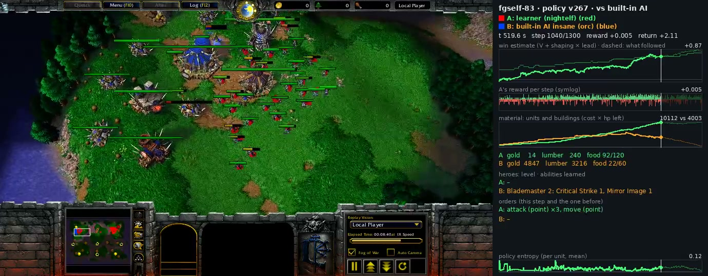
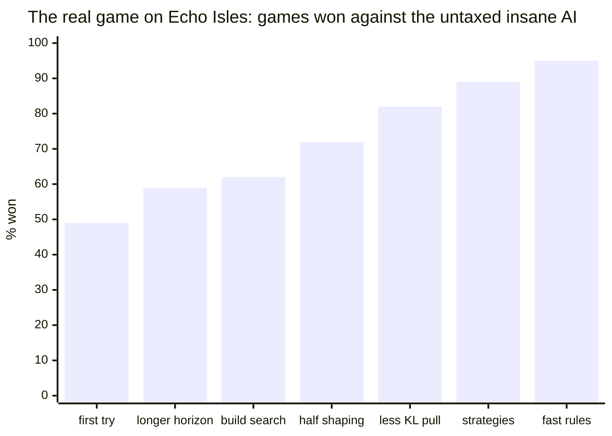
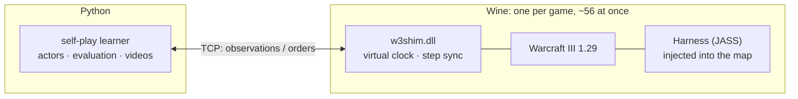
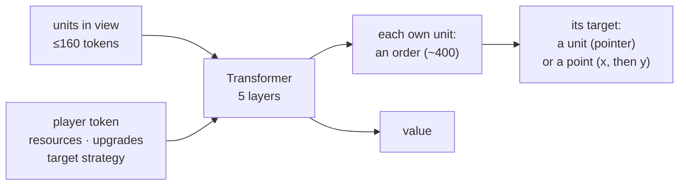
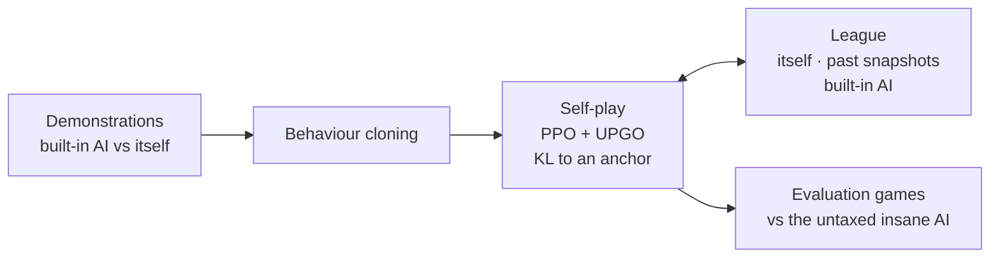
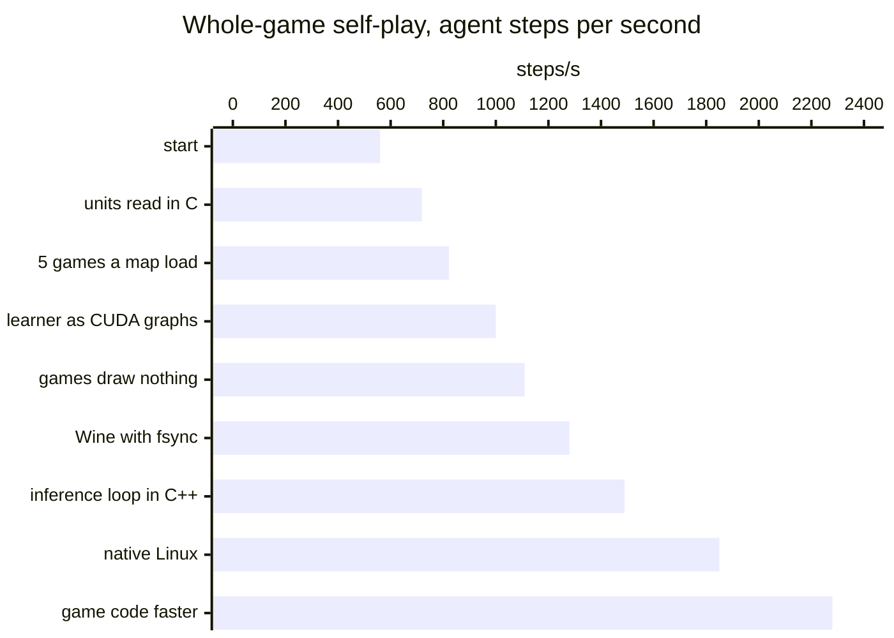
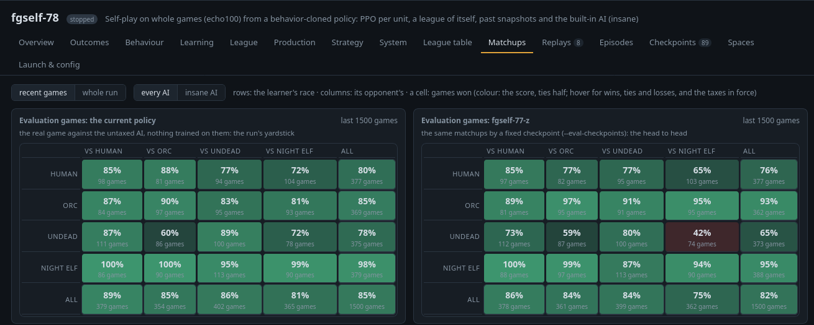
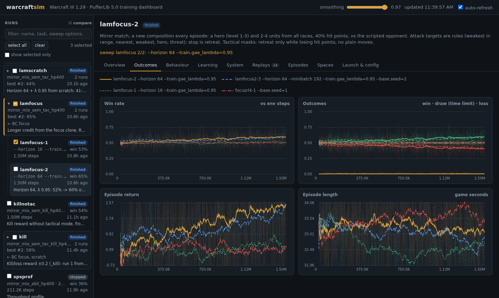

# warcraftsim

> **Blog post:** [Beating Warcraft III's insane AI with self-play reinforcement learning on one desktop](https://warlock.ai/blog/warcraftsim-1/), the story of how the agent learned, with videos and diagrams.

Reinforcement learning on the **real Warcraft III** (Legacy TFT 1.29.2) under Wine on Linux, driven step by step from Python. Nothing is reimplemented: the game's own engine runs every unit, spell, building and AI script, headless and many times faster than real time.

The agent plays the **whole game** (economy, buildings, tech, armies, heroes) on the ladder map **Echo Isles** under the game's own rules. It wins **~95% of its games against the built-in AI at its hardest setting** (insane, no handicap), about **1.8× the built-in AI's own record** in the same matchups. Now it learns to play many strategies: target build orders, narrower ones and more kinds of conditioning (no rush, expand, creep, harass, ...).

<p align="center"></p>

*A training game, played back in the real game client: the learner (night elf, red) breaks the insane orc AI's main base at 8½ minutes. The panel shows what the policy thought: its win estimate (+0.87, rising), the reward per step, the material of both sides (10,112 against 4,003), resources, heroes and their abilities, the orders of the step and the policy's entropy. The learner has no hero here, one of its known weak spots.*

## Progress



Each bar is the best policy of a step (`fgself-56`, `-62`, `-68`, `-73`, `-77`, `-78`, `-100`), measured in its own run's evaluation games: the real game, all race matchups, nothing trained on them. The last step trains on Echo Isles with faster rules toward target build orders a builder teaches, and is judged on the real game. Before Echo Isles the agent learned on small, fast "duel" maps: **79%** against the built-in AI in 2-minute games, then **80% against insane** in 6-minute games. [Experiments](docs/experiments.md) has what worked and what did not; the [experiment log](docs/reference/experiment-log.md) has every run.

## How it works



* **The harness** is JASS injected into the map script. Every half second of game time it writes an observation (units, players, events) and issues the agent's orders with the game's own natives.
* **The shim** is a DLL in the game process. It runs the game's clock as fast as the CPU allows and stops the game at every step until Python answers.
* **`.wgc` configs** start a local game with no menus: the map, the players, the built-in AI's difficulty.

Details: [architecture](docs/architecture.md) and [engine notes](docs/reference/engine-notes.md).

## The agent



One network plays one side, from that player's view through the fog of war. Each own unit gets an order and a target, sampled together for all units every half second. The player token can carry a **target strategy** (a build order and tech path from the AI's games or human replays, AlphaStar's "z"). Newer inputs give each hero's abilities, cooldowns and items and the enemies it saw before; masks keep out orders the game would refuse. [The whole-game model](docs/model.md) has every layer.



The policy started as a clone of the built-in AI and now beats its teacher by a wide margin. Each experiment is a new run forked from the best one, so the dashboard's lineage shows what every change did ([experiments](docs/experiments.md)).

## Speed



One machine (Ryzen 9 5950X, RTX 3090) runs the learner, the inference loop and ~56 games at once: ~1,600–2,000 agent steps a second in the real game on Echo Isles, about 3,000 games an hour. A second machine (a laptop under WSL2) plays the evaluation games, ~1,300 an hour, so an experiment's verdict comes in minutes rather than hours. [Optimizations](docs/optimizations.md) and the [optimization log](docs/reference/optimization-log.md) have every fix.

## The dashboard

<p align="center"></p>

*The dashboard's Matchups tab: the strategy-conditioned policy (`fgself-78`, left) and its parent (right) against the insane AI, race by race, over the same 1,500 evaluation games each.*

`python -m warcraftsim dashboard` (http://localhost:8765; `--host <address>` to watch from another machine or a phone) shows every run live: outcomes, losses and the gradient noise scale, the league, production, matchups, replay videos with the policy's panel, checkpoints, and a lineage of all runs. Its **Docs** tab shows and edits [`docs/`](docs/overview.md).

<p align="center"></p>

## Micro battles

https://github.com/user-attachments/assets/0ba228f2-3a16-411d-b0e8-685246f05764

*The first track: small fights. The league policy `genleague5d` (A, green) against its predecessor `genleague3` (B, orange) in a 5 v 5 mirror match with Liches: A focuses B's Lich, casts Frost Armor and Frost Nova, and wins with three units left (81–31 over 120 games).*

Micro policies reached 91% against a scripted opponent, and league self-play 82%. [Usage](docs/reference/usage.md) has the micro tasks and trainers (PufferLib 5.0 and our own torch trainer).

## Getting started

This repository contains no Blizzard game files: you need your own copy of Warcraft III: The Frozen Throne (Legacy 1.29). The tools read its archives and build the maps they use locally. warcraftsim is not affiliated with or endorsed by Blizzard Entertainment.

1. **The game:** install Warcraft III Legacy 1.29 with the Battle.net app (Warcraft III → Game Version) and copy its folder to `~/wc3/legacy-1.29` (or set `WC3_GAME_DIR`).
2. **System packages and Wine** (Ubuntu, native or WSL2):
   ```bash
   sudo bash scripts/setup_system.sh     # Xvfb, mingw, 32-bit libraries, ...
   scripts/setup_ge_wine.sh              # GE-Proton's Wine with fsync (28% less CPU a step)
   ```
3. **Build and install:**
   ```bash
   git submodule update --init
   python3 -m venv .venv && .venv/bin/pip install cmake && .venv/bin/pip install -e ".[rl,video,dev]"
   scripts/build_native.sh               # StormLib (MPQ), pjass (JASS checker)
   make -C shim                          # w3shim.dll, w3launch.exe
   .venv/bin/python -m warcraftsim setup
   ```

```python
from warcraftsim import Wc3Game, GameSetup, Agent, BuiltinAI

with Wc3Game(GameSetup(map="(2)EchoIsles", slots=[Agent("human"), BuiltinAI("orc", "insane")])) as game:
    obs = game.reset()                       # game time 0
    while not obs.game_over:
        for worker in game.idle_workers():
            game.harvest(worker, game.nearest_mine(worker))
        obs = game.step()                    # 0.25 s of game time
    print(obs.players[0].result)
```

```bash
python -m warcraftsim ai-vs-ai --difficulty insane                        # two built-in AIs, headless
python -m warcraftsim.fullgame.collect --out runs/fullgame/demos-1 --games 800 --parallel 24 --races all
python -m warcraftsim.fullgame.bc --data runs/fullgame/demos-1 --name fullgame-1
python -m warcraftsim.fullgame.selfplay --name fgself-1 --init runs/bc/fullgame-1/policy.pt
python -m warcraftsim.fullgame.versus runs/fgself-102/checkpoints/<steps>.pt --map echo100 --you human --agent orc \
    --wine ~/wc3/ge/GE-Proton10-34/files/bin                            # play it yourself, in a window
python -m warcraftsim dashboard
.venv/bin/pytest                                                          # unit tests
```

[Usage and reference](docs/reference/usage.md) has the Python API, scenarios, replays and videos, the micro trainers, the whole-game pipeline and the dashboard in detail.

## Documentation

| | |
|---|---|
| [Overview](docs/overview.md) | the current state and what comes next |
| [Environments](docs/environments.md) | the maps, the opponents, what the agent sees and does, the rewards |
| [The whole-game model](docs/model.md) | every layer of the network |
| [Experiments](docs/experiments.md) | what worked and what did not |
| [The road to the real game](docs/road-to-the-real-game.md) | what is still missing before games against people |
| [Optimizations](docs/optimizations.md) | how a step became fast |
| [Architecture](docs/architecture.md) | how Python drives the game |
| Related work | [AlphaStar](docs/related/alphastar.md), [OpenAI Five](docs/related/openai-five.md), [reward shaping](docs/related/reward-shaping.md), [robot learning](docs/related/robot-learning.md) |
| Reference | [ideas](docs/reference/ideas.md) (where each came from, what became of it), [experiment log](docs/reference/experiment-log.md), [engine notes](docs/reference/engine-notes.md), [optimization log](docs/reference/optimization-log.md), [human replays](docs/reference/human-replays.md), [what AlphaStar and OpenAI Five found](docs/reference/ideas-from-alphastar-and-openai-five.md), [usage](docs/reference/usage.md) |

## Citation

If you use warcraftsim in your work, please cite it (GitHub's "Cite this repository" button gives other formats):

```bibtex
@software{kahlow2026warcraftsim,
  author = {Kahlow, Robin},
  title  = {{warcraftsim} - {Self-play} reinforcement learning in {Warcraft III}},
  year   = {2026},
  url    = {https://github.com/RobinKa/warcraftsim}
}
```

## License

MIT (see `LICENSE`). The submodules in `third_party/` keep their own licenses (PufferLib and StormLib: MIT; MinHook and pjass: BSD 2-Clause). Warcraft III and its game data belong to Blizzard Entertainment and are not part of this repository; replays and videos of your runs stay in `runs/`, which is not committed.
