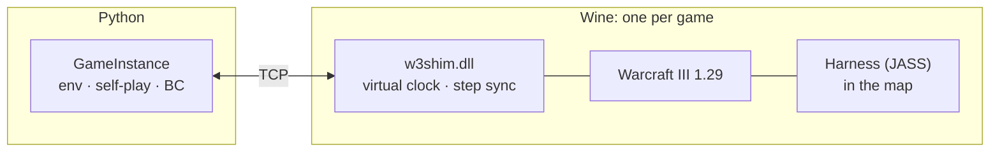
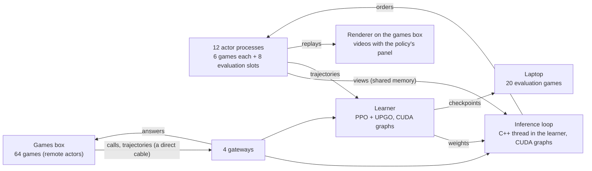
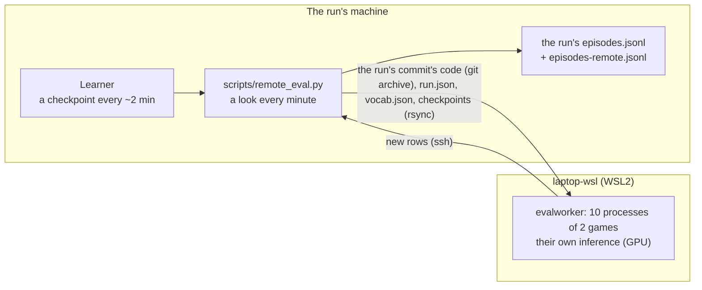
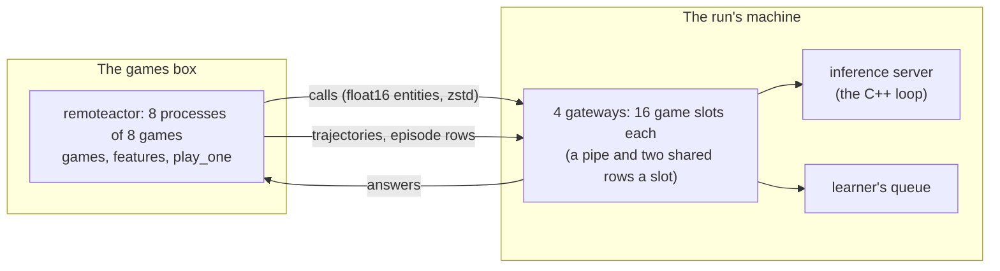
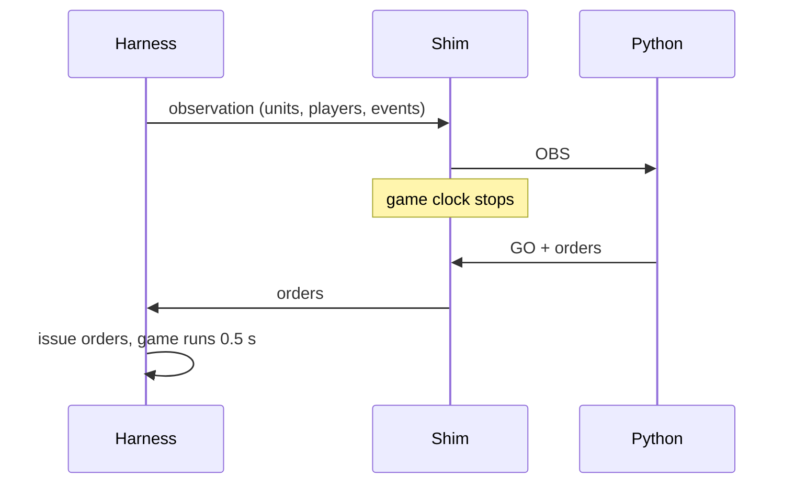

# Architecture

Python drives the real game through a script in the map (the harness) and a DLL in the game process (the shim). The [engine notes](reference/engine-notes.md) have the details.

## The parts



* **The harness** writes each observation and issues the orders with the game's own functions.
* **The shim** runs the game's clock as fast as the CPU allows and stops the game at each step.
* **The `.wgc` file** starts a game with no menus: the map, the slots and the built-in AI levels.
* **The game's own code, faster** (`shim/cuts.c`, `--game-cuts`): the shim replaces some of the game's functions with equivalent faster ones. Replays prove the same simulation at every step. With `--game-cuts 521721` (2026-10-24) the shim also talks to Python through Linux system calls instead of Wine's sockets, and writes the players' records and checks the game's result itself instead of the harness's JASS. The runs use rounds 1 to 7 (`--game-cuts 17592186041849`).
* **Wine** runs each game in a prefix of its own, with no audio, gamepad or system D-Bus (each prefix's device manager had polled the disk service), drawing into an Xvfb screen of 320×240 with nothing drawn.
* **Other rules** go into a copy of the map as the game's unit and upgrade tables (`data/duelmap.py`): the duel maps, Echo Isles with duelfast's rules (`echofast`, and `echofast2` with the economy scaled too), and fast copies of three more maps (`--map-pool`). Since `fgself-212` (2026-11-12) the runs play every game on the real Echo Isles with its own rules.

## Self-play



* One GPU context holds the learner and the inference loop. The loop has no Python in its hot path. Its calls run in bf16-mixed: the trunk in bf16, the heads and the value in fp32.
* An actor turns each game's observation into the policy's view. The observation is parsed in C (`native/w3obs.c`). The features, most masks, the teacher's facts and obs-full's channels are computed in C too (`native/w3feat.c`, `native/w3rules.c`). The rest of the masks and the policy's commands stay in Python. Its games share one Python process, so its threads take turns on the GIL. An actor uses ~0.6 of a core.
* The learner takes batches of 8,192 steps and updates in minibatches of 256 steps (16 sequences of 16 steps). During its update it already reads the next batch from the actors' queue (`--learner-intake 2`), so the games do not wait for it.
* The 8 evaluation slots wait while the laptop's games keep arriving (`--eval-fallback 300`). They play only when no game came from the laptop for 5 minutes.
* The renderer records the run's videos on the games box over ssh (`--video-host`, `--video-speed 4`), so the main machine renders none.
* The video director (`video.Director`) moves the camera in whole-game replays, because 1.29's replays have no automatic camera. It follows the largest fight, raids on buildings too. Between fights it rotates: the learner's army, its base, the opponent's army, its base.

## A remote evaluation worker

The laptop plays a run's evaluation games (`fullgame/evalworker.py`, managed from the run's machine by `scripts/remote_eval.py`): 20 at a time, ~310 games an hour of the real game on 2026-11-12 (with 16 it made ~790 an hour of the shorter `echofast` games). The run's own 8 slots play only when the laptop's games stop coming. Since 2026-11-13 they are mostly head to head (`--eval-vs 0.7`, `--gauntlet-games 0`): a run's read along the way. The verdict is an [evaluation burst](#evaluation-bursts) on the main machine.



* The worker plays the run's own evaluation games: `selfplay.game_loop`'s evaluation slots and `play_one`, set up from `run.json`'s config. Every policy plays each matchup in turn, as in the run.
* Its "current" is the run's newest checkpoint, a few minutes behind the learner's live weights. The other policies are the run's `--eval-checkpoints`.
* It samples at the run's precision (`--infer-precision`). Until 2026-11-10 it played in fp32 while the run played in bf16-mixed.
* With `--gauntlet-games N` (4 by default; 0 in the runs since 2026-11-13), N of its games are a gauntlet: the current policy against the 5 top-rated policies, head to head, under today's rules. The manager makes the list again every 30 minutes.
* Its draws are seeded by the run's name, the worker's name and where it started: other matchups than the run machine's.
* Its rows are the learner's evaluation rows plus `host` and `version` (the update "current" played with). `real_games.py`, `run_status.sh` and the dashboard read them with the run's own; `real_games.py --split host` shows them apart, `--no-remote` leaves them out.
* The manager runs the worker as a systemd user service there. It starts it again when it died or the machine came back. A restart of the run with other settings for its evaluation games, or a worker started anew, gets the run's own commit's code (run.json's launch.git; git archive: later commits and edits not committed stay here).
* Before a relaunch, and when the run ends or another run is live, the worker is drained: its games in flight finish, then it exits (SIGUSR1, at most 15 minutes). A row is written only when its game ends, and losses and ties last 3-5 times as long as wins, so the games a relaunch cut were mostly those. 58 relaunches on 2026-10-24 (then on any edit saved) read a true 84% as ~89.5% (audit 7).
* A machine for it: the repository in `~/warcraftsim` with a venv (torch), GE-Proton's Wine in `~/wc3/ge` and the game in `~/wc3/legacy-1.29` (copied), `scripts/build_native.sh` (StormLib, pjass), and the 32-bit libraries the [engine notes](reference/engine-notes.md) list. The manager copies the shim.

```
scripts/remote_eval.py --host robin@laptop-wsl [--run fgself-76] [--games 20]   # in the background
scripts/remote_eval.py --host robin@laptop-wsl --status | --stop
scripts/remote_eval.py --host tora-ms-a2@tora-ms-a2 --name tora-ms-a2 --games 32   # or the games box, CPU inference
```

## Evaluation bursts

A verdict since 2026-11-13: frozen checkpoints in paired games on the main machine, with the learner stopped and the games box's service stopped, ~950-1,250 games in ~45 minutes, all policies in one window.

```
scripts/average_checkpoints.py runs/<run>/averaged/swa-<from>-<to>.pt --run <run> --from <steps> --to <steps>   # a weight average
scripts/burst_prep.py burst-<n> <run> <current>.pt <other policies>.pt ...    # runs/burst-<n>: run.json, vocab.json, the policies
python -m warcraftsim.fullgame.evalworker --run burst-<n> --games 64 --processes 16 --host tora-burst --hours 0.75
scripts/head_to_head.py burst-<n> [--vs <a policy>]                           # each policy's games by key
```

* `burst_prep.py` makes a run directory of its own: the source run's `run.json` and `vocab.json`, one policy as its "current" checkpoint and the others as its evaluation checkpoints, `--eval-vs 0.4` and no target, hand-written player or people's games. The evaluation worker then plays it as it plays a run's: every policy on the same matchups, against the untaxed insane AI and head to head.
* `average_checkpoints.py` writes the mean of a stretch of a run's checkpoints' float weights, with the newest's tables and config. A run forked from it gets the nearest kept checkpoint's Adam state beside it (only the newest few are kept).
* The order masks are set per process, so in a burst every policy plays with the masks if any does.

## Remote actors

Training games on another machine, for the learner here and its inference (`selfplay --remote-games N`, `fullgame/gateway.py` here, `fullgame/remoteactor.py` there; the wire format in `fullgame/wire.py`). The other machine needs no GPU and no weights: its actors' network calls are answered by the run's own inference server. Since 2026-10-30 the games box (`tora-ms-a2`: an MS-A2 with an 8945HX and 32 GB, capped at 4.0 GHz) plays the run's training games on a direct 2.5 GbE cable. It plays 64 games since 2026-11-06.



* A slot is what a local game has: a pipe to the inference server and two rows of the shared memory. A remote game's connection takes a free one; its calls go through it as a local game's, so the same networks and past snapshots answer them, and the server does not know the difference.
* Its trajectories and episode rows go into the learner's queue as a local actor's (the rows with `host`). When the learner is a batch behind, the gateway stops reading and TCP holds the remote games back.
* At its start the remote side gets the actors' settings (the learner's own), vocab.json, the strategy pool and Wine's settings; the league's launches every 5 s. It plays no evaluation games and films no videos; its draws are seeded with its name. `scripts/box_games.sh` with `RUN=<run>` also copies the run's late-start states there.
* Only a machine with the shared key (`~/.config/warcraftsim/remote.key`, made by the gateway's first start) and the learner's code (a hash of the package's actor code, the game tables it reads, the native sources and the built shim) gets in. Nothing it sends is unpickled.
* Four gateway processes share the box's games (`--remote-gateways 4`). One gateway alone used ~95% of a core at 64 games, and its GIL slowed them.
* The box's games share identical memory pages (`--ksm 1`: same-page merging). Without it, 42 games took 22 of its 28 usable GB. With it, 64 games leave ~7 GB free and its CPU ~70% busy (2026-11-12).
* A connection closed frees its slot; a machine gone without a word frees its slots in ~2 minutes (TCP keepalive). The learner gone, the remote games wait for it 10 minutes, then end as a local actor's would.
* The box's 64 games give the learner ~2,300 steps a second (2026-11-12, `fgself-212`, obs-full's wider rows): ~13 MB/s up the cable for the calls and the trajectories, ~5.7 KB a step, and ~2.6 MB/s down for the answers, ~1.4 KB a call (zstd). `--remote-codec none` sends the frames uncompressed (~6x the bytes, none of either side's CPU on zstd).
* A trajectory's chunk goes as the arrays a local actor's queue pickles (`selfplay.pack_steps`' columns; `wire.PackedChunk` at the gateway, checked whole, pickled on as it came): the learner gets the same steps as from a local actor.

```
python -m warcraftsim.fullgame.selfplay ... --remote-games 64 --remote-gateways 4 [--remote-port 8770] [--remote-bind <this machine's address>] [--remote-codec none]
python -m warcraftsim.fullgame.remoteactor --host <the run's machine> --actors 8 --games-per-actor 8 --ksm 1   # there
[RUN=<run>] scripts/box_games.sh <the run's commit> [actors (8)] [games an actor (8)]   # or from here: mirrors the code, checks it, starts them
```

## Machines' readings

`scripts/host_stats.py` (no torch, started by hand like `remote_eval.py`) looks at each machine of a run every 30 s with one ssh call (BatchMode, a connect timeout and a subprocess timeout: Tailscale SSH can wait for an approval in a browser): CPU busy (two `/proc/stat` samples a second apart), memory, load, Tctl from `sensors` (null where there are none, as in WSL), mean and max clock, the game processes (counted by their comm in `/proc`, so nothing matches its own shell), uptime and the power profile. One row each in `runs/hosts/<name>.jsonl`; a machine that does not answer gets `up: false` and the others carry on. Rows older than a week are dropped at the start and every 6 hours.

```
setsid nohup .venv/bin/python scripts/host_stats.py --host robin@laptop-wsl --host tora-ms-a2@tora-ms-a2 > runs/host_stats.log 2>&1 &
.venv/bin/python scripts/host_stats.py --host robin@laptop-wsl --once    # one look, printed, nothing written
```

It also reads the machine it runs on, the main one, in its own process (no ssh, no shell; `--local NAME` renames it, default the hostname; `--no-local` leaves it out). That gives the same readings (CPU busy over the 30 s since the last look), plus the private memory (RssAnon) of the learners, of their other processes (actors, Xvfb, launchers, evaluation workers) and of the games. It reads the GPU through NVML (`pynvml`, already in the venv: no CUDA context; busy time and memory-bus time as the means of NVML's own samples, gathered every 5 s; power as the energy counter's mean against the limit; how often the power limit holds the clocks; temperature, fan, clocks, P-state, the processes on the GPU). It also reads the live runs: a learner's agent steps a second from `train.jsonl`'s newest 2 minutes, the share of its cycle in its update, and its precisions from `run.json`. Its rows carry `"local": true` and go to `runs/hosts/<hostname>.jsonl`; they are about 1 KB each, and the same trim applies. A look costs ~70 ms of CPU, most of it a pass over `/proc`.

Tensor cores have no counter here, and the tab does not make one up. NVML's tensor metrics (GPM) need a Hopper or newer GPU. The GA102's own counter (`sm__pipe_tensor_cycles_active`, through CUPTI's PM sampling) exists, but the driver keeps it for root (`/proc/driver/nvidia/params`: `RmProfilingAdminOnly: 1`; CUPTI answers `CUPTI_ERROR_INSUFFICIENT_PRIVILEGES`). Opening it would take `options nvidia NVreg_RestrictProfilingToAdminUsers=0` in `/etc/modprobe.d/`, a rebuilt initramfs and a reboot, plus a PM-sampling reader, which is not built. So the tab shows labelled proxies instead. The first is an upper bound: the tensor cores can only work while a kernel runs, so they can be busy at most as often as the GPU is. The second is the share of the learner's cycle spent in its BF16 update. The third is the inference calls' precision, which says whether their matrix multiplies run on the tensor cores.

The dashboard's header shows each of the other machines on every page (`GET /api/hosts`; not this one): online, off with when it last answered, or `?` when no reading is under two minutes old, which means `host_stats.py` isn't running rather than the machine being down.

The dashboard's System tab shows the machines with a row in the last hour. This machine comes first, on a full-width card with its GPU, the tensor-core proxies and the live runs. Each machine has a card, and charts show the last day's temperature, CPU and memory (the temperature is red from 90 C), plus this machine's GPU busy time and power. The tab also shows the run's games by machine (`split` of `GET /api/runs/<run>`: training and evaluation games and the training games' side-steps a second, over the last 30 minutes and over the run; a row without `host` is this machine's).

## One step



## Rules to remember

* A reload by `RestartGame` gives a new game. A reset by script does not: the engine keeps counting removed heroes.
* Several pairs of players in one map load (`--pairs`) work only on the duel maps. Echo Isles has two start locations: one pair.
* A build order that does not fit is tried again on rings of spots up to 768 units away, in the same step (up to 256 until 2026-10-16: Echo Isles refused most of undead's builds).
* The game runs only as the 32-bit Legacy 1.29 build. The shim's offsets are for that build.
