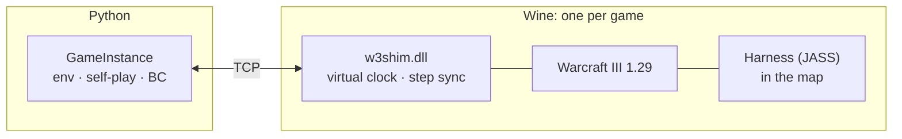
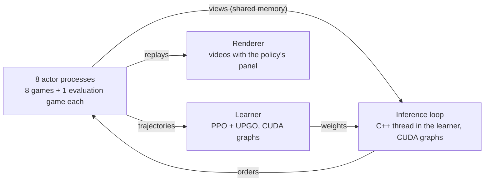
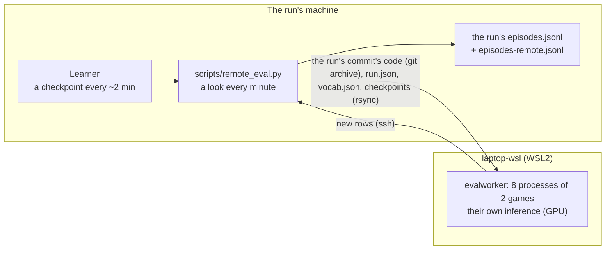
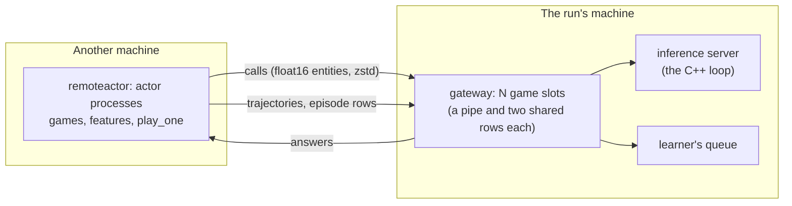
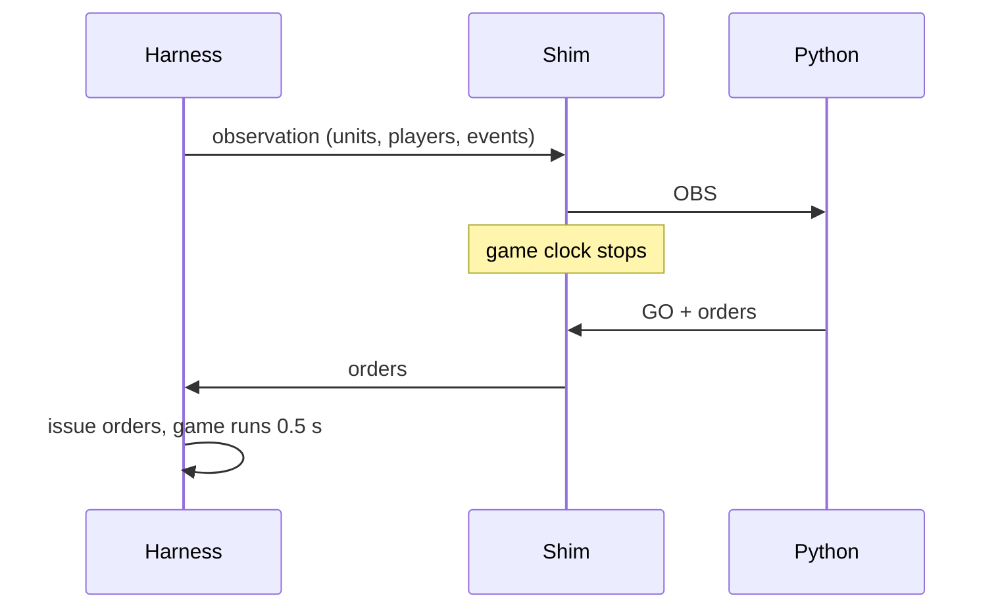

# Architecture

Python drives the real game through a script in the map (the harness) and a DLL in the game process (the shim). The [engine notes](reference/engine-notes.md) have the details.

## The parts



* **The harness** writes each observation and issues the orders with the game's own functions.
* **The shim** runs the game's clock as fast as the CPU allows and stops the game at each step.
* **The `.wgc` file** starts a game with no menus: the map, the slots and the built-in AI levels.
* **The game's own code, faster** (`shim/cuts.c`, `--game-cuts`): the shim replaces some of the game's functions with equivalent faster ones. Replays prove the same simulation at every step. With `--game-cuts 521721` (2026-10-24) the shim also talks to Python through Linux system calls instead of Wine's sockets, and writes the players' records and checks the game's result itself instead of the harness's JASS.
* **Wine** runs each game in a prefix of its own, with no audio, gamepad or system D-Bus (each prefix's device manager had polled the disk service), drawing into an Xvfb screen of 320×240 with nothing drawn.
* **Other rules** go into a copy of the map as the game's unit and upgrade tables (`data/duelmap.py`): the duel maps, and Echo Isles with duelfast's rules (`echofast`).

## Self-play



* One GPU context holds the learner and the inference loop. The loop has no Python in its hot path.
* An actor turns each game's observation into the policy's view: the observation parsed in C (`native/w3obs.c`), the units' features in C (`native/w3feat.c`, 2026-10-24), the masks and the rest in Python. Its games share one Python process, so its threads take turns on the GIL; an actor uses ~0.8 of a core.
* The video director (`video.Director`) moves the camera in whole-game replays, because 1.29's replays have no automatic camera. It follows the largest fight, raids on buildings too. Between fights it rotates: the learner's army, its base, the opponent's army, its base.

## A remote evaluation worker

A verdict needs ~300 evaluation games a policy. The run's own 8 make ~400 an hour, so another machine plays more of them (`fullgame/evalworker.py`, managed from the run's machine by `scripts/remote_eval.py`). The laptop's 16 make ~790 an hour: a verdict in ~30 minutes.



* The worker plays the run's own evaluation games: `selfplay.game_loop`'s evaluation slots and `play_one`, set up from `run.json`'s config. Every policy plays each matchup in turn, as in the run.
* Its "current" is the run's newest checkpoint, a few minutes behind the learner's live weights. The other policies are the run's `--eval-checkpoints`.
* Its draws are seeded by the run's name, the worker's name and where it started: other matchups than the run machine's.
* Its rows are the learner's evaluation rows plus `host` and `version` (the update "current" played with). `real_games.py`, `run_status.sh` and the dashboard read them with the run's own; `real_games.py --split host` shows them apart, `--no-remote` leaves them out.
* The manager runs the worker as a systemd user service there. It starts it again when it died or the machine came back. A restart of the run with other settings for its evaluation games, or a worker started anew, gets the run's own commit's code (run.json's launch.git; git archive: later commits and edits not committed stay here).
* Before a relaunch, and when the run ends or another run is live, the worker is drained: its games in flight finish, then it exits (SIGUSR1, at most 15 minutes). A row is written only when its game ends, and losses and ties last 3-5 times as long as wins, so the games a relaunch cut were mostly those. 58 relaunches on 2026-10-24 (then on any edit saved) read a true 84% as ~89.5% (audit 7).
* A machine for it: the repository in `~/warcraftsim` with a venv (torch), GE-Proton's Wine in `~/wc3/ge` and the game in `~/wc3/legacy-1.29` (copied), `scripts/build_native.sh` (StormLib, pjass), and the 32-bit libraries the [engine notes](reference/engine-notes.md) list. The manager copies the shim.

```
scripts/remote_eval.py --host robin@laptop-wsl [--run fgself-76] [--games 16]   # in the background
scripts/remote_eval.py --host robin@laptop-wsl --status | --stop
scripts/remote_eval.py --host tora-ms-a2@tora-ms-a2 --name tora-ms-a2 --games 32   # or the games box, CPU inference
```

## Remote actors

Training games on another machine, for the learner here and its inference (`selfplay --remote-games N`, `fullgame/gateway.py` here, `fullgame/remoteactor.py` there; the wire format in `fullgame/wire.py`). The other machine needs no GPU and no weights: its actors' network calls are answered by the run's own inference server.



* A slot is what a local game has: a pipe to the inference server and two rows of the shared memory. A remote game's connection takes a free one; its calls go through it as a local game's, so the same networks and past snapshots answer them, and the server does not know the difference.
* Its trajectories and episode rows go into the learner's queue as a local actor's (the rows with `host`). When the learner is a batch behind, the gateway stops reading and TCP holds the remote games back.
* At its start the remote side gets the actors' settings (the learner's own), vocab.json, the strategy pool and Wine's settings; the league's launches every 5 s. It plays no evaluation games and films no videos; its draws are seeded with its name.
* Only a machine with the shared key (`~/.config/warcraftsim/remote.key`, made by the gateway's first start) and the learner's code (a hash of the package's actor code, the native sources and the built shim) gets in. Nothing it sends is unpickled.
* A connection closed frees its slot; a machine gone without a word frees its slots in ~2 minutes (TCP keepalive). The learner gone, the remote games wait for it 10 minutes, then end as a local actor's would.
* A side-step on recorded Echo Isles games (56 entities): ~3.8 KB up for the call, ~2.2 KB for the trajectory, ~1.4 KB down (zstd; zlib on Python before 3.14 is ~15% more). ~1,900 side-steps a second are ~11 MB/s up: a wired link.

```
python -m warcraftsim.fullgame.selfplay ... --remote-games 56 [--remote-gateways 4] [--remote-port 8770] [--remote-bind <this machine's address>]
python -m warcraftsim.fullgame.remoteactor --host <the run's machine> --actors 8 --games-per-actor 7 [--ksm 1]   # there
scripts/box_games.sh <the run's commit> [actors] [games a actor]   # or from here: mirrors the code, checks it, starts them
```

## Machines' readings

`scripts/host_stats.py` (no torch, started by hand like `remote_eval.py`) looks at each machine of a run every 30 s with one ssh call (BatchMode, a connect timeout and a subprocess timeout: Tailscale SSH can wait for an approval in a browser): CPU busy (two `/proc/stat` samples a second apart), memory, load, Tctl from `sensors` (null where there are none, as in WSL), mean and max clock, the game processes (counted by their comm in `/proc`, so nothing matches its own shell), uptime and the power profile. One row each in `runs/hosts/<name>.jsonl`; a machine that does not answer gets `up: false` and the others carry on. Rows older than a week are dropped at the start and every 6 hours.

```
setsid nohup .venv/bin/python scripts/host_stats.py --host robin@laptop-wsl --host tora-ms-a2@tora-ms-a2 > runs/host_stats.log 2>&1 &
.venv/bin/python scripts/host_stats.py --host robin@laptop-wsl --once    # one look, printed, nothing written
```

The dashboard's System tab shows the machines with a row in the last hour (cards, and charts of the last day's temperature, CPU and memory; the temperature is red from 90 C) and the run's games by machine (`split` of `GET /api/runs/<run>`: training and evaluation games and the training games' side-steps a second, over the last 30 minutes and over the run; a row without `host` is this machine's).

## One step



## Rules to remember

* A reload by `RestartGame` gives a new game. A reset by script does not: the engine keeps counting removed heroes.
* Several pairs of players in one map load (`--pairs`) work only on the duel maps. Echo Isles has two start locations: one pair.
* A build order that does not fit is tried again on rings of spots up to 768 units away, in the same step (up to 256 until 2026-10-16: Echo Isles refused most of undead's builds).
* The game runs only as the 32-bit Legacy 1.29 build. The shim's offsets are for that build.
