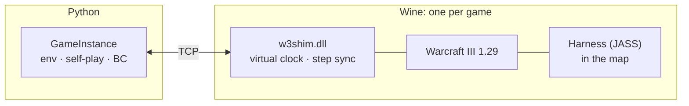
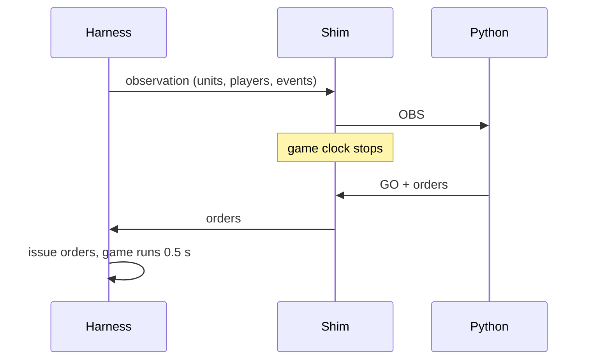

# Architecture

Python drives the real game through a script in the map (the harness) and a DLL in the game process (the shim). The [engine notes](reference/engine-notes.md) have the details.

## The parts

* **The harness** writes each observation and issues the orders with the game's own functions.
* **The shim** runs the game's clock as fast as the CPU allows and stops the game at each step.
* **The `.wgc` file** starts a game with no menus: the map, the slots and the built-in AI levels.
* **The game's own code, faster** (`shim/cuts.c`, `--game-cuts`): the shim replaces some of the game's functions with equivalent faster ones. Replays prove the same simulation at every step.
* **Other rules** go into a copy of the map as the game's unit and upgrade tables (`data/duelmap.py`): the duel maps, and Echo Isles with duelfast's rules (`echofast`).

## Self-play

* One GPU context holds the learner and the inference loop. The loop has no Python in its hot path.
* A video follows the fight, else cycles between the two players' armies and bases.

## One step

## Rules to remember

* A reload by `RestartGame` gives a new game. A reset by script does not: the engine keeps counting removed heroes.
* Several pairs of players in one map load (`--pairs`) work only on the duel maps. Echo Isles has two start locations: one pair.
* A build order that does not fit is tried again on rings of spots up to 256 units away, in the same step.
* The game runs only as the 32-bit Legacy 1.29 build. The shim's offsets are for that build.
