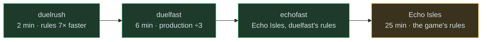
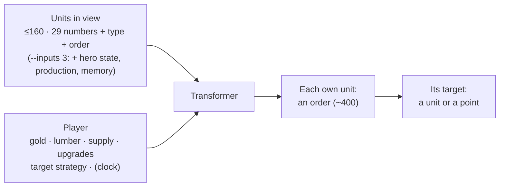

# Environments

Every environment is the real game. The duel maps are small and fast, so a game takes minutes. Echo Isles is the real ladder map with the game's own rules.

## Maps

| map | size | rules | games against insane |
|---|---|---|---|
| `duelrush` | 40 tiles | everything 7× faster | ~2 min |
| `duelfast` | 48 tiles | hit points and costs ÷2, production ÷3 | ~6 min |
| `echofast` | Echo Isles | duelfast's rules in the real map | ~10 min |
| `echoP` | Echo Isles | P% of the way to the game's rules | — |
| `echo100` | Echo Isles | the game's rules (the real game) | wins ~9 min, losses ~28 |

* The duel maps have two bases like Echo Isles' main bases, a gold mine each and creep camps. They have no expansions, items or shops.
* `echofast` and `echoP` put the rules' tables into a copy of Echo Isles. The terrain, creeps, mines and expansions are the real map's.

## What the agent sees and does

* The view follows the fog of war. With `--inputs 3` it also keeps the enemy units and buildings it saw and no longer sees, where it last saw them and how long ago, until their place is in sight again (a unit for a minute at most). An attack on one is an attack-move to where it was.
* Positions are relative to the player's own start, at the duel maps' scale. On Echo Isles the stretch between the bases is shorter in the view, so the enemy base is where it was on the duel maps.
* `--inputs 3` adds per hero its abilities' levels, whether each can be cast now (learned, cooled down, the mana), their cooldowns, whether a skill point may go there, and its items (usable, heals, mana, a town portal); per building what it makes (a worker, an army unit, a hero, research, a tier); and the time of day (night: creeps sleep, night elves hide).
* The agent does not see terrain or trees.
* Every own unit gets an order every half second: train, build, research, move, attack, cast, use an item, harvest, learn a skill. The orders are those the built-in AI gave in the demonstrations: no tavern heroes, neutral shops, mercenaries or items on the ground yet.
* Masks: a unit's type gets only the orders its type got in the demonstrations, and only what the player can pay for. `--tech-mask` also masks what the player lacks the tech for (a building, a tier, a research's next level, the hero limit), `--valid-mask` a hero's orders it can't carry out now (an ability not learned, cooling down or without the mana, no skill point, an empty item slot).
* [The whole-game model](model.md) shows the tokens, the transformer and the action heads.

## Opponents

* **The built-in AI** (normal, insane). The real game against it is the yardstick.
* **A curriculum**: the AI loses a share of its income until the learner wins half its games.
* **Itself and past snapshots.** Between races, the stronger race pays a tax. A new run forked from another starts with its parent's past snapshots, their records and the curriculum's levels (`--league-from`), not a league of one.
* **A main exploiter** (`--exploiter-share`, as in AlphaStar): a second network that trains only against the learner. In AlphaStar's league mix (`fgself-103`) it made no lasting difference.
* **You**: `fullgame/versus.py` opens the game in a window.

## Rewards

* +1 for a win, −1 for a loss. A tie gives a small reward for a lead in material.
* Shaping gives the change in material lead (what living units and buildings cost) at every step. It is potential-based, so over a game it adds up to ~0 ([reward shaping](related/reward-shaping.md)). In the best recipe for the real game it counts half (`--shaping 0.5`): the win weighs more, and the policy won more. A quarter was level (`fgself-75`). An option also counts the heroes' levels.
* With strategy conditioning, a trained side with a target strategy also loses a little reward for each item where it and its target differ (`--z-reward`). A narrow target (`--narrow` pools) counts only its own items, and heroes or army units it does not list; other buildings and research are free. Conditioning kinds (`--z-modes`: no rush, rush, expand, no expansion, workers, creeping, harass, scouting, army size, low upkeep) add their violations (`--z-mode-reward` each).
* The discount looks ~28 minutes ahead in the real game (γ 0.9997), ~8 minutes on the duel maps.
