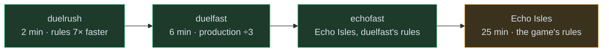

# Environments

Every environment is the real game. The duel maps are small and fast, so a game takes minutes. Echo Isles is the real ladder map with the game's own rules.

## Maps

| map | size | rules | games against insane |
|---|---|---|---|
| `duelrush` | 40 tiles | everything 7× faster | ~2 min |
| `duelfast` | 48 tiles | hit points and costs ÷2, production ÷3 | ~6 min |
| `echofast` | Echo Isles | duelfast's rules in the real map | ~10 min |
| `echofast2` | Echo Isles | echofast with the mines' gold and the starting gold and lumber ÷2 too | — |
| `echoP` | Echo Isles | P% of the way to the game's rules | — |
| `echo100` | Echo Isles | the game's rules (the real game) | wins ~9 min, losses ~28 |

* The duel maps have two bases like Echo Isles' main bases, a gold mine each and creep camps. They have no expansions, items or shops.
* `echofast` and `echoP` put the rules' tables into a copy of Echo Isles. The terrain, creeps, mines and expansions are the real map's.
* `echofast2` scales the economy like the costs: each mine holds half its gold (main mines 6,750, the expansions' 6,250) and players start with 250 gold and 75 lumber. On `echofast` a mine held twice the real game's worth of units, so a training game never mined one out and expanding never paid (audit 12: 0 expansions in 286 real games, the main mine dry ~22 min in). The map script does it (the mines' `SetResourceAmount`, the starting resources after melee initialization); a real-game check read 6,750 / 6,250 in the mines and 250 / 75 at the first step. Trees keep their lumber. The agent's mine feature stays gold / 12,500, so a fresh mine reads 0.5 there and 1.0 in the real game.

## What the agent sees and does

* The view follows the fog of war. With `--inputs 3` it also keeps the enemy units and buildings it saw and no longer sees, where it last saw them and how long ago, until their place is in sight again (a unit for a minute at most). An attack on one is an attack-move to where it was.
* Positions are relative to the player's own start, at the duel maps' scale. On Echo Isles the stretch between the bases is shorter in the view, so the enemy base is where it was on the duel maps.
* `--inputs 3` adds per hero its abilities' levels, whether each can be cast now (learned, cooled down, the mana), their cooldowns, whether a skill point may go there, and its items (usable, heals, mana, a town portal); per building what it makes (a worker, an army unit, a hero, research, a tier); and the time of day (night: creeps sleep, night elves hide).
* The agent does not see terrain or trees.
* Every own unit gets an order every half second: train, build, research, move, attack, cast, use an item, harvest, learn a skill. The orders are those the built-in AI gave in the demonstrations, and with `--neutral` the neutral buildings' wares (tavern heroes, the goblin merchant's items).
* `--spells 1` adds the five melee heroes' spells the demonstrations never gave (the vocabulary keeps orders given at least 5 times; learning them was in, casting them not): War Stomp (Tauren Chieftain, no target), Hex (Shadow Hunter, a unit), Banish (Blood Mage, a unit), Far Sight (Far Seer, a point) and Scout (Priestess of the Moon, no target). Only that hero may give one, with `--valid-mask` only while it is learned, ready and paid for (`fullgame/spells.py`).
* `--macros` adds orders of the agent's own for what the game spreads over many: expand (a worker builds the race's hall at the natural expansion where people build theirs; undead haunt the mine, night elves' tree of life entangles it), creep (attack-move to the natural's camp), mix (a building trains its target's army mix). `--macros 2` adds pick up: a hero takes the nearest item lying within 1,000 (the harness reports the items on the ground each player sees; creeps drop them). `--macros 3` also spends a hero's skill points the policy leaves unspent for 10 s, in the built-in AI's order.
* Orders the game would refuse are not sent (each is counted in the episode row): a repair of what needs none or a power build without lumber, a harvest at a mine the race cannot mine, a hall's tier while it trains (its queue is cancelled first).
* Masks: a unit's type gets only the orders its type got in the demonstrations, and only what the player can pay for (a research at the level the player would research next: weapons 100/50, then 175/175, then 250/300; level 1's for every level until 2026-10-26). `--tech-mask` also masks what the player lacks the tech for (a building, a tier, a research's next level, the hero limit), `--valid-mask` a hero's orders it can't carry out now (an ability not learned, cooling down or without the mana, no skill point, an empty item slot).
* `--econ-masks 1` (audit 12: undead built a median 6 slaughterhouses in target games, and 13-20 acolytes with 5 able to mine) masks a tech building's build order while a copy the player has is idle (finished and making nothing, under construction, or a worker on its way to build one): slaughterhouse, graveyard, temple of the damned, sacrificial pit, boneyard, tomb of relics, arcane sanctum, workshop, aviary, blacksmith, arcane vault, spirit lodge, tauren totem, beastiary, voodoo lounge, the ancients of lore and wind, chimaera roost, hunter's hall, ancient of wonders and every altar. Not the main barracks, halls, supply, towers or the human and orc lumber drop-offs. It also masks the worker's train order once the player has (alive and in training) 5 a worked mine (a hall, a haunted or an entangled mine) plus 13 peasants, 12 peons, 15 wisps or 3 acolytes (ghouls chop): 18, 17, 20 and 8 at one base. Further bits (audit 16; add them up): 2 keeps a dead hero's revival gold from other orders; 4 lowers night elf's wisps beside its mines' to 10 (~8 choppers: it had banked 1,184 lumber on average); 8 masks Detonate unless an enemy summon it sees is within 800 of a wisp; 16 masks repair unless a finished building or machine is below 70% of its hit points or damaged with an enemy unit within 900 (and sends repairs only to those; no helper builds on frames then); 32 masks human's call to arms (the town bell, a peasant's own) unless an enemy unit it sees is within 1,500 of a hall, and the bell's end and back to work while it has no militia; 64 (audit 17: fgself-158's undead refused 66 orders a game against insane, its start 35) masks orders the game refuses and leaves them unsent: a harvest while the player's haunted or entangled mines have 5 workers each or refused a harvest in the last 30 s (in a real game 5 acolytes kept mining with their current order 0, so counted by orders the mine had room, and 111 harvests were refused), Death Coil and Holy Light unless a unit can take them (one of the player's of the kind it heals below full health, not the caster, or another player's unit of the other kind that it sees; no building, machine, ancient or spell immune unit), a burrowed crypt fiend's or a stone gargoyle's orders but its way back (the network's table of orders by type) and that way back on the other form, and an item slot's use unless a hero holds a usable item there that needs no target. The game refuses a slot's immediate order for every item tried (dust of appearance, a healing salve) and takes the item's use, so with bit 64 the agent sends that (`scripts/undead_probe.py`). `--militia-lesson 1` (with `--teach`) teaches the hall's end of the bell once no enemy is near the militia and the halls. Whatever the flags, the agent sends human's militia orders in the forms the game takes (`scripts/militia_probe.py`): a militia's back to work, harvest or tree as its own back to work (immediate), a peasant's call to arms as its own, and never the bell's end without militia.
* [The whole-game model](model.md) shows the tokens, the transformer and the action heads.

## Opponents

* **The built-in AI** (normal, insane). The real game against it is the yardstick.
* **A curriculum**: the AI loses a share of its income until the learner wins half its games.
* **Itself and past snapshots.** Between races, the stronger race pays a tax; with `--win-balance` the side a model of past games expects to win (by races, targets and whether the opponent is a past snapshot) pays it, so each game is close to even. A new run forked from another starts with its parent's past snapshots, their records and the curriculum's levels (`--league-from`), not a league of one.
* **A main exploiter** (`--exploiter-share`, as in AlphaStar): a second network that trains only against the learner. In AlphaStar's league mix (`fgself-103`) it made no lasting difference.
* **Scenarios** (`--scenarios`, a fifth of the training games): the game starts with the natural's camp gone, armies between the bases, a raid or extra money.
* **The hand-written player** (`fullgame/heuristic.py`, the user's idea of 2026-10-25: a scripted opponent stronger than the learner shows its weaknesses): an orc that masses grunts and headhunters from three barracks with a Far Seer, builds watch towers in front of its base against undead and orc, defends at home, takes the natural expansion once its camp is cleared and attacks late, when the learner's single mine runs dry. It sees what its player sees. Against the learner it wins ~60% (`fgself-145`), losing the early fights and winning every long game once the learner's single mine runs dry. It is also a family of 16 strategies (`heuristic.STRATEGIES`: per race a tier-1 rush, a tier-2 army with a second hero, casters for orc and human, a fast expansion), for diverse play to clone. Since 2026-10-26 they are tuned for a person's income (the agent slots' since that day): 5 workers a mine and lumber workers to what the plan spends, every plan takes its natural (the rushes at ~8 minutes, the others at ~7, the expansions at ~3:30-4; undead haunt its mine, night elves root a tree of life there and entangle it), and money that piles up buys upgrade levels, the next tier and production (experiment log: "at a person's income"). `--heuristic-share` puts it into a share of the training launches between agents (no trajectory for its side; `--heuristic-strategy random` draws one of the race's strategies), `--eval-heuristic` into the evaluation games (eval key `vs heuristic:orc`, a player of its own on the Ratings view). `scripts/heuristic_match.py` plays it against the built-in AI, a checkpoint or itself, and with `--record` writes its games as demonstrations in `collect.py`'s format (both sides' orders as labels; their builds become targets, `src: heuristic`); `--teach-heuristic` teaches a target from those games by its strategy's own macro orders.
* **You**: `fullgame/versus.py` opens the game in a window.

## Teachers

Two heuristic teachers label the learner's steps with what they would order; the labels pull the policy toward them (`--teach-coef`), and nothing they say is carried out.

* **The target builder** (`--z-build 2`): the earliest item of the side's target that is due and neither made nor under way, or what it needs first (the tech tree), when the player can pay for it. With `--z-workers 1` also a worker at an idle hall while the side has fewer than its target's (its start's plus the strategy's trained ones, at most `--econ-masks`' cap for its mines), after the due items and with the money they leave (audit 12: the agent trained ~5 where its targets had 13-14).
* **The teacher** (`--teach`): a first hero in games without a target (with `--teach 2` the target's first hero, as soon as the altar stands), a tavern hero, the expansion and its camp, an army mix, a town portal or a potion when a hero is low, an item picked up. `--teach 3` adds lumber (a worker to the tree nearest the hall, up to 5 choppers or 3 ghouls) while the target's next item is short of it. `--teach 4` also teaches lumber in games without a builder while the bank's lumber is under half its gold, and has an orc burrow with peons inside stand down when no enemy unit is within 1,500 of it (audit 12: in target games the peons stayed inside, 14 orders a minute skipped for a loaded peon).

## Rewards

* +1 for a win, −1 for a loss. A tie gives a small reward for a lead in material.
* Shaping gives the change in material lead (what living units and buildings cost) at every step. It is potential-based, so over a game it adds up to ~0 ([reward shaping](related/reward-shaping.md)). In the best recipe for the real game it counts half (`--shaping 0.5`): the win weighs more, and the policy won more. A quarter was level (`fgself-75`). An option also counts the heroes' levels.
* With strategy conditioning, a trained side with a target strategy also loses a little reward for each item where it and its target differ (`--z-reward`). A narrow target (`--narrow` pools) counts only its own items, and heroes or army units it does not list; other buildings and research are free. Conditioning kinds (`--z-modes`: no rush, rush, expand, no expansion, workers, creeping, harass, scouting, army size, low upkeep) add their violations (`--z-mode-reward` each).
* The army's composition kinds (`--z-comp`, the user's idea of 2026-10-26: ask the policy to limit or forbid the unit it spams, footmen, grunts, ghouls, archers; `fullgame/modes.py` `COMP_KINDS`) are paid alike, each on with that chance in a game with a target. The army is the side's living units but buildings, workers and heroes, counted by food (summons have none). **cap C** (0.4-0.55): from 300 s to 900 s, while the army has 12 food or more, no unit type above C of its food; the violation is the share of that time above, each step weighted by (share - C) / (1 - C), so a pure footman army at C = 0.5 is a whole violation, a 60% one a fifth. **forbid** (0: the race's spam unit, footman, grunt, ghoul, archer, drawn 3/4 of the time; 1: its other basic unit, rifleman, headhunter, crypt fiend, huntress): none until 900 s, a quarter of a violation for each one alive at once (the most so far); undead may keep 3 ghouls for lumber. **variety N** (3 or 4): N unit types in the army at once by 600 s (the share missing). A game's build target is changed to agree with them (`modes.adapt`): the forbidden unit leaves its items and army mix, and the mix is capped at C (the excess spread over the other types), so the target's reward, the builder's labels, the teacher's mix lesson and the mix macro never ask for what a kind forbids. `--z-forbid-mask 1` also masks the forbidden unit's train order until 900 s (undead: once 3 ghouls live). Their block (on and parameter per kind: 6 numbers) sits at the strategy block's end, after the mix, so an older network grows by zero weights there and plays as before.

* The discount looks ~28 minutes ahead in the real game (γ 0.9997), ~8 minutes on the duel maps.
