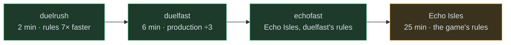
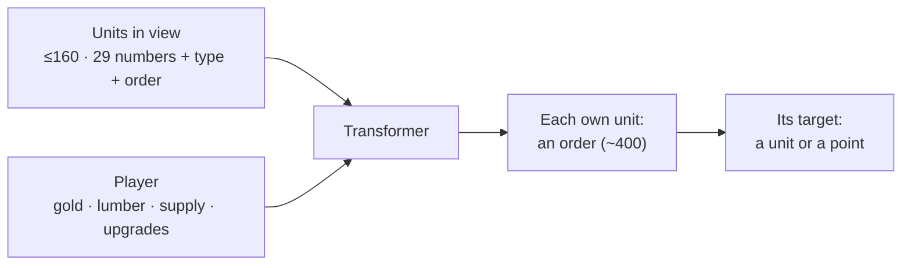

# Environments

Every environment is the real game. The duel maps are small and fast, so a game takes minutes. Echo Isles is the real ladder map with the game's own rules.

## Maps

| map | size | rules | games against insane |
|---|---|---|---|
| `duelrush` | 40 tiles | everything 7× faster | ~2 min |
| `duelfast` | 48 tiles | hit points and costs ÷2, production ÷3 | ~6 min |
| `echofast` | Echo Isles | duelfast's rules in the real map | ~10 min |
| `echoP` | Echo Isles | P% of the way to the game's rules | — |
| `echo100` | Echo Isles | the game's rules (the real game) | ~15 min: wins ~10, losses ~25 |

* The duel maps have two bases like Echo Isles' main bases, a gold mine each and creep camps. They have no expansions, items or shops.
* `echofast` and `echoP` put the rules' tables into a copy of Echo Isles. The terrain, creeps, mines and expansions are the real map's.

## What the agent sees and does

* The view follows the fog of war. The agent sees enemies only while they are in sight.
* Positions are relative to the player's own start, at the duel maps' scale. On Echo Isles the stretch between the bases is shorter in the view, so the enemy base is where it was on the duel maps.
* The agent does not see terrain, trees or buildings it saw earlier.
* [The whole-game model](model.md) shows the tokens, the transformer and the action heads.

## Opponents

* **The built-in AI** (normal, insane). The real game against it is the yardstick.
* **A curriculum**: the AI loses a share of its income until the learner wins half its games.
* **Itself and past snapshots.** Between races, the stronger race pays a tax. A new run forked from another starts with its parent's past snapshots, their records and the curriculum's levels (`--league-from`), not a league of one.
* **A main exploiter** (`--exploiter-share`, as in AlphaStar): a second network that trains only against the learner. It is not yet used in whole games.
* **You**: `fullgame/versus.py` opens the game in a window.

## Rewards

* +1 for a win, −1 for a loss. A tie gives a small reward for a lead in material.
* Shaping gives the change in material lead (what living units and buildings cost) at every step. In the best recipe for the real game it counts half (`--shaping 0.5`): the win weighs more, and the policy won more. `fgself-75` tries a quarter. An option also counts the heroes' levels.
* The discount looks ~28 minutes ahead in the real game (γ 0.9997), ~8 minutes on the duel maps.
