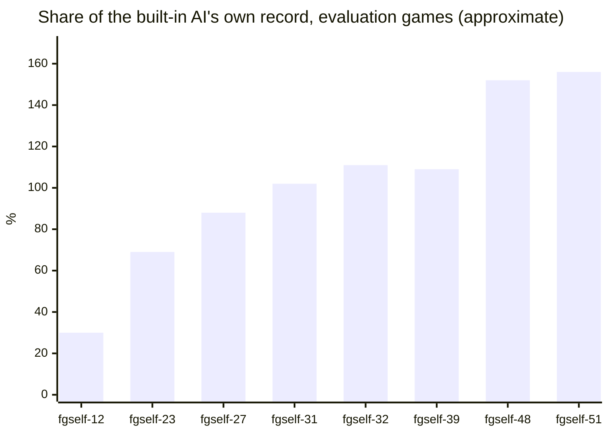
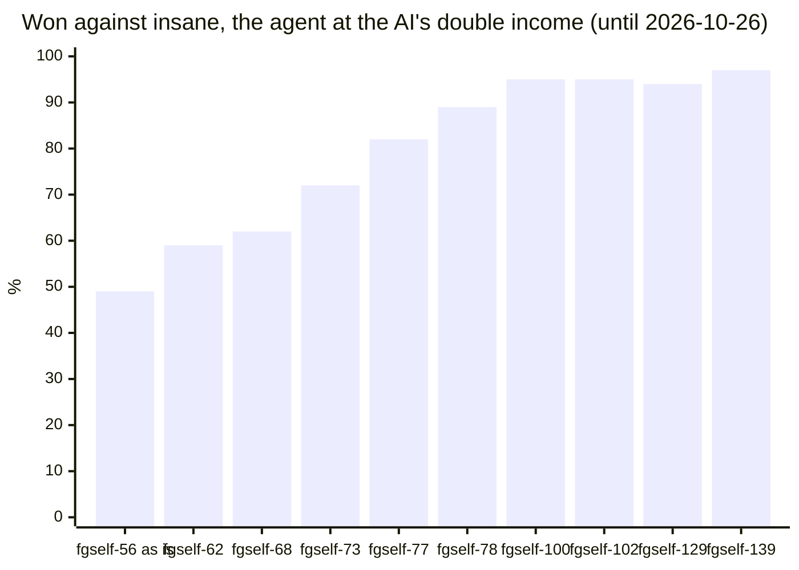
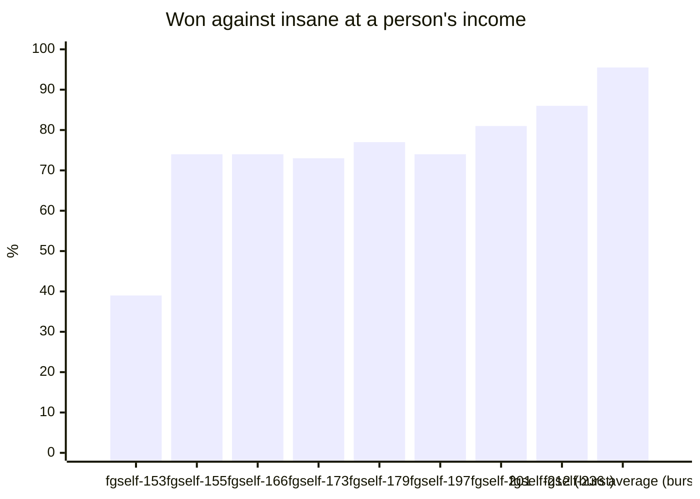

# Experiments

The main lessons, short. The [experiment log](reference/experiment-log.md) has every run, its numbers and why it ran. [Ideas](reference/ideas.md) lists every idea, where it came from (the user, the papers, LLM RL) and what became of it; [what AlphaStar and OpenAI Five found](reference/ideas-from-alphastar-and-openai-five.md) ranks the papers' findings.

Each experiment is a new run, forked from a checkpoint (`scripts/selfplay_fork.py`). The fork starts with its parent's league and gets a title of a few words (`--title`, `runs/<run>/summary.txt`). The dashboard's lineage shows the forks with their titles. Since 2026-11-13 the base goes on from the same checkpoint as the experiment's control, and an evaluation burst decides ([below](#verdicts-by-evaluation-bursts)).

## The duelfast line

100% is the built-in AI's own level in the same matchups. The runs measured different matchup mixes, so the bars are approximate.

## The real game on Echo Isles

Until 2026-10-26 the agent slots had the insane AI's double income, so these figures were at that income. Since then every agent slot plays at a person's income:

Up to `fgself-201` each bar is the run's own evaluation games. Each run played its own matchups and windows, so compare within a run. The masks and order fixes of `fgself-155` gave most of the jump. Late-game starts (`fgself-166`), shop items (`fgself-179`), what a player sees (`fgself-197`) and half the AI games in the real game (`fgself-201`) gave the rest. The last two bars are evaluation bursts: every training game in the real game (`fgself-212`, 195 games) and the weight average of `fgself-236`, whose teacher weights the first hero (95 games, one burst so far, being confirmed).

## Verdicts by evaluation bursts

Until 2026-11-13 a run was judged against its start checkpoint in its own evaluation games, over hours. Two things made that unreliable:
* **Start checkpoints are high points.** A checkpoint's level against insane swings by ~8 points between checkpoints 20-30M steps apart, and a start is usually picked as a best point. `fgself-201`'s unchanged continuation read 0.444 head to head against its 142.7M checkpoint, and 0.74 against insane where 142.7M read 0.85. `fgself-212`'s 92M and 118.8M both read 0.838 against insane, and every continuation from them 0.68-0.76: a plain resume lost as much as a fork. So `fgself-212` read "level" against its start and turned out the best policy against insane.
* **Windows drift.** The training games against the untaxed insane AI (`scripts/train_read.py`, ~500 an hour) track the evaluation within a few points, but the same lineage read 0.83 on 2026-11-11 and 0.71-0.75 two days later, on the same code. They compare runs only within one window.

So since then:
* An experiment forks from the base's latest checkpoint and trains ~26M steps. The base goes on from the same checkpoint for the same budget: the control.
* Then a burst: the learner stops, and the main machine's 64 game slots and the 3090 play frozen checkpoints for ~45 minutes (`scripts/burst_prep.py`, `evalworker --run burst-N`). ~1,000 games: the experiment's and the control's end checkpoints and weight averages against insane, all on the same matchups, and head to head. The races are weighed alike.
* **Weight averages** (`scripts/average_checkpoints.py`, the mean of ~30 checkpoints over a run's last ~10M steps) swing less than single checkpoints. The first, the mean of `fgself-212`'s 81 checkpoints over 118.8M-144.7M, read 0.845 against insane, at its best single point (0.856) without anyone picking it, and beat all three head to head. Since `fgself-221` the base mostly goes on from an average (from its end when the end read better), with the nearest kept checkpoint's Adam state beside it (a fresh Adam had cost forks ~10 points).
* An average is not always above its points (`fgself-221`'s end read 0.866 against its average's 0.788), and one broke a race: `fgself-236`'s average over 17-27M won 0.38 of 57 night elf games while its end won 0.93. Averages are read by race before one becomes a base.
* Most differences in one burst are inside the noise (±0.04-0.08 a policy against insane). A change is kept when everything points one way; a policy that looks best in one burst is confirmed in the next.

## Lessons, capped

The teacher's lessons label some of the policy's steps with an order (`--teach-coef`). For an order the policy almost never gives, a lesson spreads: with `--label-norm units` its loss pushes the order's chance up until the taught unit gives it, from a log-chance of ~-7, and the order head's shared weights carry it to every unit at every step. The attack lesson (`fgself-218`) took attacks on a unit from 0.5% to 77-84% of all attacks in 20 minutes, and the run collapsed. The spell lessons (`fgself-208` to `-210`) likely spread the same way (~25-40 casts a game).

`--teach-floor P` caps the push: a lesson's label counts only while the unit's chance of the order is under P (`--teach-floor-orders` names the orders: attacks on a unit, the spells, the expansion's halls, the army lesson's units, weapon and armor research). The lesson makes a rare order possible, and the reward decides how much of it pays.
* Spells at P = 0.005 (`fgself-224`): **kept**. The heroes cast ~17 taught spells a game in training, spread over many spells, and its average beat its control's head to head (0.59-0.62).
* Attacks on a unit: at 0.05 the order still spread (54-57% of attacks, `fgself-219`); at 0.002 it held at ~20% but read -8 against its control (`fgself-220`). The line is closed for now.
* The army lesson (`fgself-226`) and the upgrade lesson (`fgself-227`) under the cap: level. The upgrade lesson raised research in training (5.7 against 3.8 levels a game) but only a little in evaluation (1.7 against 1.2).
* A late expansion lesson (`fgself-223`, halls capped at 0.02): it expanded in 4% of the games without a target, but cost 11 points. Its camp lesson is an attack-move, an order every unit gives, so no cap can hold it.

## The first hero

[Audit 20](reference/audit-20.md) found the first hero deciding orc and human games: orc with the Far Seer won 0.93, with the Tauren Chieftain 0.62 and the Blademaster 0.40; human with the Archmage 0.95, with the others ~0.77. The same held in every burst, against every AI race and head to head. The policy picked each a third of the time because `--teach 3`'s first-hero lesson drew one uniformly in every game without a target, so the label came every game and the reward saw one decision a game. With `--first-hero-weights Ofar:4,Hamg:4` (`fgself-236`) the teacher draws the Far Seer and the Archmage two times in three. The policy's own first hero followed (70-85% in evaluation, where no teacher plays), and orc rose: 0.75 over two bursts against the control average's 0.52. Its average went on to read 0.955 against insane (burst-237). Race weights tuned for orc on top (`fgself-237`) added nothing.

## What worked

| change | head to head |
|---|---|
| Forward KL to the anchor over every action head (not reverse KL on the orders only) | 28% → 54% → 69% |
| Move the anchor to a recent checkpoint of the policy | +11 points, twice |
| Train against insane, not normal | insane 34% → 45% |
| UPGO (credit that a later bad action does not cancel) | 79% → 102% → 111% |
| No dropout in the updates (the actors play without it) | 93% → 109% |
| No advice and no cloning loss from the built-in AI, once the policy beats it | 137% → 152%, and 18% more steps a second |
| A deeper network (5 layers, grown from 3 so that it starts as the old one) | 148% → 156% |
| On Echo Isles: positions from the own base at the duel maps' scale | 0 → 49% of games against insane |
| A horizon for 25-minute games (γ 0.9997) | 55% → 59% of games |
| A wider search for a free building spot (up to 768 units) | undead's builds taken 25% → 79%, 57% → 62% of games |
| Half the reward shaping (the material lead), so the win weighs more | 62% → 72% of games, human 34% → 53%, undead 32% → 49% |
| A quarter of the anchor's pull (`--ref-kl 0.05`) | 72% → 82% |
| Target strategies (AlphaStar's z: build orders from the AI's games and people's replays) | 82% → 89% |
| Targets the policy can follow (a pool at its own rules' times, a builder that teaches from the tech tree, the next item's cost saved), trained on `echofast`, judged on the real game | 87% → 95%; ~80% of the due target items made by the policy itself |
| The anchor moved to the best checkpoint | no slide after the peak |
| More games as the weaker races (human and undead 35% each) | undead 79% → 89% |
| The game's rules made right (audits: the first hero free, purchases that go through, dead heroes revived, undead's haunted mine, a hall's tier while it trains workers) | level at first (`fgself-120`, `-122`); with the tier fix the best rating yet (`fgself-129`, ~1940 to 1875; tier 2 in 63% of real games) |
| Orders of the agent's own: expand to the natural, creep its camp (`--macros 1`) | `fgself-127` better (1874 to 1810), the first expansions in the real game |
| Targets not enforced (a side with a target may answer with items outside it) | with a target 24% → 58% against insane |
| A first hero taught in games without a target | human plays a hero again (`fgself-135`) |
| A hero's skill points spent when the policy leaves them (`--macros 3`) and a third audit's fixes | 51% head to head with its start (`fgself-137`) |
| Orders the game refuses not sent (repairs of what needs none, harvests at mines the race cannot mine, power builds without lumber) | 58% head to head with its start (`fgself-139`); 97% against insane |
| Late-game starts from captured states, half from people's games (`fgself-166`, `-168`) | against insane 69% → 74% |
| Two-base starts (`fgself-173`) | level, undead up |
| A smaller anchor pull (`--ref-kl 0.01`, `fgself-176`) | level, a little more varied |
| A strong past run fixed in the league (`fgself-177`) | 58% head to head with its start |
| Shop items as orders (`--shop-items 1`, `fgself-179`) | against insane 66% → 77%, though it hardly buys |
| Every order a player can give (`--full-vocab 1`, `fgself-196`) | level, and nothing out of reach |
| What a player sees: buffs, corpses, items, area spells, enemy upgrades (`--obs-full 1`, `fgself-197`) | wins past 18 minutes 16% → 46% |
| Half the training games against the AI in the real game (`--real-share 0.5`, `fgself-201`) | against insane 0.70 → 0.81 over the continuation |
| Every training game in the real game (`--map "(2)EchoIsles"`, `fgself-212`) | burst: against insane 0.78 → 0.86 over `fgself-201`/142.7M, +4.5 over its continuation |
| The base from a weight average of ~30-80 checkpoints (`scripts/average_checkpoints.py`, since `fgself-221`) | the mean of 81 at its best single point (0.845), above all three head to head |
| The spell lesson capped at a 0.5% chance (`--spell-lesson 0.25 --teach-floor 0.005`, `fgself-224`) | averages 0.849 → 0.876 against insane (n.s.), head to head 0.59-0.62 against the control; ~17 taught spells a game |
| Masks for orders the game refuses (`--order-masks 7`, `fgself-231`) | level (averages 0.803 → 0.821, all played masked); refused orders 40.7 → 32.2 a game |
| The teacher's first hero weighted (`--first-hero-weights Ofar:4,Hamg:4`, `fgself-236`) | over two bursts its end 0.845 against the control's end 0.754 and average 0.781, orc 0.75 against the average's 0.52; its average 0.955 in the next burst |

## What did not help

* Larger learning rates (twice as large: worse, twice) and larger batches.
* Shaping for hero levels, credit per unit, a smaller unspent-money penalty, more real games in training.
* Sampling at temperature 0.8: the policy gave fewer orders and lost (71% against 136%).
* A clone of the AI's games under the real rules: it lost every game. Cloning undid the policy's fighting.
* A cloning loss on the AI's real games, all of them or undead's only: level at ×0.02, worse at ×0.1.
* More self-play (half the games against itself): worse. More training games as the weak races: level.
* Annealing the rules from duelfast to the real game: the policy did not need it.
* More reward for following the target (×2.5, ×5), a cloning loss toward the target, targets carried out by the harness, enforcement alone: the policy did not follow better on its own.
* An 8-layer network: level. GRPO from mid-game branches: level (creeps and the AI are not deterministic, ~55% of branches replay exactly).
* AlphaStar's league (self-play, past snapshots, a main exploiter; `fgself-103`), OpenAI Five's reward decay (`-104`), each sample used once (`-105`): level.
* Classifier-free guidance toward the target (`-106`, ×2): it followed no better and won 50% instead of 91%.
* The enemies it saw before as inputs (`fgself-107`, `-117`): worse. Rewards by part (GDPO, `-110`, `-116`): worse. Self-distillation with privileged information (OPSD, `-112`, `-121`): no gain. A weight soup of two runs (`-115`): level. Scenarios (armies between the bases, a raid, extra money; `-114`): level.
* Expansion taught with a lesson to clear the natural's camp (`-123`): armies dragged away, much worse; without it (`-124`) the policy built a second hall at home.
* The target's army mix taught a unit at a time (`-131`): level; an order to train it (`-132`): followed, at a cost in wins. Halfway rules between `echofast` and the real game (`echo50`, `-133`): worse.
* Items off the ground as an order (`--macros 2`, `-134`): it picks them up, but without a target the human policy built no altar, so had no hero.
* Expansion lessons in every game (`-156`, `-157`, `-202`): worse each time. With the place taught (`-202`) they pulled hard toward early expansions and the run fell to 40% against insane.
* People's late plans as targets (`-169`, `-170`), no KL anchor (`-171`), no AI tax in training (`-174`: -15), a lesson to hunt hidden bases (`-175`), a map pool (`-178`), shop items in the targets (`-183`: -22), a value tax (`-184`), a uniform PFSP (`-187`), larger minibatches (`-189`), more two-base starts (`-190`), an EMA anchor (`-191`, `-192`): level or worse.
* AlphaStar's league first (`-194`: the built-in AI in 40% of the games, -13 against insane), dry mains to force expansions (`-195`: none in evaluation), PFSP with more data (`-198`), a league with history (`-199`): level or worse.
* Spell lessons (`-208` to `-210`), with a mana cost or without: the heroes cast ~25-40 spells a game, and the runs lost 10-15 points against insane. Capped, they held (`-224`, above).
* Upgrades counted at their cost in the shaping (`--research-value 1`, `-213`): more upgrades, -11 against insane.
* Late starts in the real game from minutes 16-28 (`--real-agents 0.5`, `-214`): 0.69 against insane in the burst, human and undead down. Late starts from positions the learner went on to lose (`-230`): more tech (tier 3 20% against 10%), averages -4 (n.s.).
* People's clone as the KL anchor (`-215`), alone or beside `fgself-100` (`--ref2`, `-216`): no wider and no stronger (216: 0.707 against the null fork's 0.755, tier 2 12% against 43%). Alone, it swapped `fgself-100`'s pull for the clone's, and losing that pull costs strength (`-171`).
* A lesson to attack a unit (workers, hurt heroes; `--attack-lesson`, `-218` to `-220`): uncapped it collapsed; capped at 0.05 it still spread; at 0.002 it held at ~20% of the attacks and read -8 against its control.
* The z-modes' deadlines scaled to the real map (`--z-mode-time 2`, `-222`): a third to a sixth of the violations, averages -3.5 (n.s.), head to head 0.44.
* Capped lessons for a late expansion (`-223`: 4% of games expanded, -11), the army (`-226`: rare, level) and upgrades (`-227`: research up in training, level).
* A smaller learning rate (`--lr 2e-5`, `-234`): level. Race weights shifted toward orc and night elf (`-237`): nothing once the first hero is weighted.

## What went wrong

| problem | cause |
|---|---|
| Every fork measured the same evaluation games | a fixed seed. The seed now includes the run's name, and the policies play the same matchups. |
| Forks lost ~10 points in their first 20 minutes | a fresh Adam optimizer. Checkpoints now keep its state. |
| On Echo Isles the policy built in the trees and attacked mid-map | the map frame scaled positions to the map's size. The frame now keeps the base area and the enemy base where the duel maps had them. |
| Games between agents had no heroes for 9 runs | a scripted reset was not a new game |
| Forks lost their parent's league and swapped two spell toggles (`fgself-113`) | the vocabulary's order differed between processes |
| No tavern hero hired in thousands of games; the first hero held back until 425 gold | the tavern stands in the fog at the start (every buy refused); the mask did not know the first hero is free |
| No policy had ever expanded; dead heroes never revived; most of `echofast`'s creeps at full hit points | undead had no haunted mine order, the revival order was missing, the creeps' hit points were not scaled (audit, 2026-10-22) |
| The policy's tech held back for every race | a hall's tier order is refused while it trains workers |
| The real-game yardstick's AI record was the duel maps' until 2026-10-23 | the wrong table (audit 4) |
| 30-40% of the policy's orders refused by the game | repairs of what needed none, workers sent to mines their race cannot mine, a peasant's power build without lumber (audits 5 and 6, tested in the game) |
| The first hero the target's only by chance (25-37%) | in target games no lesson came before the policy had made another hero (`fgself-140` teaches it) |
| Every figure before 2026-10-26 was at double income | the agent slots had the insane AI's income. All agent slots now play at a person's |
| The laptop's evaluation read too high | relaunches cut its games in flight, mostly losses and ties. The worker now drains before a relaunch |
| The engine sent trained units home 67 times a game | the computer slot's guard posts covered the agent's units (fixed 2026-11-03) |
| `fgself-200`'s real launches never played the real map | they played the training map, untaxed (fixed 2026-11-10) |
| Every fork of `fgself-197` read low | forks faded the new inputs in again: ~15 minutes nearly blind. Also, the start checkpoint was a peak |
| Expansion lessons taught "build a hall" but not where | the teacher's loss never covered the point (fixed 2026-11-10) |
| The machine reset itself twice under full load | an uncorrected machine check (data fabric). BIOS settings to check |
| `fgself-212` judged "not kept" at first, then the best policy against insane | its start checkpoint (`fgself-201`/142.7M) was a high point. Verdicts since by bursts against a control |
| A late start's research never reached the inputs (since `fgself-166`) | the state's levels are placed with `SetResearch`, which fires no event (bug finder 9; fixed) |
| The tinker never learned a second skill | Engineering Upgrade replaces its other abilities with new codes, and a learn of the base code did nothing. Fixed in the harness and in the shim's own learn path, which the runs use (bug finder 10) |
| A learn read "ok" whenever the hero had a skill point | now only when the skill's level rose, so refused learns are counted |
| Late starts placed timed hero forms that never turned back (a Chemical Rage form still enraged 90 s later) | a form placed by `CreateUnit` has no duration; the timed forms are placed as their hero now |
| People's replays played back with ~100 times their deaths | the replay harness re-added dead units every step (fixed with the human-anchor pipeline) |
| The policy picked each first hero a third of the time | the teacher's first-hero lesson drew uniformly in every game without a target (audit 20); weighted since `fgself-236` |
| A fork from an averaged checkpoint started with a fresh Adam (`fgself-228`) | only the newest few Adam states are kept; the nearest kept one goes beside the average now (`fgself-229`) |
