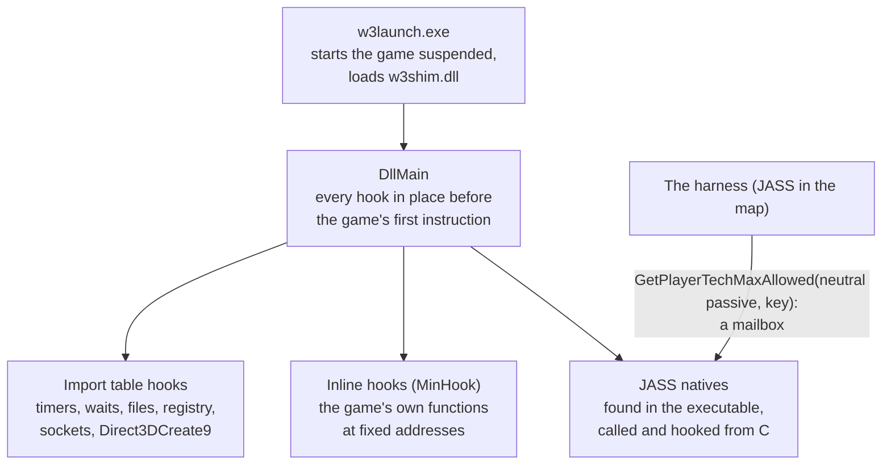

# Speeding up the game itself

warcraftsim trains on the real Warcraft III 1.29, so the game's own engine runs every step of every game. The games take about half the machine, so most of the speed had to come from the game. The rule is that the simulation must stay exactly the same, because the agent has to learn the real game. Everything below either removes work the game does for a human player (drawing, sound, waiting for the wall clock), or replaces one of the game's functions with code that gives the same answers faster. Replays prove it unchanged at every step.

The shim (`shim/`, a DLL in the game process) does it, with the harness (JASS in the map). Per-fix numbers are in the [optimization log](reference/optimization-log.md); [optimizations](optimizations.md) has the whole pipeline.

## Getting in

* **A launcher** (`w3launch.exe`) starts `Warcraft III.exe` suspended under Wine, loads the shim into it and lets it run. The hooks are installed in `DllMain` with plain memory writes, so the game's first instruction already runs hooked.
* **Import table hooks** (`shim/iat.c`) redirect the game's calls to Windows: the clock, waits, file opens, the registry, sockets, and `Direct3DCreate9`, from which the Direct3D device's methods are hooked in turn.
* **Inline hooks** (MinHook) replace the game's own functions. Their addresses are fixed: the shim supports exactly one build (1.29.2.9231, checked by its SHA-256).
* **JASS natives from C.** The executable registers every native with the same instruction pattern (`push signature; push name; push function; call`). Scanning for it gives each native's address, ~1,400 of them. They are plain cdecl functions: handles and integers by value, a real returned as its bits in `eax`. So the shim can call `GetUnitX` or `IsUnitType` directly, as the harness would.
* **A mailbox.** The harness talks to the shim through a native it otherwise has no use for: `GetPlayerTechMaxAllowed` on the neutral passive player, with negative keys as messages. The shim hooks it, so a JASS call becomes a function call into C, with an integer each way.

## Time: a virtual clock

The game runs on the wall clock: half a second of game time takes half a second. The shim gives it a clock of its own (`shim/clock.c`): virtual time = real time × speed, frozen while Python decides.

* **Speed.** The clock runs ~2.5× faster than the game can keep up with, adapting as the machine's load changes. Far faster made things worse: the game's background threads wake more often and load wineserver.
* **Cheap to read.** The game reads its clock thousands of times a turn. Under Wine `QueryPerformanceCounter` can be a system call, so the virtual clock is built on the CPU's time-stamp counter, published through a seqlock that no reader ever blocks on.
* **Frozen at every step.** While Python decides, virtual time stands still, and the game sees no gap.
* **Waits that don't spin.** A thread that waits 100 ms in game time waits 100 ms ÷ speed in real time, and at high speeds that rounded to zero: polling threads spun at 5,000-11,000 wakeups a second, each a call into wineserver. A floor of 1-5 ms on those waits gave +60% games a second.
* **Threads asleep while frozen** (2026-10-03). A frozen clock can't reach a timeout, so a background thread's timed wait now blocks until the clock runs again, then times out as it would have. Together with Wine's gamepad, USB and Bluetooth drivers left out (the HID driver's event loop woke every millisecond in every game): 22% less CPU a step.

## A step without files

The harness started with the tools JASS has for files: it wrote the observation with `Preload` and read the orders with `Preloader`. Under Wine each file operation is a round trip to wineserver, and `Preloader` *compiles* the file it reads as JASS.

| | before | now |
|---|---|---|
| observations | `Preload(token)` per token, each checking the disk for a file of that name, then `PreloadGenEnd` writing a script file for Python to read | the shim hooks both (`shim/obs.c`): the tokens are collected in memory and sent with the step sync |
| orders | a file of JASS, compiled by `Preloader` every step: ~7 ms under Wine, and ~20 KB of the compiler's memory never freed ("Not enough memory" after ~20,000 steps, so games had to be restarted) | the mailbox: the harness asks the shim for each command integer |
| the units | three passes in JASS, ~35 native calls and a few hundred JASS instructions per unit: 9-13 ms a step with 150 units and 32 games running | the shim's pass in C (`shim/units.c`), calling the same natives itself: ~4 ms |
| the step sync | | the mailbox native freezes the clock, sends the observation over a socket to Python and blocks until the orders come back |

## Drawing nothing

Nobody watches a training game. Under Wine, Direct3D 9 becomes OpenGL, and Mesa draws it in software on the CPU.

* **The device draws nothing** (`shim/render.c`): `Present`, `Clear` and the `Draw*Primitive` calls return at once. The game still builds every frame, so its animations and geometry run as before. Drawing had been 18% of a game's main thread; 22.6 → 18.7 ms of CPU a step. Mesa's own no-op driver left the game without a first frame.
* **Textures without pixels** (`--game-cuts` 8): the texture decoder allocates the same mip levels but skips the JPEG decode of each.
* **Paint now and then** (`--game-cuts` 256): the frame's paint handler runs every 50 steps instead of ~8 times a wall second. Skipping it entirely was not safe: paint rebuilds a list of units that the fog pass walks every turn, and without it the list kept growing (the fog's share rose to 17% by step 700).
* **A 320×240 virtual screen**, the game drawing in its own thread (Wine's command stream thread off), and llvmpipe rasterizing in the calling thread, with no threads of its own.

Videos are rendered from the games' replays in a process of their own, which draws.

## Equivalent rewrites of the game's own code (`--game-cuts`)

The game is a 2002-era C++ program built for a single-core PC with an x87 FPU, and some of its hot functions show it. Two rounds (2026-10-11/12 and 2026-10-24), each by a subagent, found and replaced them:

1. **Profile.** A raw stack sampler in the shim (`W3SIM_PROFILE=5`) and `perf stat -t` per thread show where the main thread's time goes: pathing ~35-55%, unit and ability timers ~15-20%, our harness ~15-25%, attack and fog the rest.
2. **Read the code.** Ghidra, driven through [REA](https://github.com/morluto/rea) (an MCP server for Ghidra), decompiles the hot functions.
3. **Replace.** A function in `shim/cuts.c` that gives the same results, hooked over the original, behind a bit of `W3SIM_CUTS` (`--game-cuts`).
4. **Prove it.** `scripts/cut_ab.py` plays a recorded game back with and without the bit, side by side. At every step it compares every unit, player, event, the built-in AI's orders, each command's result, the items on the ground, and in round 2 the observation's raw bytes. One differing step and the bit doesn't ship.

### Round 1 (2026-10-12, `--game-cuts 1529`)

| bit | the game did | now | main thread, M instructions a step |
|---|---|---|---|
| 16 | the harness's pass over the units ran a JASS thread per unit (`ForGroup`) | the group's units go straight to the C pass | -2.05 |
| 64 | A* asked, for every node, whether each cell in a ring around it is blocked: 90% of the questions were repeats within one search | each cell's answer remembered for the length of one search (nothing in a search changes it), with its side effects replayed | -1.72 |
| 1 | `GetPlayerId` and `Player()` copied the map's 14 KB info block onto the stack to read one field (a 24-player compatibility check), 20,000-40,000 times a second | the answer memoised | -1.32 |
| 256 | paint ~8 times a wall second, drawing off | every 50 steps | -1.0 |
| 1024 | A* computed a neighbour's heuristic before an early return that usually discarded it | after it, with the same stores in the same order | -0.87 |
| 32 | the C pass called each pure getter twice per unit | once | -0.21 |
| 128 | soft-float helpers: count leading zeros as a loop, an integer square root as 16 rounds of digit-by-digit | `lzcnt`, and `floor(sqrt(double))`, checked equal over all 2³² inputs | -0.82 (the AI's code) |
| 8 | JPEG-decoded textures that are never drawn | no pixels | -0.29 |

All on: a self-play replay 28.4 → 19.3 M instructions a step (-32%), the main thread's CPU -16 to -28%. Same results on 24 replays.

### Round 2 (2026-10-24, `--game-cuts 521721`)

| bit | the game did | now | main thread a step |
|---|---|---|---|
| 4096 | the long-range path search took an integer square root by Newton's method, two divisions a round, twice for every node it relaxed | `floor(sqrt(double))`. To check it, the executable's own routine was run natively over all 2³² inputs. It matches for every one, and the shim re-checks it in the process before hooking | -1.4% |
| 8192 | `UnitIsSleeping` (the harness asks it of every unit, every step) walked the unit's whole ability list through virtual calls and type checks | the same walk in C with the list's lookups inlined, and the type check `IsA(type, id)` remembered per game | -2.5% |
| 16384 | `EnumItemsInRect` over the whole map (for the items on the ground) walked ~4,000 grid cells and ~5,000 entries a step, stalling on a cache miss at each | the same walk in C, prefetching each cell's entries before reading them | -2.7% (-1% without the prefetch) |
| 32768 | each native converted the unit's handle to its object again, ~30 times a unit | once per unit of the pass | -1.3% |
| 65536 | two socket sends per observation (the header, then the body); the game asks Wine for its thread's priority around its timing code | one send; the priority remembered | wineserver requests 15.7 → 7.9 an observation |
| 131072 | the step sync's socket went through Winsock, a few wineserver round trips per call | **Linux system calls from inside the Windows program.** Under GE-Proton's Wine the game is a 32-bit Linux process, so the shim opens the TCP connection with `int 0x80` (socket, connect, read, write) and Wine never sees it; Winsock remains the fallback | -4.4 to -6% |
| 262144 | the harness wrote the players' records and checked who had won in JASS: a call, an `I2S` and a `Preload` per token, and loops over 24 × 24 players | the shim, with the same natives. A check mode runs both paths and compares them every step | -6.4% |

All on, against round 1: the main thread **-18.4%** a step, -20.7% with wineserver, and -31% in games between agents. Same results over 54 replays (60,772 steps). The last bit changes the harness, and a replay only plays back on the map it was recorded with. So it was checked on 8 new games recorded in the check mode, then played back on both paths.

Tried and dropped: pooling the events of the game's loopback messages (4: nothing), a cache for the type check `IsA` (2048: little, and delicate), Storm's allocator hashing its caller's source file name on every allocation (512: nothing measurable), paint every 200 steps (no change).

## Wine

Each game runs in a Wine prefix of its own. Wine was a third of a game's CPU at first.

* **GE-Proton's Wine with fsync**: Wine's events, mutexes and waits on Linux futexes instead of a round trip to wineserver each, 28% less CPU a step. (Wine's newer ntsync gave nothing more.)
* **"Allow Local Files" off**: the game looked for every file in its own folder before its archives, and under Wine each miss scanned the directory. A map reload went from 13.2 to 9.9 s under load.
* **No audio devices, gamepad drivers, Mono, Gecko or menu entries**, and **no system D-Bus**: each prefix's device manager had asked the disk service for every disk ~0.4 times a second, and with 57 games that service took 1.5 cores.
* **Native Linux instead of WSL** on the same machine: a step 9.2 → 7.4 ms of CPU.

## What did not work

* A clock far faster than the game keeps up with: more wakeups, more wineserver.
* Bypassing the engine's turn pacing (`turbo`): no gain at 0.25 s steps.
* Capping the background threads' waits: one of them paces the game's turns, and capped it made games 4× slower; the other three saved ~3%.
* `-graphicsapi Null` crashes 1.29; a window under 800×600 hangs it.
* A reset by script instead of a map reload: fast, but the engine kept counting the removed heroes, so games without heroes followed. Reloading the map in the running game (`RestartGame`, ~1 s) and five pairs of players per load did the job.

## Where the time goes now

With both rounds on, a game's main thread is mostly the simulation itself. Pathing is 35-55% of it (more in long games), then the other unit timers, attack and fog. The harness's pass over the units still costs ~8%, in the natives it calls. Next would be the path search's per-node functions and its heap (memory-bound, so prefetching may help, as long as the heap's order stays the same) and the per-item callback of the items' search.

| | CPU per game step |
|---|---|
| a `duelrush` step, 32 games, before the shim's pass, drawing and fsync | 35-40 ms (the whole process) |
| drawing nothing, threads asleep, fsync (2026-10-03, WSL; `duelfast`, game and wineserver) | ~9 ms |
| native Linux (2026-10-11) | ~7.4 ms (the game) |
| round 1 of the rewrites (2026-10-12) | the main thread 5.92 → 4.24 ms on a self-play replay |
| round 2 (2026-10-24) | the main thread 7.72 → 6.29 ms on Echo Isles' longer games |

The settings differ from row to row (maps, numbers of units, how loaded the machine was), so compare each row with its own "before".
