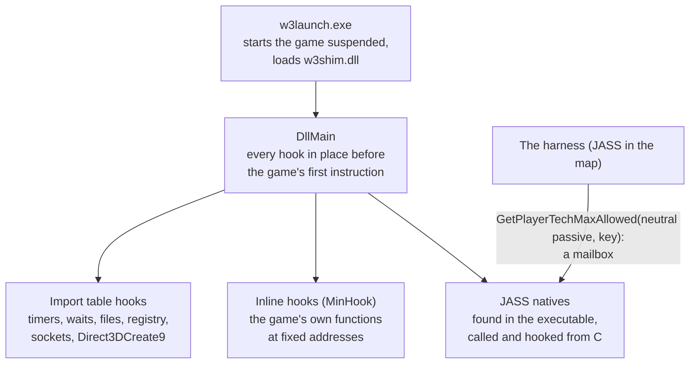
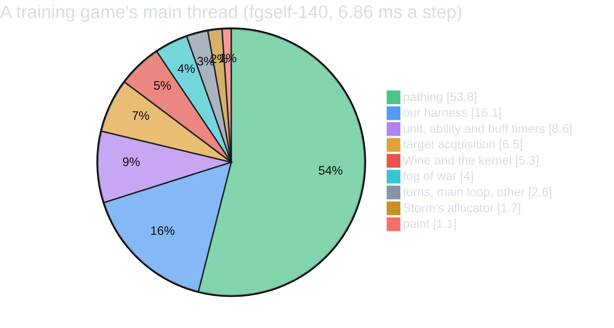
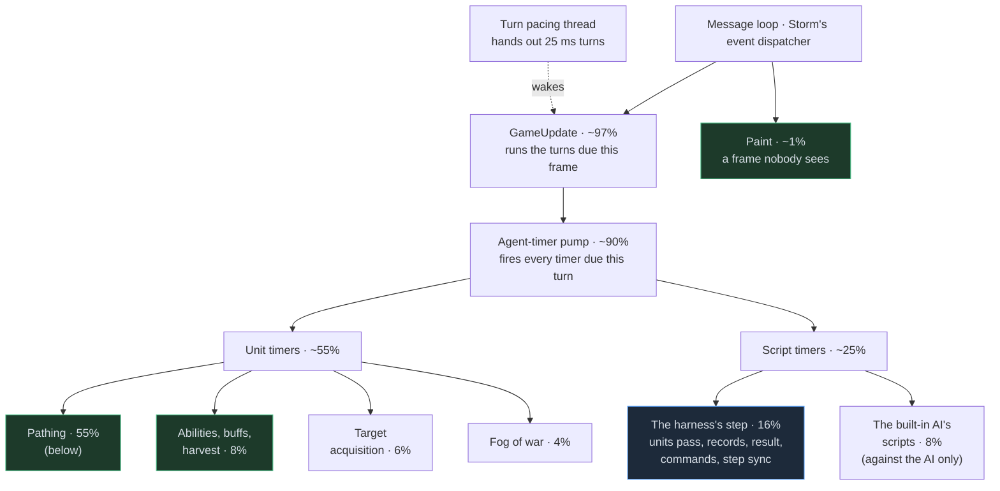
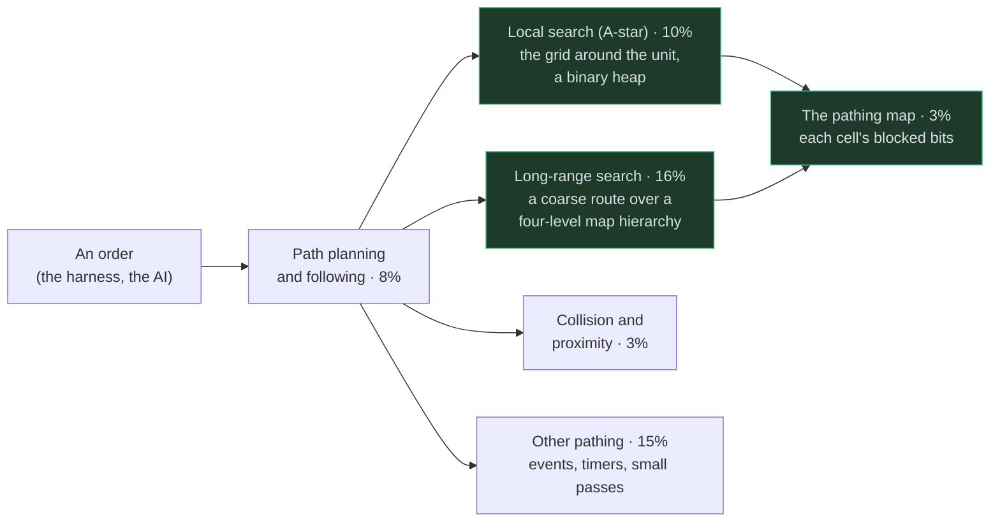

# Speeding up the game itself

warcraftsim trains on the real Warcraft III 1.29, so the game's own engine runs every step of every game. The games take about half the machine, so most of the speed had to come from the game. The rule is that the simulation must stay exactly the same, because the agent has to learn the real game. Everything below either removes work the game does for a human player (drawing, sound, waiting for the wall clock), or replaces one of the game's functions with code that gives the same answers faster. Replays prove it unchanged at every step.

The shim (`shim/`, a DLL in the game process) does it, with the harness (JASS in the map). Per-fix numbers are in the [optimization log](reference/optimization-log.md); [optimizations](optimizations.md) has the whole pipeline.

## Whose time it was

A game step's CPU went to four kinds of work, and each needed a different kind of fix:

| whose work | what was slow | the fix | where it is |
|---|---|---|---|
| **Ours: the harness and the step sync** | the observation written through files and the orders compiled as JASS each step; the pass over the units in JASS; the players' records and the result in JASS; game functions the harness called for every unit or the whole map each step; the socket through Wine | our own code made faster, in C in the shim; where the cost was a game function we called too often, that function made faster | [a step without files](#a-step-without-files), [our harness](#our-harness) |
| **The game's presentation** | drawing (in software under Wine), textures, the wall clock, background threads polling | the shim stops or skips it: nobody watches | [time](#time-a-virtual-clock), [drawing nothing](#drawing-nothing) |
| **The game's simulation** | pathfinding, the type and version checks, the integer square roots | the game's own functions patched: rewritten with the same results | [the game's own code](#the-games-own-code) |
| **Wine** | wineserver round trips for events, files and sockets | another Wine build, settings, and fewer calls | [Wine](#wine) |

Our own share was larger than it looked. In round 1 of the patches about a quarter of the gain was the harness's, half the game's simulation and the rest its drawing; in round 2 nearly all of it was the harness's (its JASS, its socket, and two game functions it called for every unit and over the whole map each step), and only one patch, a square root in pathfinding, was the game's simulation.

## Getting in

* **A launcher** (`w3launch.exe`) starts `Warcraft III.exe` suspended under Wine, loads the shim into it and lets it run. The hooks are installed in `DllMain` with plain memory writes, so the game's first instruction already runs hooked.
* **Import table hooks** (`shim/iat.c`) redirect the game's calls to Windows: the clock, waits, file opens, the registry, sockets, and `Direct3DCreate9`, from which the Direct3D device's methods are hooked in turn.
* **Inline hooks** (MinHook) replace the game's own functions. Their addresses are fixed: the shim supports exactly one build (1.29.2.9231, checked by its SHA-256).
* **JASS natives from C.** The executable registers every native with the same instruction pattern (`push signature; push name; push function; call`). Scanning for it gives each native's address, ~1,400 of them. They are plain cdecl functions: handles and integers by value, a real returned as its bits in `eax`. So the shim can call `GetUnitX` or `IsUnitType` directly, as the harness would.
* **A mailbox.** The harness talks to the shim through a native it otherwise has no use for: `GetPlayerTechMaxAllowed` on the neutral passive player, with negative keys as messages. The shim hooks it, so a JASS call becomes a function call into C, with an integer each way.

## A step without files

*Ours: the harness's input and output.*

The harness started with the tools JASS has for files: it wrote the observation with `Preload` and read the orders with `Preloader`. Under Wine each file operation is a round trip to wineserver, and `Preloader` *compiles* the file it reads as JASS.

| | before | now |
|---|---|---|
| observations | `Preload(token)` per token, each checking the disk for a file of that name, then `PreloadGenEnd` writing a script file for Python to read | the shim hooks both (`shim/obs.c`): the tokens are collected in memory and sent with the step sync |
| orders | a file of JASS, compiled by `Preloader` every step: ~7 ms under Wine, and ~20 KB of the compiler's memory never freed ("Not enough memory" after ~20,000 steps, so games had to be restarted) | the mailbox: the harness asks the shim for each command integer |
| the units | three passes in JASS, ~35 native calls and a few hundred JASS instructions per unit: 9-13 ms a step with 150 units and 32 games running | the shim's pass in C (`shim/units.c`), calling the same natives itself: ~4 ms |
| the step sync | | the mailbox native freezes the clock, sends the observation over a socket to Python and blocks until the orders come back |

## Our harness

*Ours: the harness's work each step.*

Some of the slowest work in a step was ours: the harness asked the game for more than it needed, in the slowest way the game offers (JASS), every half second. These fixes change our code, or a game function only because our harness called it far more often than the game does. Each is a bit of `--game-cuts` (`W3SIM_CUTS`), checked by replays like the patches below.

| bit | what was slow | the fix | gain |
|---|---|---|---|
| 16 | the harness's pass over the units ran a JASS thread per unit (`ForGroup`) | the group's units go straight to the shim's pass in C | -2.05 M instructions a step |
| 32 | the shim's pass called each pure getter twice per unit | once | -0.21 M |
| 32768 | each native the pass calls converted the unit's handle to its object again, ~30 times a unit | once per unit | -1.3% of the main thread |
| 8192 | `UnitIsSleeping`, which the harness asks of every unit every step, walks the unit's whole ability list through virtual calls and type checks (a game function; the game itself asks it rarely) | the same walk in C with the list's lookups inlined, and the type check remembered per game | -2.5% |
| 16384 | `EnumItemsInRect` over the whole map (the harness's items on the ground) walked ~4,000 grid cells and ~5,000 entries a step, stalling on a cache miss at each (a game function, called by us over the whole map) | the same walk in C, prefetching each cell's entries | -2.7% |
| 262144 | the players' records and the check of who won, in JASS: a call, an `I2S` and a `Preload` per token, and loops over 24 × 24 players | written by the shim with the same natives; a check mode runs both and compares them every step | -6.4% |
| 65536 | two socket sends per observation; the game asks Wine for its thread's priority around its timing code | one send; the priority remembered | wineserver requests 15.7 → 7.9 an observation |
| 131072 | the step sync's socket went through Winsock: a few wineserver round trips per call | **Linux system calls from inside the Windows program**: under GE-Proton's Wine the game is a 32-bit Linux process, so the shim opens and uses the TCP connection with `int 0x80` and Wine never sees it (Winsock stays the fallback) | -4.4 to -6% |
| 1073741824 | every token the harness still wrote in JASS (the step's and time's records, events, the commands' results): an `I2S` string (the string table's lookup, insert and release: 1-2% of the main thread on its own) and a `Preload` | the harness hands the shim the integer through the mailbox, on a player of its own, and the shim writes the token; the "V", "K" and "T" records made by the shim with the same natives | -0.6 to -5% |
| 2147483648 | the agents' commands: each integer read through a JASS function and two natives, each command applied by `W3S_ApplyOne`, a trigger evaluation per 50 | applied by the shim: `W3S_ApplyOne`'s natives that act or decide, in its order (point, target and immediate orders, hero skills, orders on trees, taxes, resources); any other command, a pending purchase or an advised player: the harness, as before | ~0-2% with the 1-3 commands a step of training games; -13% with 50 |
| 8589934592 | the items on the ground: `EnumItemsInRect` ran `W3S_SerItem` in a JASS thread for each item | the shim's `W3S_SerItem`, the same natives in the same order (the walk itself stays: it stamps every widget it passes, state the game keeps) | -0.6% against the AI (whose creeping drops items), 0 without items |
| 17179869184 | `ForGroup`'s callback pushed each unit's handle on the JASS state's enum stack and popped it after: the handle found by a hash lookup in the handle map, ~1% of the main thread in cache misses | the unit's handle remembered, and used while the handle table's entry still holds the unit (then it is the handle the map gives); the push and pop, which leave nothing behind for a live handle, skipped (a unit the pass drops still gets its push first) | -0.7 to -1.1% |
| 34359738368 | each unit's ~25 natives each turned the handle back into the object, checked the unit's agent and ran a wrapper; `GetUnitX` and `GetUnitY` each computed the whole position | the natives' reads and engine calls made directly on the object the callback has, in the same order; x and y from one call | -1.3 to -3.0% |
| 68719476736 | a hero's experience, skill points and six items read twice a record (for its hash, then for its tokens) | once | ~-0.1% in games with heroes |
| 274877906944 | `GetOwningPlayer` looked the owner's handle up in the handle map for every unit | the handle remembered per player and checked against the handle table, as for 17179869184 | ~-0.2% |
| 549755813888 | `IsUnitVisible` computed the unit's fog cell and asked the game's options once per seer | once per unit | -0.3 to -0.5% with two seers (games between agents), 0 with one |
| 137438953472 | the pass waited on memory: each unit's object, the agents of its life, mana, position, order and abilities, its handle's entry | `ForGroup`'s snapshot of the group says which units come next: their memory prefetched one to four units ahead, a stage a unit (hints only) | -1.8 to -3.3% |

Together with the step without files above, the harness went from most of a step (in JASS: ~7 ms for the orders, 9-13 ms for the units with 150 of them) to ~10% of the main thread. The bits 1073741824 to 8589934592 need the harness from 2026-10-24 (round 4; it asks the shim at a game's first step, and with an older shim or the bits off it does the work itself, as before): the maps of runs started before it never ask. Round 5's six bits (2026-10-25) are the shim's alone: every harness that has the shim make the units pass gets them, older runs' replays included.

## Time: a virtual clock

*The game's presentation: time as a player feels it.*

The game runs on the wall clock: half a second of game time takes half a second. The shim gives it a clock of its own (`shim/clock.c`): virtual time = real time × speed, frozen while Python decides.

* **Speed.** The clock runs ~2.5× faster than the game can keep up with, adapting as the machine's load changes. Far faster made things worse: the game's background threads wake more often and load wineserver.
* **Cheap to read.** The game reads its clock thousands of times a turn. Under Wine `QueryPerformanceCounter` can be a system call, so the virtual clock is built on the CPU's time-stamp counter, published through a seqlock that no reader ever blocks on.
* **Frozen at every step.** While Python decides, virtual time stands still, and the game sees no gap.
* **Waits that don't spin.** A thread that waits 100 ms in game time waits 100 ms ÷ speed in real time, and at high speeds that rounded to zero: polling threads spun at 5,000-11,000 wakeups a second, each a call into wineserver. A floor of 1-5 ms on those waits gave +60% games a second.
* **Threads asleep while frozen** (2026-10-03). A frozen clock can't reach a timeout, so a background thread's timed wait now blocks until the clock runs again, then times out as it would have. Together with Wine's gamepad, USB and Bluetooth drivers left out (the HID driver's event loop woke every millisecond in every game): 22% less CPU a step.

## Drawing nothing

*The game's presentation: what a player sees.*

Nobody watches a training game. Under Wine, Direct3D 9 becomes OpenGL, and Mesa draws it in software on the CPU.

* **The device draws nothing** (`shim/render.c`): `Present`, `Clear` and the `Draw*Primitive` calls return at once. The game still builds every frame, so its animations and geometry run as before. Drawing had been 18% of a game's main thread; 22.6 → 18.7 ms of CPU a step. Mesa's own no-op driver left the game without a first frame.
* **Textures without pixels** (`--game-cuts` 8): the texture decoder allocates the same mip levels but skips the JPEG decode of each.
* **Paint now and then** (`--game-cuts` 256): the frame's paint handler runs every 50 steps instead of ~8 times a wall second. Skipping it entirely was not safe: paint rebuilds a list of units that the fog pass walks every turn, and without it the list kept growing (the fog's share rose to 17% by step 700).
* **No fog display** (`--game-cuts` 1099511627776, 2026-10-26): every fog pass ended by marking, in the fog's map, what the local player has seen, then scanning every terrain vertex to re-tile the black mask where it changed (with the C runtime's `rand()` for the tiles' variation, not the game's synchronized random numbers). That is one client's view: a multiplayer game cannot let the simulation read it, and a replay played back by an observer has a different one with the same simulation. Both calls now return at once: 2-3% of the main thread.
* **A 320×240 virtual screen**, the game drawing in its own thread (Wine's command stream thread off), and llvmpipe rasterizing in the calling thread, with no threads of its own.

Videos are rendered from the games' replays in a process of their own, which draws.

## The game's own code

*The game's simulation: its functions patched.*

The game is a 2002-era C++ program built for a single-core PC with an x87 FPU, and some of its hot functions show it. These patches change the game's simulation code, keeping every result the same. Four rounds (2026-10-11/12, and three on 2026-10-24), each by a subagent:

1. **Profile.** A raw stack sampler in the shim (`W3SIM_PROFILE=5`) and `perf stat -t` per thread show where the main thread's time goes: pathing ~35-55%, unit and ability timers ~15-20%, our harness ~15-25%, attack and fog the rest.
2. **Read the code.** Ghidra, driven through [REA](https://github.com/morluto/rea) (an MCP server for Ghidra), decompiles the hot functions.
3. **Replace.** A function in `shim/cuts.c` that gives the same results, hooked over the original (MinHook at its fixed address), behind a bit of `W3SIM_CUTS` (`--game-cuts`).
4. **Prove it.** `scripts/cut_ab.py` plays a recorded game back with and without the bit, side by side. At every step it compares every unit, player, event, the built-in AI's orders, each command's result, the items on the ground, and in round 2 the observation's raw bytes. One differing step and the bit doesn't ship.

| bit | the game did | now | gain |
|---|---|---|---|
| 64 | A* asked, for every node, whether each cell in a ring around it is blocked: 90% of the questions were repeats within one search | each cell's answer remembered for the length of one search (nothing in a search changes it), with its side effects replayed | -1.72 M instructions a step |
| 1024 | A* computed a neighbour's heuristic before an early return that usually discarded it | after it, with the same stores in the same order | -0.87 M |
| 4096 | the long-range path search took an integer square root by Newton's method, two divisions a round, twice for every node it relaxed | `floor(sqrt(double))`: the executable's own routine, run natively over all 2³² inputs, matches it for every one, and the shim re-checks it in the process before hooking | -1.4% of the main thread |
| 1 | `GetPlayerId` and `Player()` copied the map's 14 KB info block onto the stack to read one field (a 24-player compatibility check), 20,000-40,000 times a second (the harness and the AI's scripts call them constantly) | the answer memoised | -1.32 M |
| 128 | soft-float helpers: count leading zeros as a loop, an integer square root as 16 rounds of digit-by-digit | `lzcnt`, and `floor(sqrt(double))`, checked equal over all 2³² inputs | -0.82 M (the AI's code) |
| 67108864 to 536870912 | the soft float's multiply, float-to-int, floor and int-to-float: integer code, ~40 instructions a call | SSE instructions where each is provably the IEEE operation (the multiply is IEEE's round toward zero for normal operands and results; the others on ranges like \|x\| < 2³¹), the original elsewhere; the executable's own routines run natively over all 2³² inputs (2³² random and boundary pairs for the multiply) | -4.7% instructions; the CPU within noise: the calls wait on operands their callers have just stored |
| 4294967296 | the name hash behind every JASS identifier the interpreter resolves (it looks variables up by name at run time), and file names: the name upper-cased into a 1 KB buffer, then hashed | the same hash in one pass, upper-cased by a table | -1.9% instructions, -2.4% cycles (-3% in games against the AI, whose scripts are JASS) |
| 2199023255552 | the widget grid's walk (16384's C) prefetched a cell's widgets and read them at once; most cells hold one to three, so half its time waited on the first widget's load (over the whole map for the harness's items every step, and for target acquisition) | the entries gathered across cells 32 ahead of the one processed, prefetched as they are gathered; the same stores in the same order | -2.6% cycles |

Tried and dropped: pooling the events of the game's loopback messages (4: nothing), a cache for the type check `IsA` (2048: little, and delicate), Storm's allocator hashing its caller's source file name on every allocation (512: nothing measurable), paint every 200 steps (no change).

### What the rounds gave

| | `--game-cuts` | the main thread a step | checked on |
|---|---|---|---|
| round 1 (2026-10-12): bits 1, 8, 16, 32, 64, 128, 256, 1024 | 1529 | 28.4 → 19.3 M instructions (-32%); CPU -16 to -28% | 24 replays |
| round 2 (2026-10-24): bits 4096 to 262144 | 521721 | -18.4% against round 1 (-20.7% with wineserver; -31% in games between agents) | 54 replays (60,772 steps), and 8 new recordings in the check mode for 262144, which changes the harness |
| round 3 (2026-10-24): bits 524288 to 33554432 | 67106297 | -4.6% instructions, -6.6% CPU against round 2 | 45 replays (48,766 steps) |
| round 4 (2026-10-24): bits 67108864 to 8589934592 (`W3SIM_CUTS` read as 64 bits) | 17179866617 | against round 3: on games of the new harness -8 to -9% instructions and -3 to -6% CPU (-15% with 50 commands a step); on older runs' replays, whose harness never asks for the harness bits, -6.3% and -1.5% | 63 replays (63,792 steps); 17 recordings of the new harness (pairs and recorded AI orders among them), 6 also played back with round 3's shim (its JASS paths: identical) |
| round 5 (2026-10-25): bits 17179869184 to 549755813888 (the units pass) | 1099511625209 | against round 4: -2.2% instructions, -5.2% CPU (the units pass 7.5-12.9% → 3.5-5.4% of the main thread) | 67 replays (83,550 steps): 10 recordings of the current harness, round 4's 17, 40 training replays; a check mode comparing every unit's fields both ways |
| round 6 (2026-10-26): bits 1099511627776 (the fog display) and 2199023255552 (the grid walk) | 4398046508537 | against round 5: -4.1% instructions, -4.2% cycles, -4.1% CPU (fgself-153's games: -4.6%) | 29 games (37,275 measured steps): 16 training replays of fgself-150 to -153, round 5's 10 recordings, 3 recordings made with both bits on |

## Wine

*Wine.*

Each game runs in a Wine prefix of its own. Wine was a third of a game's CPU at first.

* **GE-Proton's Wine with fsync**: Wine's events, mutexes and waits on Linux futexes instead of a round trip to wineserver each, 28% less CPU a step. (Wine's newer ntsync gave nothing more.)
* **"Allow Local Files" off**: the game looked for every file in its own folder before its archives, and under Wine each miss scanned the directory. A map reload went from 13.2 to 9.9 s under load.
* **No audio devices, gamepad drivers, Mono, Gecko or menu entries**, and **no system D-Bus**: each prefix's device manager had asked the disk service for every disk ~0.4 times a second, and with 57 games that service took 1.5 cores.
* **Native Linux instead of WSL** on the same machine: a step 9.2 → 7.4 ms of CPU.

## What did not work

* A clock far faster than the game keeps up with: more wakeups, more wineserver.
* Bypassing the engine's turn pacing (`turbo`): no gain at 0.25 s steps.
* Capping the background threads' waits: one of them paces the game's turns, and capped it made games 4× slower; the other three saved ~3%.
* `-graphicsapi Null` crashes 1.29; a window under 800×600 hangs it.
* A reset by script instead of a map reload: fast, but the engine kept counting the removed heroes, so games without heroes followed. Reloading the map in the running game (`RestartGame`, ~1 s) and five pairs of players per load did the job.
* The soft float's add and subtract as SSE: not IEEE (the smaller operand aligned by an arithmetic shift, the sum truncated, an exponent gap of 23 or more returning the larger operand unchanged), so no instruction gives their results. The reciprocal, division, square root and table functions are approximations of their own.
* Prefetching the long-range search's next cells (the node it will pop next, read from its open list): no change in cycles. Remembering the name hash by the name's address (checked against the name's bytes): fewer instructions, more cycles (its table's misses).
* A cheaper walk for the items on the ground: the walk stamps every widget it passes (~5,000 a step) and counts its cells, state the game keeps; a list of the items would leave the stamps behind (harmless only until the 32-bit counter wraps), so the walk stays.

## Where the time goes now

A game's main thread with the patches of rounds 1-4 on (`--game-cuts 17179866617`), by part, from `perf` call chains of replayed games: each sample in exactly one part, so each column sums to 100%. A typical training game between agents on `echofast`:

| part | a short game against the AI | a training game between agents | a 40-minute game between agents | a training-like game, the new harness |
|---|---|---|---|---|
| **pathing** | **38.3%** | **53.8%** | **59.3%** | **50.7%** |
| – local A* search | 4.7% | 9.9% | 12.9% | 5.3% |
| – long-range search | 5.3% | 17.0% | 10.9% | 6.0% |
| – path planning and following | 5.7% | 6.6% | 11.0% | 11.3% |
| – collision and proximity | 2.7% | 3.2% | 5.0% | 5.6% |
| – pathing-map updates | 3.3% | 2.5% | 2.4% | 4.0% |
| – other pathing (relations timer, events, small passes) | 16.7% | 14.6% | 17.1% | 18.4% |
| **our harness** | **19.9%** | **16.1%** | **20.0%** | **18.5%** (20.4% at round 3) |
| – the units pass | 7.2% | 6.9% | 7.9% | 10.8% |
| – the rest of the step (records, the result, commands) | 9.9% | 6.5% | 10.2% | 4.7% (6.8%) |
| – items on the ground, event triggers, the step sync | 3.2% | 3.0% | 2.0% | 3.3% |
| unit, ability and buff timers | 9.7% | 8.6% | 7.3% | 8.9% |
| target acquisition | 6.1% | 6.5% | 1.9% | 3.6% |
| the built-in AI (scripts and C++) | 8.6% | – | – | – |
| fog of war | 4.2% | 4.0% | 3.8% | 6.6% |
| Wine and the kernel | 5.5% | 5.3% | 3.8% | 5.1% |
| Storm's allocator | 2.9% | 1.7% | 1.1% | 1.2% |
| paint | 1.4% | 1.1% | 0.7% | 1.2% |
| turns, main loop, other | 2.8% | 2.6% | 1.9% | 3.8% |
| **ms a step** (round 3 → 4) | **6.74 → 6.55** | **7.09 → 6.86** | **16.27 → 15.55** | **6.75 → 6.51** |

The first three columns are replays of training runs (fgself-139 and -140): their maps carry the harness of their run, which never asks for round 4's harness bits, so there only the soft float and the name hash act. The fourth is a live recording with the new harness (scripted agents giving the ops in about training's proportions, ~1.4 commands a step), where the rest of the step fell from 6.8% to 4.7%. The machine was busier than for round 3's table (the 40-minute game took 13.55 ms a step then).

* **Pathing is most of a game**, and more of it the longer the game: more units walk farther. Its cost is spread over ~20 small functions and the game's soft-float arithmetic (9-13% of the main thread on its own, counted inside its callers), and much of it waits on memory. The long-range search's time is ~40% one cache miss per node it expands (its four-level cell lookup's first load), ~25% its relaxation (already in C), ~10% its open list; a C rewrite of the rest with the same heap order and writes would remove a part of the remaining ~20%.
* **Our harness is the second largest part**: every unit's record each step (the units pass: ~30 natives a unit at round 4; since round 5 their work done on each unit's object, with its memory prefetched: see below), the players' records and the result, the commands. With the new harness the rest of the step is ~90 JASS statements (~0.8 µs each: the interpreter looks every variable up by name), the items' grid walk and the commands' orders themselves.
* **Wine and the kernel are 4-5%** of the main thread (plus wineserver's ~1% of the games' CPU): a game without Wine would save about that, not more. The game's own code already runs natively on the CPU; Wine only answers its calls to Windows.
* **Soft float** stays 8-12% of the main thread as leaf time with the multiply, conversions and floor as SSE: those calls cost what their operands' memory round trips cost, and the add and subtract (the largest share) round in a way IEEE does not, so they stay the game's.

How it was measured: each replay played back twice side by side (`scripts/cut_ab.py`, 67106297 and 17179866617), `perf record -e cycles --call-graph fp` on each game's main thread (~10,000 samples for a short game, ~180,000 for the 40-minute one), each sample put in one part by its call chain (the first matching rule).

### After round 5

Round 5 (2026-10-25, `--game-cuts 1099511625209`) halved the units pass: the same rules on three other games, each played back with round 4's cuts and with round 5's (the pass's cycles a step in brackets):

| part | a game between agents (fgself-147) | an agent against the AI (fgself-147) | 40 minutes of scripted agents (~230 units) |
|---|---|---|---|
| the units pass | 9.6% → 4.3% (2.05 → 0.83 M) | 7.5% → 3.5% (1.90 → 0.85 M) | 12.9% → 5.4% (2.25 → 0.85 M) |
| our harness | 20.1% → 15.2% | 14.3% → 10.6% | 34.6% → 28.7% |
| pathing | 42.8% → 44.9% | 40.2% → 43.0% | 28.1% → 30.8% |
| unit, ability and buff timers | 12.0% → 12.9% | 11.9% → 12.3% | 12.2% → 13.3% |

What is left of the pass (~4% of the main thread): `UnitIsSleeping`'s ability walk for creeps (their sleep ability heads their list, so the cache of units without one cannot help them), the prefetching's own loads, the fog query, and the soft-float arithmetic of life, mana and the position.

### After round 6

Round 6 (2026-10-26, `--game-cuts 4398046508537`) started from a profile of the live run's own games (fgself-153, every agent slot at a person's income) at round 5's cuts: pathing 44-47% of the main thread, the unit, ability and buff timers ~12%, our harness 12-18% (of it the agents' orders themselves ~3.5%, the units pass 4-5.4%, the items' whole-map walk 2.4-3.3%), target acquisition 5-7%, fog 5.2-6.6%, the built-in AI 8.9% against it, Wine and the kernel 4-5%. Two things in it were not needed or waited for no reason: the local player's fog display (2-3%: see [drawing nothing](#drawing-nothing)) and the grid walk's prefetching without lead (bit 2199023255552 above). The same game between agents, each part's share before and after (separate playbacks):

| part | a game between agents (fgself-153) | 40 minutes of agents (fgself-153) |
|---|---|---|
| fog of war | 5.8% → 3.3% | 6.6% → 3.9% |
| the items' walk (`EnumItemsInRect`) | 2.7% → 1.5% | 3.3% → 1.4% |
| target acquisition | 6.6% → 7.0% | 6.7% → 6.9% |
| pathing | 46.8% → 49.4% | 43.8% → 45.6% |

Side by side on 29 games: -4.2% cycles a step, -4.6% on fgself-153's. What is left is spread thin: the agent table's lookup (3-4% as a leaf, called from everywhere), the long-range search's cell lookup, the proximity events of moving units (handled by the abilities' and orders' own code), the soft float (9-10%, inside its callers).

## The game's code, as we understand it

From Ghidra (through REA), the shim's own profiler and `perf`. Shares are of the main thread in a training game; boxes in green are where the shim replaced or skipped the game's code, in blue our harness.

Pathing, which every unit's order ends up in:

Under all of these, shared services: soft-float arithmetic (10-15% of the main thread, inside its callers), the object system (handles, type checks: 5-6%), the script interpreter (3-6%), Storm's allocator and string hash (2-5%).

* **Message loop and GameUpdate.** The game is a Windows message loop: every frame, GameUpdate runs the 25 ms game turns that are due. A second thread hands out the turns; the shim's virtual clock decides how fast they come, and freezes them at each step.
* **The agent-timer pump.** Everything in the simulation is a timer on an agent (a unit, an ability, a buff, a script timer): each turn fires the ones that are due. Two handlers take nearly all the time: the units' (pathing, abilities, attacks) and the scripts'.
* **Pathing tick.** Each unit's pathing agent plans and follows its route. **The local search** (A-star) searches the grid around the unit with a binary heap (patched: each cell's check remembered within a search, the loop and the heap in C). **The long-range search** finds a coarse route across a four-level map hierarchy, with integer square roots for its costs (patched: the relaxation in C, the square root as one instruction). **The pathing map** keeps each cell's blocked bits per movement class (its update in C). **Collision** keeps units apart.
* **Unit, ability and buff timers.** Abilities, buffs, harvesting, gold mines, creeps (patched: a unit's ability lookup in C).
* **Target acquisition and fog.** Units find targets in range; each turn, sight circles and line of sight make the fog.
* **Script timers.** The JASS interpreter runs the map's timers: our harness's step every half second, and in games against it the built-in AI's scripts. Both issue orders, which the pathing tick then plans.
* **The harness's step** (ours). The units pass (in C in the shim, its per-unit flags kept there, the natives' work done on each unit's object and its memory prefetched ahead), the players' records and the result (in the shim), the commands, the items on the ground, and the step sync with Python (over a Unix socket with Linux system calls).
* **Shared services.** Soft-float arithmetic keeps the simulation deterministic across machines (patched: count leading zeros and square roots as single instructions; the multiply, the conversions and floor as SSE where they are exactly IEEE). The object system turns ids and handles into objects and checks types (patched: a memoised map-version check behind `GetPlayerId`, handle conversions once per unit). Storm is the game's allocator and string hashing (patched: the name hash in one pass).
* **Paint.** With drawing off, it still builds a frame now and then (every 50 steps), with textures that have no pixels; the Direct3D device draws nothing.

The addresses of every function above, and which `--game-cuts` bit acts on each, are in `shim/cuts.c`, `shim/pathing.c` and the [optimization log](reference/optimization-log.md).

## How a step got cheaper

| | CPU per game step |
|---|---|
| a `duelrush` step, 32 games, before the shim's pass, drawing and fsync | 35-40 ms (the whole process) |
| drawing nothing, threads asleep, fsync (2026-10-03, WSL; `duelfast`, game and wineserver) | ~9 ms |
| native Linux (2026-10-11) | ~7.4 ms (the game) |
| round 1 of the rewrites (2026-10-12) | the main thread 5.92 → 4.24 ms on a self-play replay |
| round 2 (2026-10-24) | the main thread 7.72 → 6.29 ms on Echo Isles' longer games |
| round 3 (2026-10-24: pathing in C where it is exact, the units pass's flags in the shim, the step sync over a Unix socket) | the main thread -6.6% (7.20 → 7.05 ms on a training game, 14.53 → 13.55 ms on a 40-minute one) |
| round 4 (2026-10-24: the harness's tokens, commands and items in the shim, the name hash, soft float where exact) | the main thread -3 to -6% on games with the new harness (6.75 → 6.51 ms), -15% with many commands a step; -1.5 to -4% on older runs' replays |
| round 5 (2026-10-25: the units pass's natives done on each unit's object, handles remembered, its memory prefetched) | the main thread -5.2% (5.66 → 5.36 ms over 67 replays), the units pass halved |
| round 6 (2026-10-26: no fog display, the grid walk prefetched ahead) | the main thread -4.1% (6.04 → 5.79 ms over 29 games; fgself-153's 5.58 → 5.32 ms) |

The settings differ from row to row (maps, numbers of units, how loaded the machine was), so compare each row with its own "before".
