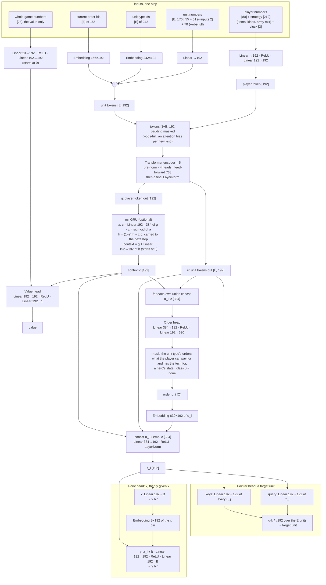
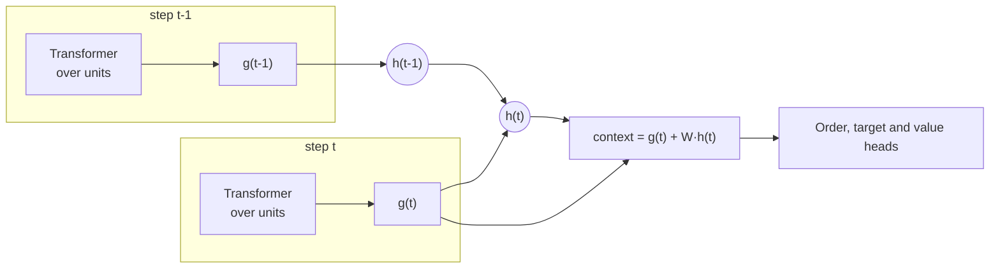
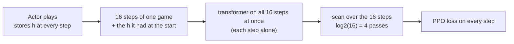

# The whole-game model

One network plays one side. It sees the game from its own player's view, as a set of tokens. Code: `fullgame/features.py` and `fullgame/model.py`.

## The full network

E is the number of entities in view (at most 160): units, and with `--obs-full` corpses, items on the ground and area spells. O is the number of own units (at most 96). Width d = 192. B is the number of point bins: 128 on the duel maps, 352 on Echo Isles.

* The tokens are a set. There is no position encoding: a unit's position is its x, y numbers.
* The order decides which target heads count: a unit (pointer), a point (x then y), or none.
* Each head samples with the Gumbel-max trick, at temperature 1 (a lower order temperature made the policy passive).
* The network had 3 layers until `fgself-51`. `scripts/grow_model.py` adds layers that start as the identity, so a grown network plays as before. `scripts/grow_bins.py` adds point bins for a larger map in the same way.
* **Fine points** (`--fine-points S`, odd, off by default). A bin is 48 world units near the bases and in y. In x between the bases on Echo Isles it is ~206 units, because the frame is squeezed there. With fine points, a third head picks one of S × S sub-cells of the chosen bin, given both bins: z_i + Embedding(x bin) + Embedding(y bin) → Linear 192→192 · ReLU · Linear 192→S². With S = 7 that gives 6.9 units near the bases and in y, and 29 units mid-map in x.
  * Encoding: a point's index per axis is bin × S + sub-cell, in the actions, the rollouts, the wire and the teacher's labels (`features.world_bins` / `bins_world`, `model.sample_points` / `point_parts`). The bins are the same as without the flag.
  * Start: `model.grow_fine` gives the policy the head with its last layer's weights zero. Its bias is a prior: the middle sub-cell, which is exactly the old bin centre, with probability `--fine-centre` (0.9) at the target temperature. The bins' logits are unchanged.
  * Old networks: a network without the head (the anchor, past snapshots, older checkpoints) plays the middle sub-cell. That is today's point bit for bit, with no extra random draw.
  * Losses: the PPO log-prob, the cloning and distillation losses (the sub-cell given the label's bins) and the `forward-all` and `forward-acting` anchor KL include the head. The KL includes it only when the anchor has a fine head of its own.
  * Costs: +0.5% per inference call, and +0.1 µs per point order to decode.
  * Design choice: the alternative was a fine grid relative to the acting unit (±512 at 16–32 units). It was not chosen because it needs a mode head, it gives two encodings of one point, and it does not help orders far from the unit (an expansion hall is ordered from the main).
* Dropout (0.1) is on for behaviour cloning only. The self-play updates run without it (`--rl-dropout 0`), as the actors play.
* **Precision.** The learner's updates run in bf16. Acting runs in bf16-mixed since 2026-11-06 (`--infer-precision bf16-mixed`): the trunk (the encoders, the transformer, the memory) in bf16, every head and the value in fp32 with TF32 multiplies. The heads' logits are large, and bf16 would round them coarsely. So the actors' log-probabilities stay as close to the learner's as with fp32 acting, at about half of fp32's GPU time ([the log](reference/optimization-log.md)).

## Token channels

A unit token is the sum of three parts:

* a linear layer on 176 numbers (the tables below),
* a learned vector for its unit type (242 types in `fgself-212`: every unit and building of the four races since `--full-vocab`, the creeps, the tavern's heroes, the mercenaries and the neutral buildings),
* a learned vector for its current order (156 orders).

| index | channel |
|---|---|
| 0, 1, 2 | side: own, enemy, neutral (as this player sees it) |
| 3, 4 | position x, y relative to the own start ÷ 3072 (x mirrored, so the own base is always on the left; on Echo Isles the stretch between the bases is shorter, so the enemy base is where the duel maps had it) |
| 5, 6 | hit points ÷ maximum, maximum ÷ 1000 |
| 7, 8 | mana ÷ maximum, maximum ÷ 1000 |
| 9 – 19 | flags: hero, building, worker, under construction, hidden, loaded, sleeping, paused, summoned, illusion, flying |
| 20 | hero level ÷ 10 |
| 21 | gold left in it (gold mines) ÷ 12,500 |
| 22 | unspent skill points ÷ 3 |
| 23, 24 | facing: sine, cosine (mirrored) |
| 25 | it has an order now |
| 26 | own building: units queued ÷ 5 |
| 27 | own building: it makes something now |
| 28 | own worker: sent to cut lumber |
| 29 | hit points' change since the last step ÷ maximum |
| 30 – 49 | position as sines and cosines at 5 frequencies |
| 50 – 54 | the last order the player gave it: the target's dx, dy ÷ 1536 (mirrored), at a point, on a unit, steps ago ÷ 40 |

`--features 29` kept channels 29 to 54 at zero until `fgself-196`. Since then they are on (`--features 55`).

With `--inputs 2` or `3` (`fgself-107`; the new channels start with zero weights, so a network plays as before):

| index | channel |
|---|---|
| 55 – 70 | a hero, per ability slot (4): level ÷ 3, it can be cast now (learned, cooled down, the mana), cooldown left ÷ 60 s, a skill point may go there now. An enemy hero: its levels only, as the game shows them |
| 71 – 100 | a hero, per inventory slot (6): it holds an item, a usable one, one that heals, restores mana, a town portal |
| 101 – 105 | own building: what it makes now (a worker, an army unit, a hero, research, its next tier) |
| 106, 107 | `--inputs 3` only: an enemy it remembers (out of sight now), seen how long ago ÷ 60 s: those come after the units in sight. Off: it hurt twice |

With `--obs-full 1` (`fgself-197`) 70 channels follow (106 – 175 with `--inputs 2`), and three new entity kinds come after the units: corpses (the 8 nearest the own units, with the dead unit's type), items on the ground (6 at most) and area spells in progress (4 at most). Items and areas have the unknown type: the code channels tell what they are.

| index | channel |
|---|---|
| 106 – 108 | the kind: a corpse, an item on the ground, an area spell |
| 109 – 122 | its state: 8 classifications (stunned, snared, poisoned, polymorphed, sleeping, ethereal, magic immune, plagued), positive and negative magic buffs ÷ 3, armor now ÷ 10, move speed now ÷ 400 and against its type's, whether its state is known |
| 123 – 146 | its buffs: a fixed random code of 24 numbers for each buff, summed (an area spell: its ability's code) |
| 147, 148 | its owner's weapon and armor upgrade levels ÷ 3 (an enemy's: from the research the player saw finish) |
| 149 – 170 | a hero's items: a code of 16 numbers for each item, summed (an item on the ground: its own code), and each slot's charges ÷ 5 |
| 171 – 173 | own building: the progress of what it makes, its seconds left ÷ 60. A building under construction in sight: its progress |
| 174, 175 | a corpse: seconds since its death ÷ 90. An area: seconds left ÷ 30, radius ÷ 1000. An item: a powerup |

The block's weights start at zero. Each new kind has an attention bias of -30 (`kind_bias`), so a network from before plays exactly as it did. `--obs-fade N` raises the learner's bias from -8 to 0 over its first N updates, only for a network that has not seen the new kinds yet. The anchor and older networks keep -30. No order targets a corpse, an item or an area, so the pointer never picks them.

What a person playing sees and the agent still lacks (the fog's memory, the terrain, non-hero cooldowns and autocast), ranked, with what the game exposes: [observation-coverage](reference/observation-coverage.md) (`scripts/observation_coverage.py`, probed by `scripts/obs_probe.py`).

The **player token** has 80 numbers of what the player knows, then the target strategy (212 numbers since `fgself-130`), then the time of day:

| index | channel |
|---|---|
| 0 – 5 | gold ÷ 1000, lumber ÷ 1000, supply used ÷ 100, supply cap ÷ 100, upkeep ÷ 2, step number ÷ 1800 (steps of half a second) |
| 6 – 9 | own race: human, orc, undead, night elf (one-hot) |
| 10 – 13 | enemy race, the same |
| 14 – 79 | the player's level of each of 66 upgrades |
| 80 – 207 | the target strategy (zeros: none): per item slot of the race (64), whether the target makes it and when ÷ 900 s |
| (+20) | with `--z-modes`: per conditioning kind (10), on, and its parameter |
| (+64) | with `--z-mix`: the target's army mix, each army unit's share |
| (+6) | with `--z-comp`: per army composition kind (cap, forbid, variety), on, and its parameter (C; 0 the spam unit, 1 the other basic unit; N / 5) |
| (+2K) | with `--z-shop K`: per item bought (the race's K race-shop items), whether the target buys it and its first purchase ÷ 900 s (zeros: a target that does not say, the built-in AI's) |
| (+3) | with `--inputs 2` or `3`: the time of day (sine, cosine) and whether it is night |

The **value head** also reads 23 numbers of the whole game that the player does not see: the enemy's gold, lumber and supply, and for both players their workers, army, buildings, heroes, hero levels, army hit points and where the army is. The policy never sees them. With `--value-tax 1` two more follow: the share of its income the opponent loses to the training game's tax, and the share it loses itself (negative: a bonus; zeros untaxed and in evaluation games). They enter through a projection of their own, zero at first, so a network from before plays and values as it did.

**How players differ:** only by the side channels. The view is always from "my" side, so "own" means this player. The two races sit in the player token. Position is the x, y numbers, not a token index. The transformer treats the units as a set, so their order does not matter.

## Memory: a minGRU across steps

The transformer looks across units within one step. The minGRU looks across steps, on one vector: the player token's output `g`. It is an option (`--memory 1`), on in every self-play run since `fgself-11`.

* Gate and candidate come from `g(t)` only: `z = sigmoid(A·g)`, `c = B·g`.
* The new state is `h(t) = (1 − z)·h(t−1) + z·c`.
* The gate does not read `h`, so training computes 16 steps at once with a parallel scan. The actors start each sequence from the state they stored.
* `W` starts at zero, so a new core changes nothing at first. In `fgself-12` its size grew from 0 to 2.2.

### Training with memory

* The state still depends on the last state. The dependency is linear, so a scan computes 16 steps in 4 passes, not 16 one after the other.
* A GRU or LSTM puts `h(t−1)` inside its gates and its tanh. That is not linear, so it must step through time.
* Each sequence starts from the state the actor had, not from zero. The gradient does not flow into that start state.
* Acting needs one step at a time, as any RNN: the inference server keeps 192 numbers per game.

There are no tokens per time step and no time encoding. The order of the steps is the order of the recurrence. AlphaStar and OpenAI Five use the same split: a network over units at each step, then a recurrent core.

## Actions

* Every own unit gets its own order at every step (half a second).
* Masks allow only orders that the unit's type gave in the demonstrations, and that the player can pay for now. `--tech-mask`: and has the tech for (`features.TechMask`, from the game's tables). `--valid-mask`: a hero's orders it can carry out now (`FullGameNet.unit_valid`, from its hero channels: a cast needs the ability learned, cooled down and the mana; learning a skill needs a point; using an item needs one in the slot).
* The chosen order goes into the target heads, so a target depends on its order.
* The action's log-probability is the order's plus the target heads that the order uses.
* The orders are the game's own (move, attack, harvest, build, train, research, cast, learn a skill, use an item, buy at a neutral building: 630 classes with "none" in `fgself-212`) and, with `--macros`, four of the agent's own that the actor carries out with the game's orders: **expand** (a worker builds a hall at the natural, where people build it; undead haunt its mine, night elves' tree of life entangles it), **creep the natural** (attack-move to the camp guarding it), **train the target's mix** (a building trains the unit its target's army lacks most) and **pick up an item** (a hero near an item on the ground). `--macros 3` also spends a hero's skill points the policy leaves unspent for 10 s, in the built-in AI's order. `--spells 1` adds five hero spells the demonstrations never gave (War Stomp, Hex, Banish, Far Sight, Scout: `fullgame/spells.py`): a grown network's new rows in the order head are the "none" row's less 8 (each spell 1/2981 as likely as no order for its hero; every old logit unchanged), their embeddings the old hero spells' of the same target kind and side, only the hero with the ability allowed.
* **The full vocabulary** (`--full-vocab 1` in `fullgame/fullvocab.py`, since `fgself-196`): every order a 1.29 melee player can give, from the game's own tables. That is every unit, building and research, every unit ability with its autocast and morph orders, patrol, hold position, attack ground, rally points, and dropping, giving, selling and picking up items. Before it the vocabulary had the orders the demonstrations gave and a few added by hand (519 classes in `fgself-194`). A few orders are left out on purpose, each with its reason ([order coverage](reference/order-coverage.md)). A grown network's new rows are the "none" row's less 5 to 9 by category, so every old logit stays as it was and a new order is rare at first. A new unit type's embedding is the mean of similar old types'. Only the unit types that the tables give an order may use it, and the masks check its tech, mana and cooldown.
* The actor leaves out orders the game would refuse (it counts them: the episode rows' `refused`): a repair of what needs none, a power build without lumber, a harvest at a mine the race cannot mine, a tier while the hall trains (its queue cancelled first).
