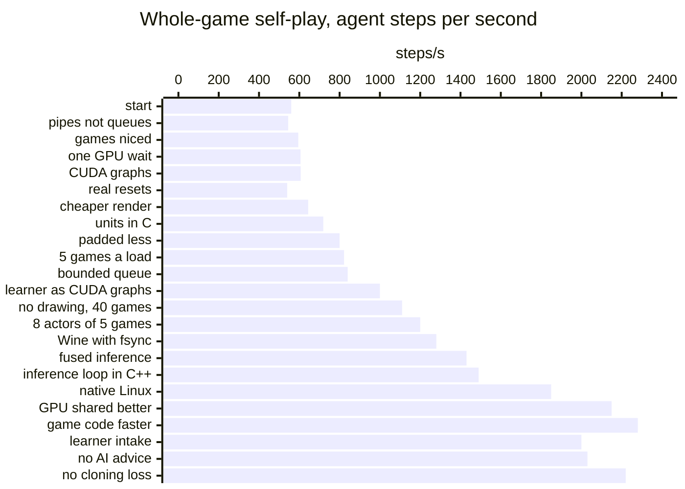
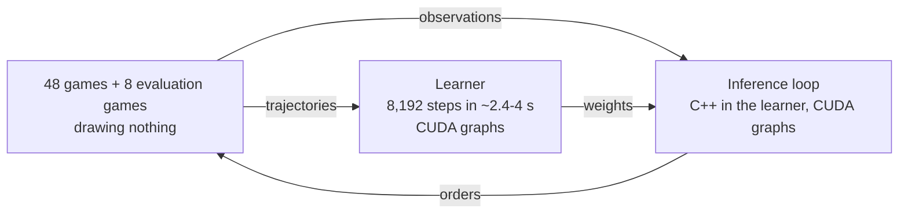

# Optimizations

The game's CPU sets the speed. The [optimization log](reference/optimization-log.md) has every fix with its numbers; [speeding up the game itself](game-speedups.md) tells how the game's own code was made faster.

Since 2026-10-24 the RTX 3090's BF16 rate is unlocked and its power limit is 400 W: matrix multiplies 1.4 to 1.8 times faster ([GPU unlock](reference/gpu-unlock.md)). More games need more CPU: [scaling up the CPUs](reference/scaling-cpus.md) has what to buy or rent, with UK prices and electricity.

## Self-play throughput

The starting point already ran the game as fast as the CPU allows (the shim's virtual clock came first, with the micro work). In real time a game gives 2 decisions a second per side: at 560 steps/s on 32 games, each game ran ~9× faster than real time. Now ~48 games each run ~15× faster: ~1,470 game steps a second, ~3,300 games and ~730 hours of game time an hour (`fgself-83`, 2026-10-18).

## Where the time goes

The bars from "learner intake" on are with 8 evaluation games running beside the 48 training games (the learner intake made it ~25% faster in the same setting). The real game on Echo Isles runs at ~1,600 steps/s (`fgself-75`: 1,614 on 2026-10-17): its games have more units.

* The CPU sets the speed (2026-10-24, `fgself-139` on `echofast`, 64 games, ~1,730 agent steps a second): the games take about half of the 32 threads, the 8 actors' Python ~0.8 of a core each, and the learner waits ~2.2 s for each batch of 8,192 steps while its update takes ~2.9 s. The CPU is ~3% idle.
* The GPU has room: the inference loop's rounds take ~9 ms, the learner's update is mostly small kernels, and the BF16 unlock made no difference to the steps a second ([GPU unlock](reference/gpu-unlock.md)). A game waits ~13 ms a step for its orders (a round to start and to finish), which is why more games than cores pay off.
* A game step costs ~7 ms of CPU on native Linux, less with the equivalent speedups of the game's own code.

## The largest fixes

1. Orders and observations travel with the step sync, not through files.
2. The shim reads the units in C, not the map script in JASS.
3. Five games per map load, each with new players.
4. One inference server with CUDA graphs and one GPU wait per round.
5. The learner's minibatch steps as CUDA graphs: one launch where eager PyTorch made ~2,000.
6. The games draw nothing: the Direct3D device's draw calls return at once (17% less CPU a step, the same simulation).
7. While a game waits for its orders its background threads sleep, and Wine's gamepad drivers are not loaded (~22% less CPU a step).
8. GE-Proton's Wine with fsync: Wine's synchronization on futexes, not wineserver round trips (28% less CPU a step).
9. 8 actor processes of 5 games (13% more steps/s: each actor's games had waited for its GIL). The inference server's view steps through shared memory and its calls on CUDA streams (rounds 12.5 → 7.4 ms).
10. The inference server's calls compiled into fused kernels inside their CUDA graphs (30% less GPU a round, ~1,430 steps/s).
11. The inference server's loop in C++ in the learner's process: one GPU context, no GIL (the learner's update 5.1 → 3.5 s, ~1,490 steps/s).
12. Native Linux instead of WSL on the same machine (2026-10-11): a game step 7.4 instead of 9.2 ms of CPU, the learner's update 4.2 → 3.0 s, ~1,850 steps/s with 48 games (1,387 in WSL's last hour). Wine's ntsync gave nothing over fsync.
13. The learner and the inference loop share the GPU better (2026-10-12): the loop's CUDA events made once, the learner's copies to the GPU through pinned memory (both had held the CUDA driver's lock), and the learner pausing a few ms after each minibatch: rounds during the update 39 → 6 ms, ~2,150 steps/s.
14. The game's own code faster with the same results (2026-10-12, `--game-cuts 1529`: the harness's units pass without a JASS thread per unit, A* cell checks remembered within a search, a memoised map-version check and more): -16 to -28% CPU a game step, the same simulation at every step on 24 replays, ~2,280 steps/s.
14b. The game's own code, round 2 (2026-10-24, branch `game-cuts-2`, `--game-cuts 521721`): UnitIsSleeping's ability walk and the grid walk behind EnumItemsInRect in C, a unit's handle converted once per unit, the long-range search's square root as sqrt, the step sync's socket through Linux system calls (no wineserver requests), the players' records and the result's check in the shim: -18% of a game's main thread a step (-21% with wineserver), the same simulation at every step on 54 replays and 8 new recordings.
15. The learner's intake (2026-10-12): plain arrays from the shared rows (a memmap subclass was slow to unpickle), 4 workers for the cloning batches: ~1,600 → ~2,000 steps/s with evaluation games.
16. No advice and no cloning loss from the built-in AI (2026-10-14, a recipe change that the policy no longer needed): no shadow AI in the games, no labels or cloning batches in the updates: ~1,900 → ~2,220 steps/s.
18. The actors' Python (2026-10-24): the tech mask's tables read once a process (they had been read from the game's archives at every game's start), the shared buffer's slices as plain arrays, the units' features in C (`native/w3feat.c`: View.step 1,002 → 556 µs a side-step, the same features), and 8 games an actor in the CPU this freed: ~1,494 → ~1,730 steps/s. Wine off the system D-Bus: each game prefix's device manager had asked the udisks service for every disk ~0.4 times a second, and the service took ~1.5 cores.
19. The afternoon of 2026-10-24: the learner's update compiled before its CUDA graphs are captured (`--update-fuse default`: 1.38 → 0.64 s alone, ~2.8 → ~1.5 s in the run, the GPU free for the inference loop sooner), rounds 2 and 3 of the game's own code (`--game-cuts 67106297`, [speeding up the game itself](game-speedups.md)), 4 games a launch, and the actors' per-step Python (5.88 → 3.87 M instructions a side-step: the target builder from its own rows, a binary search for `np.isin`, trajectory chunks pickled as a few arrays): ~1,786 steps/s (`fgself-140`, round 2) → **~2,170** (`fgself-141`), the actors' CPU a step 3.50 → 2.67 ms. The System tab shows where the CPU goes ([the bottleneck view](reference/optimization-log.md)).
17. Evaluation games on a second machine (2026-10-17, `fullgame/evalworker.py` and `scripts/remote_eval.py`: [a remote evaluation worker](architecture.md#a-remote-evaluation-worker)): a laptop (WSL2, 8 cores, RTX 3050 Ti) plays 16 at a time, ~790 games an hour (12 at a time: ~710), beside the run's own ~380-490. A verdict (~300 games a policy) takes ~30 minutes instead of 1.5-2 hours: `fgself-76` had 786 evaluation games in the matchups both policies played within 40 minutes, 496 of them the laptop's.

## What remains

* The games: pathing (~35-55% of the main thread after round 2), the other agent timers, attack and fog; the units pass's natives (~8%).
* The actors' Python (~0.8 of a core each, ~20% of the machine): the masks and the rest of the per-step view, the teacher and the target builder.
* More machines: training games on a second machine with the 3090 doing their inference ([scaling up the CPUs](reference/scaling-cpus.md)); then the learner's update (~2.9 s per 8,192 steps) becomes the limit.
* The video renderer: 3.4 cores while it renders.
* Other work on the machine: a headless Chrome from another project takes ~10 cores in bursts.
* Longer steps on long games: about 1.4× more game time per CPU, at the cost of half the decisions.
