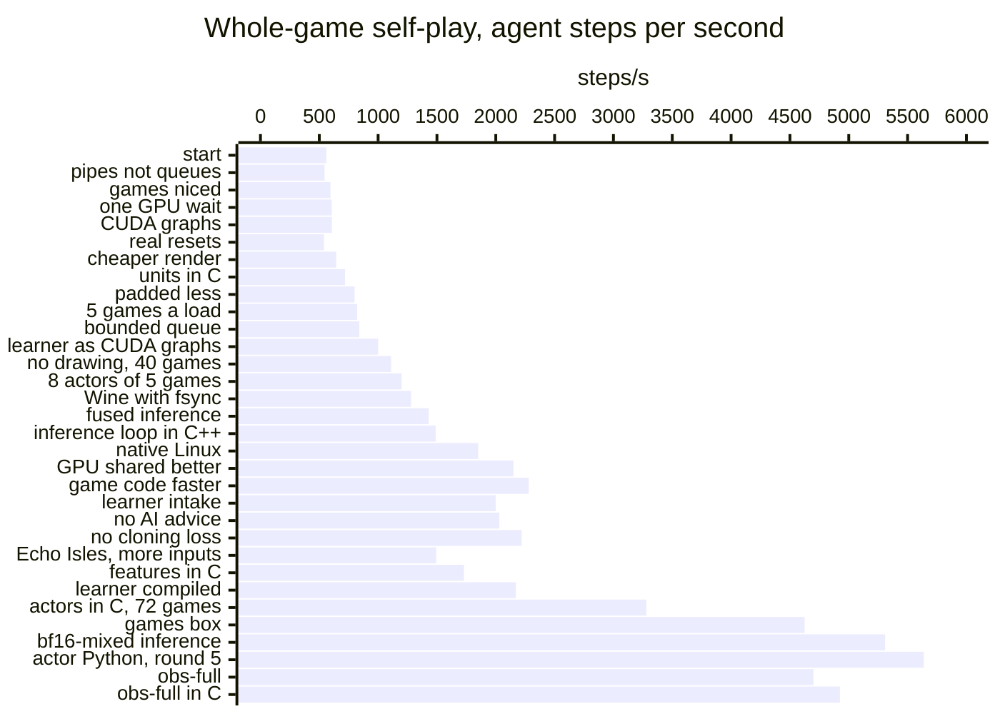
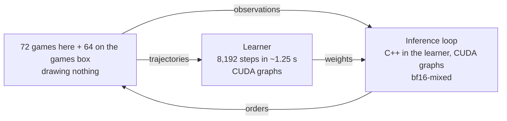

# Optimizations

The main machine's CPU sets the speed, and the GPU is nearly as busy. The [optimization log](reference/optimization-log.md) has every fix with its numbers; [speeding up the game itself](game-speedups.md) tells how the game's own code was made faster.

Since 2026-10-24 the RTX 3090's BF16 rate is unlocked and its power limit is 350 W (400 W until 2026-10-31): bf16 matrix multiplies are 1.4 to 1.8 times faster ([GPU unlock](reference/gpu-unlock.md)). The learner's updates run in bf16. The inference calls use it since 2026-11-06 (bf16-mixed). Before that date they ran in fp32. More games need more CPU: [scaling up the CPUs](reference/scaling-cpus.md) has what to buy or rent, with UK prices and electricity.

## Self-play throughput

The starting point already ran the game as fast as the CPU allows (the shim's virtual clock came first, with the micro work). In real time a game gives 2 decisions a second per side: at 560 steps/s on 32 games, each game ran ~9× faster than real time. Now 136 training games (72 here, 64 on the games box) each run ~16× faster: a step every ~30 ms, ~4,500 game steps a second (`fgself-212`, 2026-11-12).

## Where the time goes

Some bars change the setting, not the code. From "learner intake" on, evaluation games run too: 8 beside the training games, later on the laptop. From "Echo Isles, more inputs" on, the games play on Echo Isles, which has more units than the duel maps, and the recipe has more inputs and masks. From "games box" on, 56 to 64 more games play on a second machine. From "obs-full" on, the network sees what a player sees: ~4 more entities a step and wider rows cost ~20% (6,250 → 5,020 steps/s by the updates' medians).

The live run (2026-11-12, `fgself-212`, every game in the real game) makes ~5,000-5,300 agent steps a second:

* The main machine's CPU sets the speed. It is ~96% busy: the 72 games take ~16 of its 32 threads, the Python of the 12 actors and the 4 gateways ~8, and the learner ~1.5. The learner waits ~0.3 s for each batch of 8,192 steps.
* The games box gives ~2,300 of the steps a second from its 64 games. Its CPU is ~70% busy, and ~7 GB of its memory is free (with same-page merging).
* The GPU is ~84% busy at ~320 W. The learner's update takes ~1.25 s, and three quarters of the inference rounds (~10 ms each) run beside it. Past snapshots make ~670 of the ~870 inference calls a second, at ~1.2 rows each.
* A game step takes ~12 ms of wall time to simulate on the main machine and ~7 ms on the box. For the rest of its ~30 ms the game waits for its orders (a round to start and a round to finish), so more games than cores give more steps.

## The largest fixes

1. Orders and observations travel with the step sync, not through files.
2. The shim reads the units in C, not the map script in JASS.
3. Five games per map load, each with new players.
4. One inference server with CUDA graphs and one GPU wait per round.
5. The learner's minibatch steps as CUDA graphs: one launch where eager PyTorch made ~2,000.
6. The games draw nothing: the Direct3D device's draw calls return at once (17% less CPU a step, the same simulation).
7. While a game waits for its orders its background threads sleep, and Wine's gamepad drivers are not loaded (~22% less CPU a step).
8. GE-Proton's Wine with fsync: Wine's synchronization on futexes, not wineserver round trips (28% less CPU a step).
9. 8 actor processes of 5 games (13% more steps/s: each actor's games had waited for its GIL). The inference server's view steps through shared memory and its calls on CUDA streams (rounds 12.5 → 7.4 ms).
10. The inference server's calls compiled into fused kernels inside their CUDA graphs (30% less GPU a round, ~1,430 steps/s).
11. The inference server's loop in C++ in the learner's process: one GPU context, no GIL (the learner's update 5.1 → 3.5 s, ~1,490 steps/s).
12. Native Linux instead of WSL on the same machine (2026-10-11): a game step 7.4 instead of 9.2 ms of CPU, the learner's update 4.2 → 3.0 s, ~1,850 steps/s with 48 games (1,387 in WSL's last hour). Wine's ntsync gave nothing over fsync.
13. The learner and the inference loop share the GPU better (2026-10-12): the loop's CUDA events made once, the learner's copies to the GPU through pinned memory (both had held the CUDA driver's lock), and the learner pausing a few ms after each minibatch: rounds during the update 39 → 6 ms, ~2,150 steps/s.
14. The game's own code faster with the same results (2026-10-12, `--game-cuts 1529`: the harness's units pass without a JASS thread per unit, A* cell checks remembered within a search, a memoised map-version check and more): -16 to -28% CPU a game step, the same simulation at every step on 24 replays, ~2,280 steps/s.
14b. The game's own code, round 2 (2026-10-24, branch `game-cuts-2`, `--game-cuts 521721`): UnitIsSleeping's ability walk and the grid walk behind EnumItemsInRect in C, a unit's handle converted once per unit, the long-range search's square root as sqrt, the step sync's socket through Linux system calls (no wineserver requests), the players' records and the result's check in the shim: -18% of a game's main thread a step (-21% with wineserver), the same simulation at every step on 54 replays and 8 new recordings.
14c. The game's own code, rounds 6 and 7 (2026-10-26, `--game-cuts 17592186041849`, in use): the local player's fog display skipped with drawing off, and pathing's grid walks, range queries and A*'s expansions prefetched ahead: -4.2% and -1.4% cycles of a game's main thread, the same simulation on 29 and 33 games. What is left is mostly memory-bound or game logic ([speeding up the game itself](game-speedups.md#after-round-7)).
14d. Approximations for training games (2026-10-26, `shim/approx.c`, bits from 2⁴⁴ on): all off. Thinning the relation timers saves 7-10% of the main thread's instructions but halves the economy ([speeding up the game itself](game-speedups.md#approximations-disabled)).
15. The learner's intake (2026-10-12): plain arrays from the shared rows (a memmap subclass was slow to unpickle), 4 workers for the cloning batches: ~1,600 → ~2,000 steps/s with evaluation games.
16. No advice and no cloning loss from the built-in AI (2026-10-14, a recipe change that the policy no longer needed): no shadow AI in the games, no labels or cloning batches in the updates: ~1,900 → ~2,220 steps/s.
17. Evaluation games on a second machine (2026-10-17, `fullgame/evalworker.py` and `scripts/remote_eval.py`: [a remote evaluation worker](architecture.md#a-remote-evaluation-worker)): a laptop (WSL2, 8 cores, RTX 3050 Ti) plays 16 at a time, ~790 games an hour (12 at a time: ~710), beside the run's own ~380-490. A verdict (~300 games a policy) takes ~30 minutes instead of 1.5-2 hours: `fgself-76` had 786 evaluation games in the matchups both policies played within 40 minutes, 496 of them the laptop's.
18. The actors' Python (2026-10-24): the tech mask's tables read once a process (they had been read from the game's archives at every game's start), the shared buffer's slices as plain arrays, the units' features in C (`native/w3feat.c`: View.step 1,002 → 556 µs a side-step, the same features), and 8 games an actor in the CPU this freed: ~1,494 → ~1,730 steps/s. Wine off the system D-Bus: each game prefix's device manager had asked the udisks service for every disk ~0.4 times a second, and the service took ~1.5 cores.
19. The afternoon of 2026-10-24: the learner's update compiled before its CUDA graphs are captured (`--update-fuse default`: 1.38 → 0.64 s alone, ~2.8 → ~1.5 s in the run, the GPU free for the inference loop sooner), rounds 2 and 3 of the game's own code (`--game-cuts 67106297`, [speeding up the game itself](game-speedups.md)), 4 games a launch, and the actors' per-step Python (5.88 → 3.87 M instructions a side-step: the target builder from its own rows, a binary search for `np.isin`, trajectory chunks pickled as a few arrays): ~1,786 steps/s (`fgself-140`, round 2) → **~2,170** (`fgself-141`), the actors' CPU a step 3.50 → 2.67 ms. The System tab shows where the CPU goes ([the bottleneck view](reference/optimization-log.md)).
20. The actors' per-step Python, rounds 3 and 4 (2026-10-24/25): View.step's masks and entities in two C calls, the teacher's and the modes' facts in C, the parser's tables, material, Production and the trajectory's chunks in C or a chunk at a time, the target builder on the step's rows: 3.175 → 1.161 M instructions a side-step on 12 recorded games (CPU 1,038 → 403 µs, -61%), the same commands, chunks and episode rows ([the log](reference/optimization-log.md)). By 2026-10-30 the run made ~3,280 steps/s with 72 games here.
21. The actors' per-step Python, round 5 (2026-11-06, `fgself-196`'s full vocabulary and `--features 55`): the last-order features and the futile masks' spells and mines in C, the full vocabulary's mask by unit type, the economy and chore masks over per-step lists, the remote games' chunks on the wire as a few arrays: 5.1-6.0 → 2.0-2.3 M instructions a side-step on 3 recorded games (CPU -58 to -62%), the gateways' chunks 30 → 7 M, the same commands, chunks, episode rows and view steps ([the log](reference/optimization-log.md)). In the run: ~5,000-5,380 → ~5,640 steps/s.
22. `--obs-full`'s per-step work in C (2026-11-09): the units' state from the harness's events, upgrades, items, progress and the corpses', items' and area spells' rows in one call (`w3f_obs_a`), and the learner's minibatch entities copied as float16 and made float32 on the GPU: obs-full's part of an actor's side-step 0.9-1.3 → ~0.2 M instructions on 3 recorded games (the whole side-step -27 to -32%), a minibatch's entity fill and copy halved; the same commands, chunks, episode rows and view steps ([the log](reference/optimization-log.md)). In the run: ~4,700 → ~4,925 steps/s (+5%).
23. Training games on the games box (2026-10-30, `--remote-games`: [remote actors](architecture.md#remote-actors)): an MS-A2 on a direct 2.5 GbE cable, its network calls answered by the 3090. 56 games there with same-page merging and 4 gateways took the run from ~3,280 to ~4,625 steps/s, and the GPU became the limit. The box plays 64 games since 2026-11-06.
24. The learner's update with fused Adam and finer entity widths (2026-10-30, `--adam-fused 1`, `--update-widths`): an update of 8,192 steps 0.62 → 0.57 s alone (-8%), ~1.35 → ~1.2 s in the run.
25. Inference in bf16-mixed with finer row buckets (2026-11-06, `--infer-precision bf16-mixed`, `--infer-rows 8,16,24,32,48,64`): the trunk in bf16, every head and the value in fp32 with TF32 multiplies, so PPO's ratio stays as close to the learner's as with fp32 acting. An inference round 7.4 → 3.4 ms, ~4,300 → ~5,300 steps/s.
26. The learner reads the actors' queue during its update (2026-11-06, `--learner-intake 2`), and 10 past-snapshot slots stop the weight swaps (`--infer-past-slots 10`): no more steps, because the games were the cap, but fresher data (staleness 3.6 → 3.0 updates).

## What remains

* The games: pathing (~45% of the main thread after round 7: the searches, path following, sensors and events, mostly memory-bound or game logic; approximations listed in [the log](reference/optimization-log.md)), the unit, ability and buff timers (~12%), target acquisition (~7%), fog (~3.5%), the units pass (~4-5%).
* The actors' Python (2026-11-09: ~2.1-2.3 M instructions a side-step with obs-full on, ~8 cores for the actors and the gateways): what is left is spread thin. The masks still in Python take ~600k, the policy's commands ~130-250k, View.step's and play_one's own lines ~250k each, and the ctypes wrappers ~40k each.
* The GPU: past snapshots' calls are three quarters of the inference calls, at ~1.2 rows each. One batched call a round for all of them is not built yet. obs-full's extra entities are mostly corpses: 4 corpses instead of 8 would halve them, a trade not made.
* More games: the box has a little room at 64 games, but 8 more there gave nothing on 2026-11-06. Many more games need another machine, and then more GPU ([scaling up the CPUs](reference/scaling-cpus.md)).
* The video renderer: it runs on the games box since 2026-11-01 (`--video-host`), 4.5× faster than real time with `--video-speed 4` ([the log](reference/optimization-log.md)).
* Other work on the machine: a headless Chrome from another project takes ~10 cores in bursts.
* Longer steps on long games: about 1.4× more game time per CPU, at the cost of half the decisions.
