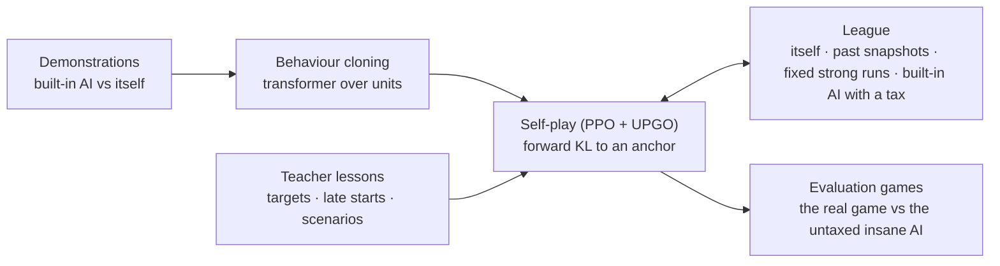

# Overview

warcraftsim trains agents on the real Warcraft III 1.29, headless under Wine. Python steps the game every half second of game time. The project reimplements nothing.

## Status (2026-11-20)

| track | best result | run |
|---|---|---|
| Micro fights | 91% against the scripted opponent. League self-play: 82%, and 79% against the 91% policy. | `--trainer torch` |
| Whole game, `duelrush` (2-minute games) | **79%** against the built-in AI, all 16 matchups. | `fgself-10` |
| Whole game, `duelfast` (6-minute games) | **80%** of its games against the insane AI won. Every matchup is above the AI's own record. | `fgself-51` |
| **The real game on Echo Isles** (the game's own rules, no handicap, a person's income) | **0.951 against the insane AI** (250 of 263 games over two evaluation bursts, every race 0.90-1.00): `fgself-236`'s weight average. `fgself-236`'s end checkpoint read 0.845 over two bursts. It can give every order a melee player can, and it sees what a player sees. | the top-rated policy: `fgself-236 avg swa-43-53` (rating 1,935, insane at 1,500); rating ~1,904 ±14 after the ratings counted its head-to-head games); running: `fgself-261`, two league exploiters (AlphaStar's: trained against the whole league), on the recipe (league history, a working main exploiter, the order fixes) |

## How a run is judged

The yardstick is the real game against the untaxed insane AI, and head to head between policies. Since 2026-11-13 a verdict is an **evaluation burst**:

* An experiment forks from the base's latest checkpoint and trains for a budget (~26M steps). The base then goes on from the same checkpoint for the same budget: the control.
* The learner stops. For ~45 minutes the main machine plays ~1,000 games between frozen checkpoints: both runs' end checkpoints and their weight averages, against insane and head to head. Every policy plays the same matchups in the same window, and the races are weighed alike.
* Why: a checkpoint's level against insane swings by ~8 points between checkpoints 20-30M steps apart. A start picked as a burst's best reads ~8 above any continuation of it, so an experiment is fair only against its control. The training games' reads (`scripts/train_read.py`) drift between windows by more than their intervals: a quick look, never the verdict.
* The base goes on from a **weight average** of a stretch of checkpoints (`scripts/average_checkpoints.py`), which swings less than a single checkpoint. An average is checked by race before it becomes a base: one broke night elf (`fgself-236`'s 17-27M: 0.38).

## Where it is weak

From [audit 20](reference/audit-20.md): 2,832 burst games against insane by the bases before `fgself-236`, 557 not won.

* **Long games.** It won 99% of the games that ended within 12 minutes, 49% of those that ended at 18-24 minutes, 21% at 24-30 and 2% past 30. 431 of its 532 losses came past 18 minutes.
* **The AI's development decides them, not its own build.** Once the AI had 8 or more research levels the learner won 0 of 433 games; with 4 or more AI air units, 0 of 301. The learner's own build reads the same in the long games it wins and the ones it loses.
* **Economy.** It expanded in 3 of 2,832 games. Its one mine runs dry at about 24 minutes, and its supply peaks at 52-57 where the AI's reaches 79 in long losses.
* **The night elf AI** is the hardest opponent (0.71 with the learner's races weighed alike).
* **Orc** was the weakest race (0.65), mostly its first hero: the Far Seer won 0.93, the Blademaster 0.40. Weighting the teacher's first hero (`fgself-236`) lifted it: 0.75 for its end over two bursts, 0.96-1.00 for its policies in burst-237.
* Short losses are rare: 7 before 12 minutes, none of them a rush.

## Since 2026-11-12

Kept:
* Every training game in the real game (`fgself-212`: 0.86 against insane in a burst, +8 over `fgself-201`/142.7M, undead at last near the other races).
* Weight averaging. The mean of `fgself-212`'s 81 checkpoints read 0.845, at its best single point and above all three head to head.
* The spell lesson, capped (`--teach-floor`, `fgself-224`). Uncapped, a lesson for a rare order spreads to every unit. Capped at a 0.5% chance, the heroes cast ~17 taught spells a game in training, and its average beat its control's head to head (0.59-0.62).
* Masks for orders the game refuses (`--order-masks 7`, `fgself-231`): level strength, ~20% fewer refused orders.
* The first hero weighted (`--first-hero-weights Ofar:4,Hamg:4`, `fgself-236`). The teacher had drawn it uniformly, so the policy opened with each hero a third of the time. Over two bursts its end checkpoint read 0.845 against the control's end 0.754 and average 0.781, orc 0.75 against the control average's 0.52.
* Bug fixes: a late start's research reached no input (bug finder 9); the tinker never learned a second skill, and a refused learn read "ok" (bug finder 10).

Not kept: upgrades counted in the shaping (`fgself-213`, -11), late starts in the real game (`-214`), people's clone as a KL anchor (`-215`, `-216`), the attack lesson (`-218` to `-220`: it spread, capped it still cost), the z-modes' deadlines for the real map (`-222`), a capped late expansion lesson (`-223`: 4% of games expanded, -11), the capped army (`-226`) and upgrade (`-227`) lessons, late starts from lost positions (`-230`), lr 2e-5 (`-234`), race weights (`-237`). [Experiments](experiments.md) has the lessons, [the plan](proposals/next-experiments.md) the next runs.

## From 2026-10-26 to 2026-11-12

* Every agent slot plays at a person's income. Before, the agent slots had the insane AI's double income, and the ~95-100% figures were at that income.
* A games box plays 64 training games. Training runs at ~5,000-5,600 agent steps a second. The main machine's CPU sets the speed, and the GPU is nearly as busy.
* Late-game starts from captured states, two-base starts and a fixed league of strong past runs (`fgself-130`, `-171`, and `fgself-197`'s peak).
* The full order vocabulary (`fgself-196`), and inputs for buffs, corpses, items, area spells and enemy upgrades (`fgself-197`: wins past 18 minutes 46% against 16%).
* Half the training games against the AI in the real game (`fgself-201`: +11 points against insane).

## How we make a whole-game agent

* A clone of the built-in AI was the start. Reinforcement learning then improved on it.
* A small KL term (`--ref-kl 0.01`) keeps the policy near an anchor, `fgself-100`.
* Target strategies (AlphaStar's z): in most training games a side plays toward a build order from the AI's games or people's replays.
* Teacher lessons label some of the policy's steps: in a game without a target its first hero (the Far Seer and the Archmage weighted), and hero spells capped so they never spread to every unit.
* Each experiment is a new run, forked from the base. It starts with its parent's league. The base goes on beside it as a control, and an evaluation burst decides.

## Read next

* [Environments](environments.md): the maps, the opponents, what the agent sees and does.
* [The whole-game model](model.md): tokens, transformer, action heads.
* [Experiments](experiments.md): what worked and what did not.
* [The road to the real game](road-to-the-real-game.md): what is still missing.
* [Optimizations](optimizations.md): how a step became fast. [Speeding up the game itself](game-speedups.md).
* [Architecture](architecture.md): how Python drives the game.
* Related work: [AlphaStar](related/alphastar.md), [OpenAI Five](related/openai-five.md), [robot learning](related/robot-learning.md).
