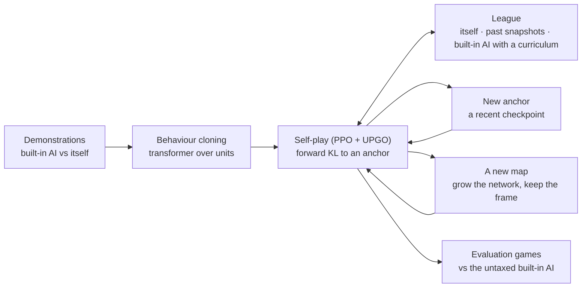

# Overview

warcraftsim trains agents on the real Warcraft III 1.29, headless under Wine. Python steps the game every half second of game time. The project reimplements nothing.

## Status

| track | best result | run |
|---|---|---|
| Micro fights | 91% against the scripted opponent. League self-play: 82%, and 79% against the 91% policy. | `--trainer torch` |
| Whole game, `duelrush` (2-minute games) | **79%** against the built-in AI, all 16 matchups. | `fgself-10` |
| Whole game, `duelfast` (6-minute games) | **80%** of its games against the insane AI won. Every matchup is above the AI's own record. | `fgself-51` |
| **The real game on Echo Isles** (the game's rules, no handicap) | **~89% of its games against the insane AI won** (~500 evaluation games, against ~84% for the previous best): ~179% of the AI's own record on Echo Isles. Night elf ~99%, orc ~88%, human ~85%, undead ~82%. | best `fgself-78` (now: `fgself-89`, strategic variety on the fast rules) |

The yardstick is the evaluation games: the real game against the built-in AI, which the policy does not train on. Each policy in a run plays the same matchups (paired), so a run compares its policies directly.

## Next (2026-10-18)

1. `fgself-89`: strategic variety first (the user's direction, a lower win rate accepted for a while), on Echo Isles with the fast rules: enforced targets (only the target's items can be made for its first 15 minutes) and five times the reward for following them. `fgself-88` (enforcement with the old reward) kept its win rate without a target (44% against `fgself-78`'s 42%) but barely followed: ~15 of ~21 target items missed, flat. Before it, `fgself-87` (8 layers) was level after ~50 minutes and stopped: no larger network without a clear gain. Every run since `fgself-79` started from `fgself-79`'s last with its stronger strategy reward (0.05), and every one had a weaker human (8-20 points behind, more workers): their "level" verdicts hid the other races' gains. Before it: a richer AI in training (`fgself-85`: the insane AI with 90% more income still lost ~85%; human collapsed, worse), target strategies from people only (`fgself-84`, level), workers capped in the material shaping (`fgself-83`, level).
2. Strategy conditioning (`fgself-78`) and a quarter of the anchor's pull (`fgself-77`) helped. The material shaping still helps: without it the policy lost ~5 points (`fgself-81`), and with a rolling anchor orc collapsed (`fgself-82`).
3. Did not help: more reward for following the target (`fgself-79`), a cloning loss to teach the targets (`fgself-80`, worse), a main exploiter (`fgself-76`).

[The road to the real game](road-to-the-real-game.md) has the details.

## How we make a whole-game agent

* A clone of the built-in AI is the start. Reinforcement learning then improves on it.
* The KL term keeps the policy near an anchor. The anchor moves to a recent checkpoint as the policy improves.
* The policy now beats its teachers. The advice and the cloning loss from the built-in AI are off.
* Each experiment is a new run, forked from the best checkpoint. It starts with its parent's league.

## Read next

* [Environments](environments.md): the maps, the opponents, what the agent sees and does.
* [The whole-game model](model.md): tokens, transformer, action heads.
* [Experiments](experiments.md): what worked and what did not.
* [The road to the real game](road-to-the-real-game.md): what is still missing.
* [Optimizations](optimizations.md): how a step became fast.
* [Architecture](architecture.md): how Python drives the game.
* Related work: [AlphaStar](related/alphastar.md), [OpenAI Five](related/openai-five.md) and [robot learning](related/robot-learning.md), and how this project differs.
