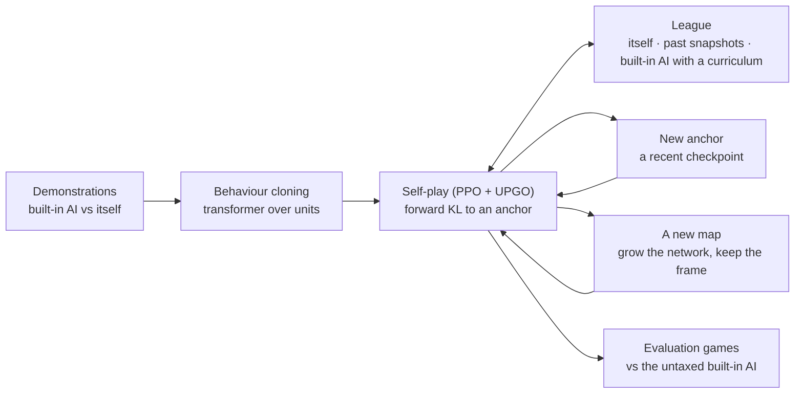

# Overview

warcraftsim trains agents on the real Warcraft III 1.29, headless under Wine. Python steps the game every half second of game time. The project reimplements nothing.

## Status

| track | best result | run |
|---|---|---|
| Micro fights | 91% against the scripted opponent. League self-play: 82%, and 79% against the 91% policy. | `--trainer torch` |
| Whole game, `duelrush` (2-minute games) | **79%** against the built-in AI, all 16 matchups. | `fgself-10` |
| Whole game, `duelfast` (6-minute games) | **80%** of its games against the insane AI won. Every matchup is above the AI's own record. | `fgself-51` |
| **The real game on Echo Isles** (the game's rules, no handicap) | **72% of its games against the insane AI won**: ~140% of the AI's own record on Echo Isles. Human 53%, undead 49%, orc and night elf ~95%. | best `fgself-73`, `fgself-75` running |

The yardstick is the evaluation games: the real game against the built-in AI, which the policy does not train on. Each policy in a run plays the same matchups (paired), so a run compares its policies directly.

## Next (2026-10-17)

1. Finish `fgself-75`: a quarter of the reward shaping.
2. An exploiter league: AlphaStar's exploiters against the policy's one strategy, an early rush of tier-1 units.
3. A strategy for each game: a target build order and unit mix, with a small reward to follow it, so that the policy also techs. Human replays add more strategies: build orders from any game version, demonstrations from 1.29's.

[The road to the real game](road-to-the-real-game.md) has the details.

## How we make a whole-game agent

* A clone of the built-in AI is the start. Reinforcement learning then improves on it.
* The KL term keeps the policy near an anchor. The anchor moves to a recent checkpoint as the policy improves.
* The policy now beats its teachers. The advice and the cloning loss from the built-in AI are off.
* Each experiment is a new run, forked from the best checkpoint. It starts with its parent's league.

## Read next

* [Environments](environments.md): the maps, the opponents, what the agent sees and does.
* [The whole-game model](model.md): tokens, transformer, action heads.
* [Experiments](experiments.md): what worked and what did not.
* [The road to the real game](road-to-the-real-game.md): what is still missing.
* [Optimizations](optimizations.md): how a step became fast.
* [Architecture](architecture.md): how Python drives the game.
* Related work: [AlphaStar](related/alphastar.md), [OpenAI Five](related/openai-five.md) and [robot learning](related/robot-learning.md), and how this project differs.
