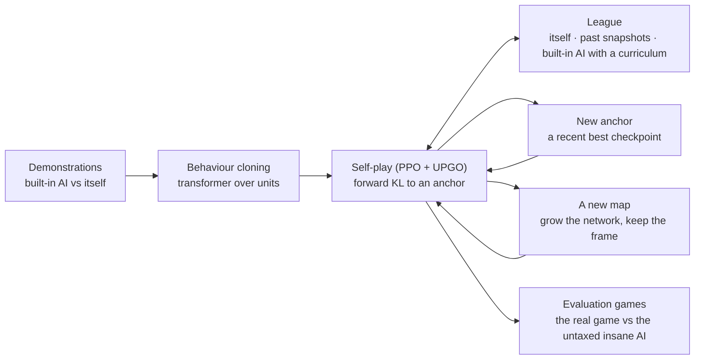

# Overview

warcraftsim trains agents on the real Warcraft III 1.29, headless under Wine. Python steps the game every half second of game time. The project reimplements nothing.

## Status

| track | best result | run |
|---|---|---|
| Micro fights | 91% against the scripted opponent. League self-play: 82%, and 79% against the 91% policy. | `--trainer torch` |
| Whole game, `duelrush` (2-minute games) | **79%** against the built-in AI, all 16 matchups. | `fgself-10` |
| Whole game, `duelfast` (6-minute games) | **80%** of its games against the insane AI won. Every matchup is above the AI's own record. | `fgself-51` |
| **The real game on Echo Isles** (the game's rules, no handicap) | **At a person's income: ~74% of its games against the insane AI won** (`fgself-166`, late-game starts, kept; `fgself-158` ~69%). Until 2026-10-26 the agent slots had the insane AI's double income and every earlier figure (~95-100%) was at equal income. Still weak: the strategy (half its wins before 12 minutes, the top unit ~91% of the army, no expansions, little anti-air), undead (~35-40%), and play with a target build order (~25-30%). | `fgself-166` (late-game starts from its own games); `fgself-167` (half the late starts from people's games; stopped for a shutdown, level at 174 games, its army more varied) |

The yardstick is the evaluation games: the real game against the built-in AI, which the policy does not train on, and games against frozen snapshots of the policy (`--eval-vs`). Each policy in a run plays the same matchups (paired), so a run compares its policies directly.

## Since the milestone (2026-10-20)

Beating the insane AI clearly was the milestone; the user's direction now is strategic variety, then the whole game's actions. Tried since, all level with their start: AlphaStar's league with a main exploiter (`fgself-103`), OpenAI Five's reward decay (`-104`), each sample used once (`-105`), classifier-free guidance toward the target in evaluation (`-106`: it followed no better and won 50% instead of 91%).

`fgself-107` added what the agent could not see (each hero's abilities, cooldowns and items, what each building makes, the time of day, the enemies it saw before: `--inputs 3`) and masks for orders the game would refuse (`--tech-mask`, `--valid-mask`); it fell below its start (41% head to head), likely from the remembered enemies looking like enemies in sight at first. On the rating scale both were about level with their start, a strong checkpoint (`fgself-108`, without the memory: 2024 ± 22 to its 2070 ± 19). `fgself-109` added narrow targets and more kinds of conditioning: level on the rating, ~75-80% of the due target items made, the easy kinds kept (workers 88%, army size 84%, rush 76%), the hard ones not (expand 47%, low upkeep 34%, no rush 14%). `fgself-110`, rewards by part (GDPO), was worse (the material shaping back at full weight). `fgself-111` added the tavern's heroes, mercenaries and the goblin merchant as orders, a heuristic teacher and targets with tavern heroes: level (2031 ± 20 to its start's 2010 ± 9), and after a day of fixes (every buy order had been refused: the tavern stands in the fog at the start) it hires (413 tavern heroes and ~1,500 mercenaries in 2,751 training games). In the real game the policies' untaught mercenary purchases cost wins, so they are off now (`--neutral 2`). `fgself-112`, self-distillation with privileged information (OPSD), gave no gain in an hour and a half (44% head to head with its start). `fgself-113` (scenarios) was confounded by two bugs found on the way (a run's vocabulary differed between processes, so forks lost their parent's league and swapped two spell toggles). `fgself-114`, scenarios again, clean (a quarter of the training games start with armies between the bases, a raid, or extra money): level. `fgself-115`, weight averaging (a soup of `fgself-111`'s and `fgself-114`'s last checkpoints): level, worse with a target. `fgself-116`, rewards by part (GDPO) with the material shaping at half weight: worse (38% head to head with its start; targets followed a little more). `fgself-117`, the enemies it saw before as inputs faded into its attention: worse, as `fgself-107`. Two rules of the game had been wrong since `fgself-111`: the first hero is free (the mask held it back until 425 gold and 100 lumber), and about half the purchases never went through (a worker's right-click on the tavern). `fgself-120`, the corrected rules alone: level, the new baseline (first hero at 60 s, tavern heroes hired as a third of the targets ask). `fgself-121`, self-distillation with privileged information (OPSD), clean: no gain. An audit (2026-10-22) found seven more silently wrong assumptions about the game, among them: dead heroes were never revived, undead could not build a haunted mine (so never expanded), workers could not be moved to another mine, and on `echofast` most of Echo Isles' creeps kept full hit points. No policy had ever expanded (0% of games, a hall far from home at a gold mine). `fgself-122`, the corrected game: level to a little lower, the base. `fgself-123`, expansions taught with a lesson to clear the natural's camp: much worse (armies dragged away), no expansion. `fgself-124`, expansion teaching without the camp lesson (the naturals' camps gone in a third of the training games): the policy learned to build a hall, at home (28% of games), not at the natural. `fgself-125`, an expand order of the agent's own (`--macros 1`: the policy chooses to expand, the agent builds the hall where people do): level to a little better, and it expands in a quarter of the games with the naturals free (not yet with their camps standing, as in the real game). `fgself-126`, a creep order: it crept and expanded with the camps standing, and lost those games; a second audit found why (every worker took the expand order at once, any unit the creep order from minute 1, the newest units past 96 cut from the view, build orders held 30 s). `fgself-127`, the expand and creep orders with those fixed: better than its start (rating 1874 to 1810 at its best hour), and the first policy to expand in the real game (14 of 150 evaluation games); its weak point is playing a target (24% against insane). `fgself-128`, targets not enforced (a side with a target may answer with items outside it): better, and its target play more than doubled (58% against insane with a target, 24% before; 93% without), the targets still followed (70%). A hall's tier order was refused whenever it trained workers (the policy's tech held back for all races). `fgself-129`, tier orders that go through (a hall's tier order had been refused while it trained workers): the best yet (rating ~1940 to its start's 1875; against insane 94%, 70% with a target; tier 2 in 63% of the real games), its army still tier 1. `fgself-130`, a target's army mix as an input and in the strategy reward: a little better, but the mix not followed. `fgself-131`, the army mix taught a unit at a time: level, the mix not followed. `fgself-132`, a mix order of the agent's own (a building trains its target's army mix): the mix followed more, at a cost in wins. `fgself-133`, halfway rules (`echo50`): worse (45% head to head with its start). `fgself-134`, items off the ground, night elf expansions and a dead tavern hero's revival (`--macros 2`): it picks up items, but worse head to head (41% with its start), the loss human's: without a target the human policy rarely builds an altar, so has no hero. `fgself-135`, a first hero in games without a target (the teacher): level to a little better, human plays a hero again. `fgself-136`, games between policies taxed by who is expected to win (`--win-balance`), 20% of the games, went on as `fgself-137` with a third audit's fixes. `fgself-137`, those, and a hero's skill points spent when the policy leaves them (`--macros 3`): better, level with `fgself-130`'s best head to head by its last third. Two more audits found the income tax undone by purchases and rounded away, and 30-40% of the policy's orders refused by the game (repairs of what needed none, undead and night elf workers sent to mines they can't mine). `fgself-139`, with those fixed: better (58% of 490 head to head with `fgself-137`; 42.5% of 637 with `fgself-130`, closing), 97% against insane. Its targets: the first hero is the target's only 25-37% of the time (chance), because in target games no lesson came before the policy had made another hero; `fgself-140` teaches it as soon as the altar stands (`--teach 2`).

The machine got faster the same day: the RTX 3090's BF16 rate unlocked, the actors' features in C, a second round of equivalent speedups in the game's own code (`--game-cuts 521721`: -18% of a game's main thread), and a second machine for games ordered ([scaling up the CPUs](reference/scaling-cpus.md)).

Next: the targets' items the policy misses most (the first hero, then the expansion, ~44% missed for every race, undead's tier 2 and tavern heroes, about half), so that a target build order is played as asked; then its wins with a target closer to its wins without. On the machine side, training games on a second machine (inference staying on the 3090) and a learner that keeps up with twice the steps. [Ideas](reference/ideas.md) has every idea tried: where it came from, what became of it.

## How we make a whole-game agent

* A clone of the built-in AI is the start. Reinforcement learning then improves on it.
* The KL term keeps the policy near an anchor. The anchor moves to a recent best checkpoint as the policy improves.
* Target strategies (AlphaStar's z): in most training games a side plays toward a build order from the AI's games or people's replays, rewarded for following it; a builder's orders teach it (labels only, never carried out).
* Each experiment is a new run, forked from the best checkpoint. It starts with its parent's league.

## Read next

* [Environments](environments.md): the maps, the opponents, what the agent sees and does.
* [The whole-game model](model.md): tokens, transformer, action heads.
* [Experiments](experiments.md): what worked and what did not.
* [The road to the real game](road-to-the-real-game.md): what is still missing.
* [Optimizations](optimizations.md): how a step became fast. [Speeding up the game itself](game-speedups.md): the shim's hooks, the virtual clock and the game's functions rewritten with the same results.
* [Architecture](architecture.md): how Python drives the game.
* Related work: [AlphaStar](related/alphastar.md), [OpenAI Five](related/openai-five.md) and [robot learning](related/robot-learning.md), and how this project differs.
