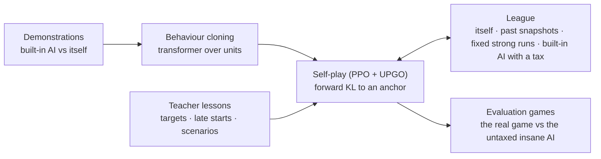

# Overview

warcraftsim trains agents on the real Warcraft III 1.29, headless under Wine. Python steps the game every half second of game time. The project reimplements nothing.

## Status (2026-11-12)

| track | best result | run |
|---|---|---|
| Micro fights | 91% against the scripted opponent. League self-play: 82%, and 79% against the 91% policy. | `--trainer torch` |
| Whole game, `duelrush` (2-minute games) | **79%** against the built-in AI, all 16 matchups. | `fgself-10` |
| Whole game, `duelfast` (6-minute games) | **80%** of its games against the insane AI won. Every matchup is above the AI's own record. | `fgself-51` |
| **The real game on Echo Isles** (the game's own rules, no handicap, a person's income) | **~86% of its games against the insane AI won** (`fgself-212`, a paired evaluation burst of 195 games; `fgself-201` read 81% over 612). It can give every order a melee player can, and it sees what a player sees. | base `fgself-212` (every training game in the real game: 0.86 against insane in a paired evaluation burst, +8 over `fgself-201`/142699211). People's clone as a KL anchor (`fgself-215`, `-216`) not kept. Running: `fgself-218`, a lesson to attack a unit (workers, hurt heroes), where the policy only attack-moves. |

The yardstick is the evaluation games. The policy plays the real game against the untaxed insane AI, and games against frozen checkpoints (head to head). Each policy in a run plays the same matchups, so a run compares its policies directly. Since 2026-11-11 a run is judged against the level of an unchanged continuation of its start, not against the start checkpoint alone. A checkpoint can be a peak that no continuation plays at again (`fgself-197`'s, [the log](reference/experiment-log.md)).

## Where it is weak

* **The late game.** It wins 96% of the games that end within 18 minutes and 41% of the longer ones. 102 of its 118 losses come past 18 minutes.
* **Economy.** It never expands without a target. It mines one mine, and on the real map that mine runs dry at about 24 minutes.
* **Army.** One hero and one tier-1 unit type (93% of the army), few upgrades. It wins 2 of 49 games in which insane makes 4 or more air units.
* **Spells.** The policy gives many hero spells almost no chance. Lessons made the heroes cast, but cost strength (`fgself-208` to `-210`).

## Since 2026-10-26

* Every agent slot plays at a person's income. Before, the agent slots had the insane AI's double income, and the ~95-100% figures were at that income.
* A games box plays 64 training games. Training runs at ~5,000-5,600 agent steps a second. The main machine's CPU sets the speed, and the GPU is nearly as busy.
* Late-game starts from captured states, two-base starts and a fixed league of strong past runs (`fgself-130`, `-171`, and `fgself-197`'s peak).
* The full order vocabulary (`fgself-196`), and inputs for buffs, corpses, items, area spells and enemy upgrades (`fgself-197`: wins past 18 minutes 46% against 16%).
* Half the training games against the AI in the real game (`fgself-201`: +11 points against insane), then every training game there (`fgself-212`: +8 more in a paired burst, undead up most).

[Experiments](experiments.md) has the lessons, [the plan](proposals/next-experiments.md) the next runs.

## How we make a whole-game agent

* A clone of the built-in AI was the start. Reinforcement learning then improved on it.
* A small KL term (`--ref-kl 0.01`) keeps the policy near an anchor, `fgself-100`.
* Target strategies (AlphaStar's z): in most training games a side plays toward a build order from the AI's games or people's replays.
* Each experiment is a new run, forked from the base. It starts with its parent's league.

## Read next

* [Environments](environments.md): the maps, the opponents, what the agent sees and does.
* [The whole-game model](model.md): tokens, transformer, action heads.
* [Experiments](experiments.md): what worked and what did not.
* [The road to the real game](road-to-the-real-game.md): what is still missing.
* [Optimizations](optimizations.md): how a step became fast. [Speeding up the game itself](game-speedups.md).
* [Architecture](architecture.md): how Python drives the game.
* Related work: [AlphaStar](related/alphastar.md), [OpenAI Five](related/openai-five.md), [robot learning](related/robot-learning.md).
