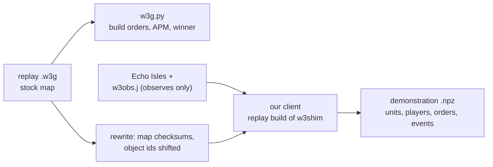

# People's replays

Two tools for replays (`.w3g`) of games people played:

* **A parser** (`warcraftsim/data/w3g.py`, `scripts/replay_stats.py`) reads replays of any version: the players, the map and every action. From the actions it makes each player's build order and APM. This part needs no game.
* **A converter** (`warcraftsim/fullgame/replays.py`) plays a 1.29 replay on a stock map back in our client and records the built-in AI's kind of demonstrations from it. `bc.py` reads them unchanged.
* **A fetcher** (`scripts/replay_fetch.py`): warcraft3.info's index and downloads, W3Champions' ladder 1v1s ([sources](#sources-and-versions)).



## Run it

```
python scripts/replay_fetch.py index --out runs/fullgame/replay-survey/w3info-index.jsonl --version 1.29
python scripts/replay_fetch.py download --index runs/fullgame/replay-survey/w3info-index.jsonl \
    --out runs/fullgame/human-replays-128 --version 1.28 --type 1on1    # files: untrusted data, own directory
python -I scripts/replay_stats.py runs/fullgame/human-replays-129       # rows in <dir>/stats.jsonl, a summary
make -C shim replay                                                     # the replay build of w3shim (build/shim-replay)
python -m warcraftsim.fullgame.replays --replays runs/fullgame/human-replays-129 \
    --out runs/fullgame/demos-human-129 --parallel 2                    # 1v1s on Echo Isles at build 6060
python -m warcraftsim.fullgame.replays --replays runs/fullgame/human-replays-129 \
    --out runs/fullgame/demos-human-129-maps --map "(2)LastRefuge-1.3,(2)Amazonia,(2)TerenasStand_LV"  # other stock maps (or --map all)
python -m warcraftsim.fullgame.bc --data runs/fullgame/demos-human-129 ...
```

* The converter skips what it can't play and gives the reason in `<out>/skipped.jsonl`. It resumes where it stopped (`--retry-failed` tries the failures again).
* A game takes about 66 s for both playbacks, two at a time beside the training (niced): the 95 games took 52 minutes. The games are named `replayconv*`.
* A game whose playback is out of step with the replay goes to `<out>/desync` (`--min-sync`).

## The parser

* **Formats:** the classic layout (16-bit block sizes), Reforged's (32-bit block sizes, protobuf records before the slots, 2.0's action `0x7A` before an order) and the GRBN container (protobuf metadata, then a classic replay; warcraft3.info serves NetEase's replays in it). It also reads the older action layouts (before 1.07, 1.13 and 1.14b). Checked on 1.26, 1.28, 1.29, 1.30 and Reforged 2.0 replays: every action known (1.30-1.31 have an action 0x77 of 12 bytes, twice a game, that Reforged uses otherwise).
* **What it reads:** the header, the game info (host, game name, settings, map path, the map's checksums), players and slots (team, colour, race, computer and level, handicap, observers), chat, leave records, and every action with its time. Actions name units by object ids: a slot in the engine's table of objects and the count of objects made before it.
* **Build orders** (`w3g.summarize`): per player, the buildings placed (with the spot), units and heroes trained, upgrades, researches, hero skills, items bought and cancels, with their game time. `w3ids.json` (from the 1.29 game data, `replay_stats.py --ids`) tells which code is which. A random player's race is the one its starting units show.
* **Strategy statistics** (`w3g.strategy`, in `stats.jsonl`): as AlphaStar's conditioning, the first 20 buildings, units, upgrades and researches (workers left out) and the counts of everything made.
* **Noise:** the same order again within 1.5 s counts once (a double click, a spammed key), and so does a building placed again at the same spot. A replay does not say whether the game took an order. So a train click refused for gold, food or a full queue still counts, and a hero's revival looks like a second hero of the type.
* **APM:** orders, adding to the selection, hotkeys, queue cancels, ESC and the skill and build menus, per minute until the player left.
* **Winner:** a "won" leave record, else the side still there when every other player left. It agreed with warcraft3.info's winner in 168 of the 176 games that have one.

## The downloaded replays

2,591 replays from warcraft3.info, all 1.29 build 6060, all parsed (2026-10-17).

| | replays |
|---|---|
| containers | 1,857 GRBN (NetEase), 734 classic |
| types | 2,543 1v1, 47 2v2, 1 6v6 |
| maps | Last Refuge 464, Amazonia 411, Echo Isles 350, Turtle Rock 311, Twisted Meadows 294, Terenas Stand 278, Ancient Isles 218, ... |
| 1v1 on Echo Isles | 350: 95 on the stock map (convertible), 249 on NetEase's own version (map checksum 94b4de8e), 6 others |
| 1v1 length | median 15 min (10-90%: 9-24) |
| 1v1 APM | median 260 (10-90%: 188-331) |

## Playing a replay back

A replay holds only the players' actions. The game re-simulates it from the map, so the map must be the one the game was played on, and nothing may change the simulation.

**The map.** The replay names its map (`Maps\FrozenThrone\(2)EchoIsles.w3x`), and 1.29 looks for it in `Documents\Warcraft III`. It finds it only if its checksums are the replay's: a modified map is "not found". The checksums are the classic one and a SHA-1 over `common.j`, `Blizzard.j` and the map's script and terrain files (GHost++'s algorithm, `w3g.map_checksums`). `w3g.rewrite` writes the observer map's checksums into a copy of the replay. 1.29 checks the replay's own checksums too: the header's CRC-32, and per block the CRC-32s of its header and its data, each folded to 16 bits.

**Object ids.** Actions name units by object ids: a slot and the count of objects made before (at `+0xc` and `+0x10` of every engine object). Every object the map's script makes takes the next id, so units made later get other ids than in the recorded game, and the replay's orders reach nobody. One `TimerStart` with a callback in an otherwise stock map was enough: the bases stopped growing after a minute.

* What makes objects: triggers, timers, groups, hashtables, regions, rects, events, a timer's handler (its first `TimerStart` with code) and a callback's wrapper (its first use). A trigger's event makes objects each time it fires, even with no condition or action.
* What doesn't: reading units and players, `Preload` and the mailbox sync, enumerating into a group made before.
* The observing harness (`harness/w3obs.j`) makes all of its objects at the end of `main`, after the map's own melee initialization, between two probe groups. It registers no events. A short first playback reads the probes' ids (16 objects). Every later object id in the replay is then shifted by their count: the count always, the slot if it is a new one (`replays.shift_of`). The 8 bytes after an order's id are an object id too (the item a "useslot" uses): a Rod of Necromancy raised no skeletons until they were shifted as well.

**The replay build of w3shim** (`shim/replay.c`, `make -C shim replay`) reports each unit's object ids, the probes' and the trees'. It also adds the engine's own state of buildings to the unit records, found by comparing the bytes of an altar, a barracks, a ziggurat and a great hall over their construction, training and upgrade:

| flag | what | where |
|---|---|---|
| 8 | under construction | `+0x164 & 0x2000000` |
| 4096 | producing (training or researching) | `+0x3c4` |
| 8192 | being upgraded | `+0x164 & 0x4000000` |

The default build has none of this (`#ifdef W3SIM_REPLAY`).

## The demonstrations

The arrays and files of `collect.py`: units, heroes, players, events, orders and trees per game, plus `games.jsonl` and `collect.json`. Differences:

* **Players** are 0 and 1 in slot order (in the game they are their slots), also in the visibility bits. `difficulties` are `["human", "human"]`. `meta.source` names the replay and has the players' APM.
* **Orders** (the labels) come from the replay's actions. Each player's selection is followed through clicks, groups and subgroups, and its units are found by their object ids. Orders every unit takes (smart, move, attack, patrol, hold, stop) go to every selected unit. A build order goes to one worker: the one walking to that building the next step. Train, research and upgrade orders go to one building of the active subgroup, one not yet producing if there is one. Other abilities go to the subgroup's units, and hero skills to its hero (kind 3). Targets are units and trees; a tree out of sight is found by its type and spot.
* **Events** are derived from the units' states step by step: construction start, finish and cancel; production start, finish and cancel at a building (from its producing flag and the units of its owner that appear beside it); upgrades; deaths (no killer); hero levels; summons (no summoner); items picked up. Research levels are polled by the harness, and the research is put at the building last ordered to research it.
* **Result:** from the leave records (above).

## Verified

All 95 Echo Isles 1v1s on the stock map converted (2026-10-17): 23.7 hours of play, median 13.8 minutes, APM median 226. None was out of step.

| check | result |
|---|---|
| units the players' subgroup actions name (type and object ids) that are that unit in the playback, at that time (`meta.sync`) | **9,508 of 9,508** |
| buildings the replay places that came up within 64 of the spot | 2,892 of 2,982 (97%; the rest: orders the game refused) |
| how far the playback ran | to the first player's leave, give or take a second; when a side's defeat ended the game for the viewer, up to 72 s before |
| researches the harness saw done, against the replay's research clicks (8 games) | 59 of 63 (the rest cancelled or unfinished) |
| build labels: the worker went to build (or the building came up at once) / another selected worker went / none | 374 / 7 / 14 of 395 (10 games) |
| `bc.py`'s encoder (`features.load_game`, both sides, `side_data`, `sides_of`) | every game reads: 341,220 side-steps, 48% with labels (the AI's: 23%) |

* Before the probes, one passive `TimerStart` was enough to stop every base after a minute. With the harness's objects shifted, a Rod of Necromancy's skeletons were the first miss: their object ids came up in the stock playback (no harness, read from the engine) and not in ours, until the item ids in orders were shifted too.
* The players' food, gold and build orders go as in a real game. People against the built-in AI on Echo Isles (`demos-echo-1`, normal and insane), medians:

| race | workers at 5 / 10 min | food at 5 / 10 min | first hero | tier 2 |
|---|---|---|---|---|
| human | 13 / 14 (AI 16 / 16) | 32 / 44 (AI 40 / 49) | 123 s (121) | 468 s (506) |
| orc | 12 / 12 (14 / 14) | 29 / 46 (34 / 43) | 123 s (128) | 283 s (610) |
| undead | 5 / 5 (5 / 7) | 28 / 44 (32 / 53) | 136 s (150) | 332 s (352) |
| night elf | 12 / 15 (17 / 18) | 27 / 44 (35 / 49) | 122 s (125) | 328 s (344) |

## Limits

* Only replays of our client's build (1.29.2, build 6060) play back, and only on a stock map of the game (`Maps/FrozenThrone`, its `Community` folder too) whose checksums the replay has ([other versions](#other-versions)). NetEase's 1.29 games are on NetEase's own map versions ([sources](#sources-and-versions)).
* `bc.py` takes the map frame (`features.set_geometry`) from its first game: demonstrations of several maps need it per game. On a four-player map (Turtle Rock, Twisted Meadows) a 1v1's two bases are any two of the four starts, and `map_geometry` takes the first two.
* The labels are the players' commands spread over their selection, not the game's issued orders: which worker builds and which building trains is a choice, and a command the game refused is still a label.
* The events are reconstructions: the building a unit came from is the nearest producing one, research and train starts come from the last order a building got, and there are no spell, tree-death or killer events.
* Units the harness never saw are missing: it adds units by enumerating the map each step, which skips units that are hidden from the moment they are made.
* Each replay plays twice (the probe playback is short: about 10 s).
* The game's own events and issued orders would need the shim to hook the engine's event dispatch (no script objects): a next step if the derived labels and events fall short.

## Sources and versions

Surveyed 2026-10-26 (`runs/fullgame/replay-survey/`: `w3info-index.jsonl`, warcraft3.info's metadata of every replay of 1.26-1.31).

**warcraft3.info** (public API, no login; robots.txt allows `/api`): 140,250 replays. The list takes a `version` filter (`{"page": N, "version": "1.30"}`); a row has the map's checksums (the classic one byte-swapped against the replay's) and the origin (Battle.net or NetEase).

| version | replays | 1v1 | origin of the 1v1s | 1v1s on a map file identical to ours |
|---|---|---|---|---|
| 1.26 | 6,692 | 6,359 | Battle.net (W3Arena's map versions and stock maps) | 1,535 (Turtle Rock 565, Echo Isles 381, Terenas Stand 228, Secret Valley 194, Twisted Meadows 126, ...) |
| 1.27 | 546 | 331 | NetEase 317 | 5 |
| 1.28 | 4,032 | 4,030 | NetEase 4,006 | 5 |
| **1.29** | 2,605 | 2,557 | NetEase 1,857, Battle.net 700 | **608 convertible** (checksums match): Last Refuge 158, Amazonia 124, Echo Isles 98, Turtle Rock 87, Terenas Stand LV 61, Twisted Meadows 57, others 23 |
| 1.30 | 4,036 | 4,004 | NetEase 2,764 | 15 (1.30 changed most ladder maps) |
| 1.31 | 9,998 | 9,309 | Battle.net 4,576, NetEase 4,733 | 0 |
| 1.32-1.36 (Reforged) | 75,615 | | | (another engine) |
| 2.0 / 3.0 | 29,802 / 2,585 | | NetEase, Battle.net | |

"Identical": the replay's classic checksum with our map's files peeled off leaves the same value for several maps of a version (the version's `common.j` and `Blizzard.j`), so those map files are byte for byte ours. The 1.29 NetEase games (1,816 1v1s) are on NetEase's map versions (Maps/1.29: Last Refuge a39562b3 291, Amazonia 23d68f0b 276, Echo Isles 94b4de8e 249, Twisted Meadows c43206f3 218, Terenas Stand LV 1a181b47 214, Ancient Isles 56381717 209, Turtle Rock 6a9d1f28 203, ...): convertible only with those map files (not served; not stock). Ancient Isles is not a 1.29 stock map at all.

**W3Champions** (Reforged ladder, public backend API, robots.txt allows all): `GET website-backend.w3champions.com/api/matches?offset=&pageSize=100&gameMode=1&season=N` lists the 1v1s with both players' MMR (season 0 2020: 139k; seasons 20-25 2025-26: 330k-690k each; about 9.3 million 1v1s in all). `GET /api/replays/<match id>` serves the replay for some months (2026 games yes, most 2021-2025 ones 404/410). The replay endpoint answers 429 after ~20 downloads in a row: bulk downloads need W3Champions' blessing. Reforged 2.0, build 7003: parse-only.

**Others:** wc3replays.com is an analyzer, not an archive (and disallows `/api/`); gamereplays.org has old-patch replays (not checked); wcreplays.com and replays.net no longer answer. No public replay dataset (Kaggle, GitHub, Zenodo) turned up.

## Other maps

A pilot of 54 1.29 games on Last Refuge (28), Amazonia (23) and Terenas Stand LV (3) converted (2026-10-26, `runs/fullgame/demos-human-129-maps`): **none out of step**: 5,760 of 5,760 subgroup units, 1,795 of 1,834 buildings (98%); one playback timed out (`--retry-failed`). 14.1 hours of play, 202,756 side-steps, each game read through `bc.py`'s encoder in its own map's frame. 82 s a game per playback slot (two at a time beside the training, load ~90 on 32 threads): the other ~460 convertible 1.29 games take about 5 hours at two at a time (~10 slot-hours).

## Cloning people (the anchor to be)

`bc.py --like-run runs/<run>` clones these games into a policy a self-play run can take as `--init` (its KL anchor; [five changes](../proposals/five-changes.md), 1) and later as a teacher (2026-10-27):

* **The run's network.** Its settings as its learner sets them (`apply_run`: `--features`, `--inputs`, the tech, valid and economy masks, `--neutral 2`, `--macros 3`, `--spells 1`, the strategy block's size, the map's frame and bins), `--init` defaulting to the run's (`fgself-100/13649982`, the clone of the built-in AI) loaded through `model.load` with the run's `vocab.json`: the same architecture (5 layers, the minGRU core, 352 point bins), vocabulary and order of the orders, so `selfplay` takes it as `--init` and the anchor's KL compares like with like. `--fresh`: that architecture and its tables with new weights.
* **Own targets.** Each side's own strategy (`strategy.from_demos`) cut and narrowed as the run's pool holds its strategies (the `--z-pool`'s item slots, the horizon, at least 5 items, `strategy.narrow`, no mercenaries), given as the strategy input to the run's `--z-share` of the sides (0.75; the rest zeros, as the run's games without a target). The modes' and mix parts of the block are zeros, and their weights are zeroed (`zero_z_extras`), so a run that fills them sees the clone as without them. Validation gives every side its target.
* **Right clicks.** People give a third to a half of their orders as `smart` (a right click), which the built-in AI never gives, so the run's policy may give it only to workers (its table of orders by unit type). `resolve_smart` turns a unit's right click on a point into a move and on an enemy's unit or a creep into an attack, as the game does (`--resolve-smart 1`); a building's (its rally: not in the vocabulary), on its own units, trees, mines and shops stay right clicks.
* **Labels the run can't give are left out** (`IGNORE`, `drop_labels`): those the step's masks rule out (the economy masks, tech, ...: 0.1-0.3%), mercenaries (`--neutral 2`), and orders the run's policy's table rules out for the unit's type (`--run-orders 1`, the table of its last checkpoint; self-play gives the anchor the policy's table before each update, so weight there would only be taken from the other orders). In all 5-17% of the labels a map (Echo Isles 9%, Last Refuge 12%, Twisted Meadows 17%: mostly buildings' rally clicks and clicks on own units); without the right clicks resolved 51-67%. The clone's own table is the run's.
* **The value** learns the run's rewards (its gamma, shaping and tie-break).
* **Each game its own frame** (`game_frame`). The features' frame reads a map with the bases left and right (it mirrors x only, and squeezes the stretch between the bases to the duel maps' 4,600), as Echo Isles'. Every other map's bases are diagonal, so each game is turned (`level_frame`: units, facings, point and target orders, trees) about the midpoint of the two starts its players used (on a 4-player map the start nearest each player's hall at the first step: `used_starts`) until they lie level. The bins keep the network's reach (Echo Isles' ±2.75, 352 bins) on every map:

| map | bases apart (Echo Isles 9,856) | turned | middle squeezed to | point labels in an edge bin |
|---|---|---|---|---|
| Echo Isles | 9,856 | 0° | 0.23 | 0 |
| Last Refuge | 10,549 | 43° | 0.21 | 0.3% |
| Amazonia | 9,458 | 45° | 0.25 | 0 |
| Terenas Stand LV | 11,860 | -46° | 0.18 | 0 |
| Turtle Rock (34 games) | 10,061-11,254 (23 games); 4,172-4,345 (11: close spawns) | -64° to 49° | 0.19-0.23; close: 1.19-1.37 (stretched) | 0 (close spawns too) |
| Twisted Meadows (25) | 8,177-8,664 (16, adjacent); 11,857-12,125 (9, across) | -52° to 86° | 0.17-0.31 | 0 |

So the points stay in range and mean "this far towards the enemy base, this far to its side" on every map; what differs is the scale of the middle stretch (a bin there is 48 world units divided by the squeeze: ~200 on Echo Isles, ~150-270 elsewhere, ~40 in a close spawn) and the side: the frame mirrors x only, so on a map symmetric under a half turn (most of these) the right player's view is the left's upside down, as it is on Echo Isles. Games on maps not on this machine, or whose starts can't be told, are skipped.

**Run it** (the GPU; once `fgself-158` has stopped: one GPU job at a time):

    .venv/bin/python -m warcraftsim.fullgame.bc --like-run runs/fgself-158 \
        --data runs/fullgame/demos-human-129 runs/fullgame/demos-human-129-maps \
        --name human-anchor-1 --epochs 12 --batch 256 --seq-len 16 --lr 1e-4 --dropout 0.1 \
        --val-pct 5 --workers 16 --log-every 500

`--val-pct 5` holds out ~5% of the games by a hash of their names (the same games while the conversion adds more). `policy.pt` is the epoch with the lowest validation loss. Time: ~3 million side-steps when the conversion is done (~800 games, ~3,750 side-steps a game), ~11,700 batches an epoch; the encoding takes ~2-5 s a game per loader worker (~4 minutes an epoch on 16 workers), the network's steps likely more: about 5-10 minutes an epoch, 1-2 hours for 12 (not measured on the GPU: the CPU smoke test below ran ~2 s a batch of 64).

**Smoke test** (CPU, 2026-10-27; 8 games: Echo Isles 3, Last Refuge 3, Turtle Rock 2; 2 held out; `--batch 64 --seq-len 16 --workers 1 --max-batches 300 --lr 1e-4`): the cloning loss fell (train order loss 0.56 after 25 batches, 0.25 after 250), validation (the 2 held-out games' every step, targets given) from the start's (`fgself-100`: total 11.91, order accuracy given one 0.20, predicted order rate 0.51 against people's 0.044, target 0.20, point error 33.4 bins) to 8.51 (0.47, 0.073, 0.34, 25.3 bins) in 300 batches; ~2.7 s a batch of 64 on the CPU beside the training (load ~90). The checkpoint loads as the run's `--init` (`selfplay.main`'s path: `model.load` under its settings with the start weights' vocabulary): the same `arch_key` as `fgself-158`'s policy (the policy's weights load into it), 352 bins, 318 global inputs (a strategy block of 212), the same 493 orders in the same order; the forward-all KL from it to `fgself-158`'s policy on 400 steps of a held-out Echo Isles game is finite, 0.37 a unit (the old anchor's 0.20: the policy descends from it); its log-likelihood of people's orders there -6.90 (the old anchor's -7.08).

**Evaluate it:**

1. *The real game against insane at a person's income:* add `runs/bc/human-anchor-1/policy.pt` to a run's `--eval-checkpoints` (its evaluation games: real Echo Isles, insane, the eval pool's targets in real time) and read `scripts/scorecard.py <run> --vs bc/human-anchor-1/policy` (expansions, workers, upgrades, creeping, ...) and its wins in `episodes.jsonl` (`eval_key`). The clone alone is expected to lose to insane at first (fgself-100 did too); what counts is its macro (expansions: people expand in 81% of Echo Isles games, the policies in none).
2. *As the anchor:* fork with it as `--init`, the policy unchanged: `scripts/selfplay_fork.py fgself-158 fgself-159 --title "people's clone as the KL anchor" --set init=runs/bc/human-anchor-1/policy.pt` (`--dry-run` first), then `scripts/scorecard.py fgself-159 --vs <its start>` against the start in the same hours, and the win rate against insane at a person's income.

**Risks.** The targets' times are people's real-game times, the training map's (echofast2) are faster: the anchor reads an echofast2 target as a slower schedule than the run's policy does. The forward KL over points (`--ref-kl-mode forward-all`) pulls towards people's places, learned on six maps turned level (Echo Isles is a fifth of the games). The anchor gives the macros (expand, creep, mix, pickup) almost no weight (people never use them): the forward KL does not pull the policy off them. A tenth of people's clicks are left out (above), so the anchor's order rates are off where those were (rallies, following own units). People's micro (many orders a second) is in the labels: the clone may give more weight to orders than the run's policy, which the KL then pulls towards.

### What people order, not when (`--acting-only`, `--ref-kl-mode forward-acting`; 2026-10-27)

The clones of people barely play (`human-anchor-2` and `human-ft-1`: 0 of ~55 real games against insane each; 5 workers, no army, 157 orders a game), and as the anchor `human-anchor-2` pulled `fgself-161` down. The likely cause is *when* to act: people command groups with sparse clicks, a unit getting an order in ~5% of its steps (the clone's rate 0.049), while the run's policy decides per unit every 0.5 s and gives one in ~93% of them (`fgself-158`'s validation rate on people's games, below). Cloning the "none" class teaches passivity; what people order when they act is what is wanted. Two switches keep the act/no-act tendency the RL policy's:

* **`bc.py --acting-only`**: the order's loss only for the units that got one, over the orders without "none" (class 0 masked out of the softmax: no gradient to its logit; `bc.acting`); the targets' and points' losses as before (labels only with an order). With `--init` it first prints the start's validation (`start: ... rate`, also `start_val` in `bc.json`), so the fine-tune's drift of the order rate reads against it (no term holds the rate: the shared trunk may still move it).
* **`selfplay --ref-kl-mode forward-acting`** (`model.anchor_kl`): as `forward-all`, but the order's term is the forward KL of the orders given one (both distributions renormalized without "none"), times the policy's chance of giving one, a constant (detached: through it the KL would be lowered by not acting, a pull towards "none" again). The target unit, x, y (and the sub-cell) given the step's order as `forward-all`. Both update paths (the eager one and `GraphedUpdate`) call `anchor_kl` with the mode, so they agree. Unit tests: `tests/unit/test_acting_only.py`.

CPU smoke test (3 games, 4 batches of 32 from `fgself-158`'s 33539153): start rate 0.934 against people's 0.052, order accuracy given one 0.005 (the RL policy's conditional order loss on people's orders ~11 nats), rate 0.933 after.

**Run it** (the GPU; once `fgself-162` has stopped, or between its launches; the same as `human-ft-1` but `--acting-only`):

    .venv/bin/python -m warcraftsim.fullgame.bc --like-run runs/fgself-158 \
        --init runs/fgself-158/checkpoints/0000000033539153.pt --acting-only \
        --data runs/fullgame/demos-human-129-maps --name human-act-1 --epochs 2 --batch 256 --seq-len 16 \
        --lr 3e-5 --dropout 0.1 --val-pct 5 --workers 16 --log-every 500

Read per epoch: `rate` stays near the start's (~0.93; `human-ft-1` learned people's; but that rate is without the type's table: read the rate as played, "Held near the start" below), `order acc` given one against `human-ft-1`'s 0.703, target against its 0.562.

**Check its play first** (a clone is checked in real games before it anchors anything): as an evaluation checkpoint of the running run, e.g. `fgself-162` relaunched with it added (`scripts/selfplay_restart.py fgself-162 --note "human-act-1 among the evaluation checkpoints" --set "eval-checkpoints=runs/fgself-158/checkpoints/0000000033539153.pt runs/bc/human-act-1/policy.pt runs/fgself-130/checkpoints/0000000005534555.pt"`, `--dry-run` first), then its wins against insane in `episodes.jsonl` (`eval_key`) and `scripts/scorecard.py fgself-162 --vs bc/human-act-1/policy` (workers, army, expansions, orders a game) against `fgself-158`'s in the same hours. Expected: near `fgself-158`'s record (it keeps the policy's rate); far below it means the fine-tune broke the play, and it should not anchor.

**As the anchor** (this code merged into master first: launches run from a checkout of master's HEAD): fork with it as `--init` and the new KL mode, the policy unchanged:

    python3 scripts/selfplay_fork.py fgself-162 fgself-163 --title "people's orders given one as the KL anchor" \
        --note "Anchor: human-act-1 (fgself-158 fine-tuned on people's orders given one, bc --acting-only); --ref-kl-mode forward-acting (the anchor never pulls towards none)." \
        --set init=runs/bc/human-act-1/policy.pt --set ref-kl-mode=forward-acting --dry-run

(`--weights runs/fgself-158/checkpoints/0000000033539153.pt` to start where `fgself-161` started; `--ref-kl 0.025` inherited.) Judge by `loss/ref_kl` (its start: the anchor descends from the start, but its orders given one differ), the win rate against insane at a person's income, head to head against the start, and the scorecard (expansions, upgrades, creeps, army mix).

### Held near the start (`--hold-start`, `--hold-all`, `--train-heads`, `--z-extras`; 2026-10-27)

`human-act-1` (above, 2 epochs at 3e-5) learned people's orders given one (accuracy 0.020 to 0.727) but won 0 of 36 real games against insane (`fgself-158`: ~70%). Two things broke it besides what it learned:

* **Its strategy inputs.** `zero_z_extras` zeroed the weights of the strategy block's modes' and mix parts (glob.0.weight's columns 208-292: norm 3.80 to 0) because they were meant for clones of `fgself-100`, whose network had no such parts (`load` grows them as zeros anyway). `fgself-158` learned them (`--z-mix 1`, `--z-modes 0.15`), so `human-act-1` and `human-ft-1` played blind to their targets' modes and army mix. Now `--z-extras auto` (the default) keeps `--init`'s weights when its own network has the parts and zeros them otherwise, as before.
* **Its rate of giving orders, read the wrong way.** The `rate` printed so far was the chance of an order *without* the unit type's table of orders. The RL policy keeps most of that mass on orders its table rules out (RL never moves masked logits), so playing renormalizes onto "none". On people's states, `fgself-158` as played gives an order in 12-35% of a unit's steps, not 93%. Validation now prints both, `rate ... as played` (the table applied, as `model.order_logits(by_type=True)`), and a `drift from the start` line (`fit.jsonl` `"drift"`). On one held-out game, `human-act-1`'s rate as played is 0.294 against `fgself-158`'s 0.122: 2.4 times as many orders, although the unmasked rate fell (0.883 to 0.406).

The switches (the start network frozen in eval mode, its own memory states; `bc.losses`):

* **`--hold-start β`**: β times KL(start ‖ network) of the act/no-act decision of every own unit, labelled or not, on the demonstrations' states. It is a Bernoulli on P(none) of the orders as played (`bc.act_kl`). "none" gets a gradient only from this term (`--acting-only` gives it none).
* **`--hold-all β2`**: β2 times the forward KL from the start over every head: the orders as played, plus the target unit, x and y (given the label's order and x) for the units that got one. It is self-play's `forward-all` anchor (`model.anchor_kl`; a test checks they agree), with the targets' terms computed over the labelled units only (a whole game's validation batch over all of them ran out of memory).
* **`--train-heads`**: only the heads train (`bc.HEADS`: the order, target and point heads and the value head, 0.73 of 3.24 million parameters); the encoders, transformer and memory core stay frozen. The order head's hidden layer still moves the rate, so use it with `--hold-start`.

**CPU smoke test** (2026-10-27; 2 training games, 1 held out, 60 batches of 32, `--lr 3e-4` (10 times the GPU's), `--dropout 0 --value-coef 0 --workers 0`, under 3 GB; start: rate as played 0.122, order accuracy given one 0.043, people's rate 0.043):

| switches | rate as played | drift | order acc given one | KL act (val) |
|---|---|---|---|---|
| `--acting-only` | 0.360 | +0.238 | 0.512 | |
| `--hold-start 10` | 0.111 | -0.011 | 0.415 | 0.082 |
| `--hold-start 100` | 0.102 | -0.020 | 0.270 | 0.039 |
| `--train-heads --hold-start 100` | 0.116 | -0.007 | 0.200 | 0.006 |
| `--hold-start 100 --hold-all 1` | 0.102 | -0.020 | 0.264 | 0.039 (all 0.100) |

On 6 other games `--hold-start 10` drifted -0.072 (KL act 0.20): β 100 is the safer choice. The holds learn the orders more slowly; at the GPU's lr over 2 epochs the accuracy should keep rising.

**Run it** (the GPU, when it is free; `--dropout 0`: the RL policy trained without dropout; `--value-coef 0`: an anchor's value is unused, and the value loss moves the shared trunk):

    .venv/bin/python -m warcraftsim.fullgame.bc --like-run runs/fgself-158 \
        --init runs/fgself-158/checkpoints/0000000033539153.pt --acting-only --hold-start 100 \
        --data runs/fullgame/demos-human-129-maps --name human-hold-1 --epochs 2 --batch 256 --seq-len 16 \
        --lr 3e-5 --dropout 0 --value-coef 0 --val-pct 5 --workers 16 --log-every 500

(or with `--train-heads` added, as `human-heads-1`, for the trunk left exactly as RL left it; `--hold-all 1` for a trust region over the targets too). Read per epoch: `drift ... as played` within ~0.02 of the start's, and `order acc` rising towards `human-act-1`'s 0.727.

**Before using it anywhere** (as an anchor or a teacher): check its play in the real game. Add it to a running run's `--eval-checkpoints` (as for `human-act-1` above) and compare its wins against insane at a person's income (`episodes.jsonl`, `eval_key`) and `scripts/scorecard.py <run> --vs bc/human-hold-1/policy` (orders a game, workers, army, expansions) with `fgself-158`'s in the same hours. It should be near `fgself-158`'s ~70%. Far below that means the orders given one, learned from people's sparse clicks, break play at the policy's own rate: people click when something changes, while the policy decides for every unit every 0.5 s. In that case it should not anchor.

## Late-game starts from people's games

Self-play's late starts ([five changes](../proposals/five-changes.md), 2; `fullgame/late.py`) can begin from mid-game states of people's games as well as the run's own. `fgself-166`'s own states hold one-unit armies, and its late game did not change. The demonstrations already hold everything a training capture reads. They are the real game's observations of the playback every 0.5 s: units with hit points, mana and orders, heroes with level, experience, skills and items, resources, the mines' gold and the creeps. They also hold research levels, from the harness's polled levels (each event at the player's building). So `late.from_demo` takes the states from the `.npz` files and no new playback is needed. Each side's start location is the one nearest its town hall at step 0 (a tree of life stands 200 off it).

    python3 scripts/late_from_demos.py runs/fullgame/demos-human-129 --out runs/fullgame/late-states-human-129.jsonl
    python3 scripts/late_from_demos.py --describe runs/fgself-166/late-states.jsonl --map echofast2   # a run's own

* **Which states.** Minutes 8, 10, 12, 14 and 16 of each game. None comes from a game out of step with its replay, from a game's last minute (people leave a lost game), or from a decided game (`late.capture`: no town hall, or under a quarter of the other side's material). Harvesters' jobs are guessed from their orders and places, as for the built-in AI's sides: 13% of peasants have none (fgself-166's own: 19%).
* **For echofast2.** `echofast2` is Echo Isles with other object data. Its terrain, pathing, doodads and trees, pre-placed units and start locations are the same files byte for byte, and its script differs only in the mines' gold and the starting resources (both halved). The script checks this each time. `late.rescaled` writes each state for both maps: on `echofast2` the mines' gold and each side's gold and lumber are halved (its costs are). Hit points and mana are per mille of the map's own, and levels, experience and research stay the same. Hero experience is not scaled on `echofast2`.
* **Weights.** `--late-states own.jsonl,runs/fullgame/late-states-human-129.jsonl:0.5`: people's states are half of the late starts in every game that has one, however many own states pile up. Files without a weight share the rest, and without any weights every state is drawn alike (as before). The episode row's `late_replay` names the replay of a people's start.

**What they hold** (2026-10-29, the 95 games): 262 states (211 minutes past a game's end, 2 decided). Matchups: human-human 56, orc-undead 52, human-orc 41, human-undead 39, human-night elf 25, night elf-undead 23, night elf-orc 11, orc-orc 8, undead-undead 7, night elf-night elf 0. A state fits only the start locations it was captured at (or swapped), so for a game's race at each start: 15 of the 16 pairs have some, from 2 (undead left, night elf right) to 56. Per side, against `fgself-166`'s own 2,479 states. Four in five of those come from its training games against the built-in AI, so they hold the AI's side too:

| per side | people's | fgself-166's learner | the built-in AI there |
|---|---|---|---|
| army (no workers, heroes or harvesters at work) | 7.0 | 6.8 | 11.7 |
| top unit's share (armies of 5+) | 58% | 82% | 45% |
| air units (any) | 0.6 (12%; 25% at minute 16) | 0.7 (21%) | 0.9 (31%) |
| expanded | 34% (55% at minute 16) | 20% | 41% |
| tier 1/2/3 | 9/52/39% | 14/50/36% | 7/44/49% |
| research levels | 1.8 | 5.1 | 11.7 |
| heroes alive (level) | 2.0 (2.7) | 1.3 (3.2) | 2.1 (4.0) |
| workers | 12.6 | 13.7 | 11.9 |

Against the learner's own sides, people's armies are more mixed. They also have more heroes, often a tavern hero or mercenaries, with items, and they expand more often. They have less research and fewer air units. Their top units are footmen, grunts and crypt fiends, while the learner's are ghouls, footmen and archers.

**In the real game** (2026-10-29, `scripts/late_probe.py start` on `echofast2`, both sides idle agents). Three people's states were tried. Orc (fortress, expansion, 2 heroes, 6 items each) against human (castle, expansion, an alchemist from the tavern) at minute 16 matched at step 1 with no mismatch: 39 and 61 units by type, tiers, both expansions, 10 of 10 research levels, gold and lumber at `echofast2`'s scale, the mines and 11 creeps. Human against night elf (expansions on both sides, a tinker) at minute 14 and human against undead (a haunted expansion, a pit lord) at minute 16 also matched every unit type, hero, item, tier, expansion and research level at step 1. The exceptions were the entangled and haunted mines, which the follow-ups set right by step 3 as designed, and the undead's gold and lumber, 1 short (a repair under way). Every harvest order was taken (25, 23 and 21). People's armies are often in a fight when captured: idle, a side lost up to 41 food in the first 30 s.

**Not faithful.** Everything `late.py` does not reproduce (trees cut down, items on the ground, cooldowns and buffs, queues, research and upgrades under way, summons) is missing here too; people cut many trees by minute 16. Units the harness never saw (hidden from the moment they were made) are missing. Harvesters' jobs are guesses, and a worker that was building or repairing stands idle. The state's minute is the real game's, while on `echofast2` production runs three times as fast. Some start pairs have only a few states, and those are drawn often.

## Other versions

Playback in our 1.29.2 client (`replays.py --any-version`: the header set to 1.29 build 6060, the map found by its name; a test):

| version | what happened | why |
|---|---|---|
| 1.26, 1.28 (on map files identical to ours) | no order reached its unit; with the starting units' ids aligned (`version_shift`: 1.29 makes ~480 more objects before them, 24 players) the start is in step, then the first new building's ids miss within 3-6 s | the engines make different numbers of objects as the game runs: not one offset |
| 1.29 on NetEase's map versions (`--other-map-versions`, 2026-10-27) | Last Refuge, Terenas Stand: the start in step once the ids move by 3 (`version_shift`: the trees keep theirs; mines, creeps and starting units matched by position and hall), then the first new building's ids miss within ~7 s: sync 11/67 and 17/82 units, 5/24 and 10/27 buildings. Echo Isles, Turtle Rock, Twisted Meadows, Amazonia: the playback never starts (10 of 10: "did not reach the harness") | NetEase's map script makes 3 (4-player maps: 5) more objects before the preplaced units, and objects as the game runs (made and freed: the slots stay in step, the counts drift): 156 more within the first 4.5 s in every game, then more by what happens (+3 to +276 by 8-31 s): not one offset. Echo Isles, Turtle Rock and Twisted Meadows make ~96 more objects before the starting units, Amazonia's preplaced units come in another order: other map files. Ways in: resolve the replay's ids by slot alone in the replay build (the engine's lookup: not found yet), or NetEase's map files (not public) |
| 1.30 (Flood Plains 1v1 LV, identical map file) | the starting units in step; the first miss at ~10 s (an undead crypt) | balance: 1.30.0 made acolytes faster (220 to 250) and changed a few hundred values |

What the versions change (for playback, and for build orders as targets):

* **1.26-1.28**: no balance patch (1.27/1.28: launcher, Battle.net, fixes); the engine for 12 players. 1.29.0 (2018-04) changed heroes only: speed 270 to 290 for most, many hero skills, and four mechanics (Critical Strike no longer multiplies item damage, Carrion Swarm hits mechanical units, Healing Spray spares enemies, Cluster Rockets hit air). Object data could undo the hero values, not the engine's object counts. **Build orders only** (their unit timings are 1.29's; hero speeds and skills differ).
* **1.30.0-1.30.4** (2018-08 to 2019): a large balance patch (costs, HP, damage, build times: Necropolis 100 to 90 s, Mountain Giant 425 to 350 gold, Siege Engine 4 food, ...), tech-tree changes (Tauren Totem at Stronghold trains Spirit Walkers, Flak Cannons at Keep, Sentinel and Hippogryph Taming free then a research again in 1.30.2, Skeletal Longevity removed), engine fixes (Defend, dropped items), new stock map versions; the header's build (6061) does not tell 1.30.x apart (their balance differs: 1.30.1, 1.30.2). Most of it object data could express, but only with each sub-patch's exact data (we have none of their game files) and never the engine fixes. **Build orders only**: drop removed research, rescale per version.
* **1.31** (2019-05): new abilities and items (Incite Unholy Frenzy, Ritual Dagger, Sundering Blades), Critical Strike on all damage, Windwalk cooldown, Orb of Fire as anti-heal, changed drop tables. **Build orders only**.
* **1.32-2.0 (Reforged)**: another client and replay format, a balance patch every few months, a new map pool. **Build orders only**: keep the items of 1.29's vocabulary (`strategy.py --vocab`), and take timings relative to each version's own medians.

`strategy.py --replay-patches 1.28 1.29 ...` picks versions; strategies of other versions carry `"patch"`. Build times are 1.29's (`build_seconds`).

**Looking for NetEase's 1.29 map files** (2026-10-27): they make extra objects all game (a platform script), so their ~1,800 replays need NetEase's own files. Not found in epicwar's 36 uploads of the six maps, archive.org's "Warcraft III The Frozen Throne Maps" (its Echo Isles is our stock 1.29 one, ccd6b5ca), or w3replayers' NetEase pack (46 maps: NetEase versions, but not 1.29's; probably their later editions). `scripts/map_match.py <maps...>` checks candidates: the exact checksum, and each map peeled back out of the replays' checksums (two maps leaving the same remainder are the replays' versions under NetEase's own scripts; the stock scripts leave c3aa7b5f).
