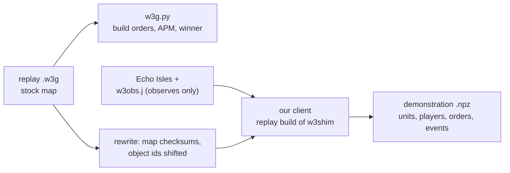

# People's replays

Two tools for replays (`.w3g`) of games people played:

* **A parser** (`warcraftsim/data/w3g.py`, `scripts/replay_stats.py`) reads replays of any version: the players, the map and every action. From the actions it makes each player's build order and APM. This part needs no game.
* **A converter** (`warcraftsim/fullgame/replays.py`) plays a 1.29 replay back in our client and records the built-in AI's kind of demonstrations from it. `bc.py` reads them unchanged.



## Run it

```
python scripts/replay_stats.py runs/fullgame/human-replays-129          # rows in <dir>/stats.jsonl, a summary
make -C shim replay                                                     # the replay build of w3shim (build/shim-replay)
python -m warcraftsim.fullgame.replays --replays runs/fullgame/human-replays-129 \
    --out runs/fullgame/demos-human-129 --parallel 2                    # 1v1s on Echo Isles at build 6060
python -m warcraftsim.fullgame.bc --data runs/fullgame/demos-human-129 ...
```

* The converter skips what it can't play and gives the reason in `<out>/skipped.jsonl`. It resumes where it stopped (`--retry-failed` tries the failures again).
* A game takes about 66 s for both playbacks, two at a time beside the training (niced): the 95 games took 52 minutes. The games are named `replayconv*`.
* A game whose playback is out of step with the replay goes to `<out>/desync` (`--min-sync`).

## The parser

* **Formats:** the classic layout (16-bit block sizes), Reforged's (32-bit block sizes, protobuf records before the slots, 2.0's action `0x7A` before an order) and the GRBN container (protobuf metadata, then a classic replay; warcraft3.info serves NetEase's replays in it). It also reads the older action layouts (before 1.07, 1.13 and 1.14b). Checked on 1.26, 1.28, 1.29 and Reforged 2.0 replays: every action known.
* **What it reads:** the header, the game info (host, game name, settings, map path, the map's checksums), players and slots (team, colour, race, computer and level, handicap, observers), chat, leave records, and every action with its time. Actions name units by object ids: a slot in the engine's table of objects and the count of objects made before it.
* **Build orders** (`w3g.summarize`): per player, the buildings placed (with the spot), units and heroes trained, upgrades, researches, hero skills, items bought and cancels, with their game time. `w3ids.json` (from the 1.29 game data, `replay_stats.py --ids`) tells which code is which. A random player's race is the one its starting units show.
* **Strategy statistics** (`w3g.strategy`, in `stats.jsonl`): as AlphaStar's conditioning, the first 20 buildings, units, upgrades and researches (workers left out) and the counts of everything made.
* **Noise:** the same order again within 1.5 s counts once (a double click, a spammed key), and so does a building placed again at the same spot. A replay does not say whether the game took an order. So a train click refused for gold, food or a full queue still counts, and a hero's revival looks like a second hero of the type.
* **APM:** orders, adding to the selection, hotkeys, queue cancels, ESC and the skill and build menus, per minute until the player left.
* **Winner:** a "won" leave record, else the side still there when every other player left. It agreed with warcraft3.info's winner in 168 of the 176 games that have one.

## The downloaded replays

2,591 replays from warcraft3.info, all 1.29 build 6060, all parsed (2026-10-17).

| | replays |
|---|---|
| containers | 1,857 GRBN (NetEase), 734 classic |
| types | 2,543 1v1, 47 2v2, 1 6v6 |
| maps | Last Refuge 464, Amazonia 411, Echo Isles 350, Turtle Rock 311, Twisted Meadows 294, Terenas Stand 278, Ancient Isles 218, ... |
| 1v1 on Echo Isles | 350: 95 on the stock map (convertible), 249 on NetEase's own version (map checksum 94b4de8e), 6 others |
| 1v1 length | median 15 min (10-90%: 9-24) |
| 1v1 APM | median 260 (10-90%: 188-331) |

## Playing a replay back

A replay holds only the players' actions. The game re-simulates it from the map, so the map must be the one the game was played on, and nothing may change the simulation.

**The map.** The replay names its map (`Maps\FrozenThrone\(2)EchoIsles.w3x`), and 1.29 looks for it in `Documents\Warcraft III`. It finds it only if its checksums are the replay's: a modified map is "not found". The checksums are the classic one and a SHA-1 over `common.j`, `Blizzard.j` and the map's script and terrain files (GHost++'s algorithm, `w3g.map_checksums`). `w3g.rewrite` writes the observer map's checksums into a copy of the replay. 1.29 checks the replay's own checksums too: the header's CRC-32, and per block the CRC-32s of its header and its data, each folded to 16 bits.

**Object ids.** Actions name units by object ids: a slot and the count of objects made before (at `+0xc` and `+0x10` of every engine object). Every object the map's script makes takes the next id, so units made later get other ids than in the recorded game, and the replay's orders reach nobody. One `TimerStart` with a callback in an otherwise stock map was enough: the bases stopped growing after a minute.

* What makes objects: triggers, timers, groups, hashtables, regions, rects, events, a timer's handler (its first `TimerStart` with code) and a callback's wrapper (its first use). A trigger's event makes objects each time it fires, even with no condition or action.
* What doesn't: reading units and players, `Preload` and the mailbox sync, enumerating into a group made before.
* The observing harness (`harness/w3obs.j`) makes all of its objects at the end of `main`, after the map's own melee initialization, between two probe groups. It registers no events. A short first playback reads the probes' ids (16 objects). Every later object id in the replay is then shifted by their count: the count always, the slot if it is a new one (`replays.shift_of`). The 8 bytes after an order's id are an object id too (the item a "useslot" uses): a Rod of Necromancy raised no skeletons until they were shifted as well.

**The replay build of w3shim** (`shim/replay.c`, `make -C shim replay`) reports each unit's object ids, the probes' and the trees'. It also adds the engine's own state of buildings to the unit records, found by comparing the bytes of an altar, a barracks, a ziggurat and a great hall over their construction, training and upgrade:

| flag | what | where |
|---|---|---|
| 8 | under construction | `+0x164 & 0x2000000` |
| 4096 | producing (training or researching) | `+0x3c4` |
| 8192 | being upgraded | `+0x164 & 0x4000000` |

The default build has none of this (`#ifdef W3SIM_REPLAY`).

## The demonstrations

The arrays and files of `collect.py`: units, heroes, players, events, orders and trees per game, plus `games.jsonl` and `collect.json`. Differences:

* **Players** are 0 and 1 in slot order (in the game they are their slots), also in the visibility bits. `difficulties` are `["human", "human"]`. `meta.source` names the replay and has the players' APM.
* **Orders** (the labels) come from the replay's actions. Each player's selection is followed through clicks, groups and subgroups, and its units are found by their object ids. Orders every unit takes (smart, move, attack, patrol, hold, stop) go to every selected unit. A build order goes to one worker: the one walking to that building the next step. Train, research and upgrade orders go to one building of the active subgroup, one not yet producing if there is one. Other abilities go to the subgroup's units, and hero skills to its hero (kind 3). Targets are units and trees; a tree out of sight is found by its type and spot.
* **Events** are derived from the units' states step by step: construction start, finish and cancel; production start, finish and cancel at a building (from its producing flag and the units of its owner that appear beside it); upgrades; deaths (no killer); hero levels; summons (no summoner); items picked up. Research levels are polled by the harness, and the research is put at the building last ordered to research it.
* **Result:** from the leave records (above).

## Verified

All 95 Echo Isles 1v1s on the stock map converted (2026-10-17): 23.7 hours of play, median 13.8 minutes, APM median 226. None was out of step.

| check | result |
|---|---|
| units the players' subgroup actions name (type and object ids) that are that unit in the playback, at that time (`meta.sync`) | **9,508 of 9,508** |
| buildings the replay places that came up within 64 of the spot | 2,892 of 2,982 (97%; the rest: orders the game refused) |
| how far the playback ran | to the first player's leave, give or take a second; when a side's defeat ended the game for the viewer, up to 72 s before |
| researches the harness saw done, against the replay's research clicks (8 games) | 59 of 63 (the rest cancelled or unfinished) |
| build labels: the worker went to build (or the building came up at once) / another selected worker went / none | 374 / 7 / 14 of 395 (10 games) |
| `bc.py`'s encoder (`features.load_game`, both sides, `side_data`, `sides_of`) | every game reads: 341,220 side-steps, 48% with labels (the AI's: 23%) |

* Before the probes, one passive `TimerStart` was enough to stop every base after a minute. With the harness's objects shifted, a Rod of Necromancy's skeletons were the first miss: their object ids came up in the stock playback (no harness, read from the engine) and not in ours, until the item ids in orders were shifted too.
* The players' food, gold and build orders go as in a real game. People against the built-in AI on Echo Isles (`demos-echo-1`, normal and insane), medians:

| race | workers at 5 / 10 min | food at 5 / 10 min | first hero | tier 2 |
|---|---|---|---|---|
| human | 13 / 14 (AI 16 / 16) | 32 / 44 (AI 40 / 49) | 123 s (121) | 468 s (506) |
| orc | 12 / 12 (14 / 14) | 29 / 46 (34 / 43) | 123 s (128) | 283 s (610) |
| undead | 5 / 5 (5 / 7) | 28 / 44 (32 / 53) | 136 s (150) | 332 s (352) |
| night elf | 12 / 15 (17 / 18) | 27 / 44 (35 / 49) | 122 s (125) | 328 s (344) |

## Limits

* Only replays of our client's build (1.29.2, build 6060) play back, and only on Echo Isles in its stock version. NetEase's 249 Echo Isles games need their map file (checksum 94b4de8e). Another stock map needs its name in `replays.py` (`ECHO`: the observer map and `skip_reason`).
* The labels are the players' commands spread over their selection, not the game's issued orders: which worker builds and which building trains is a choice, and a command the game refused is still a label.
* The events are reconstructions: the building a unit came from is the nearest producing one, research and train starts come from the last order a building got, and there are no spell, tree-death or killer events.
* Units the harness never saw are missing: it adds units by enumerating the map each step, which skips units that are hidden from the moment they are made.
* Each replay plays twice (the probe playback is short: about 10 s).
* The game's own events and issued orders would need the shim to hook the engine's event dispatch (no script objects): a next step if the derived labels and events fall short.
