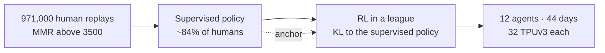
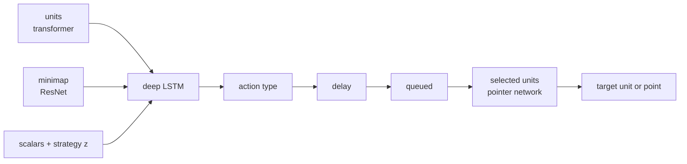

# AlphaStar (StarCraft II)

**The paper:** O. Vinyals et al., "Grandmaster level in StarCraft II using multi-agent reinforcement learning", *Nature* 575, 350–354 (2019), [nature.com](https://www.nature.com/articles/s41586-019-1724-z), doi [10.1038/s41586-019-1724-z](https://doi.org/10.1038/s41586-019-1724-z). Open copies: [DeepMind's PDF](https://storage.googleapis.com/deepmind-media/research/alphastar/AlphaStar_unformatted.pdf) and the [supplementary data](https://static-content.springer.com/esm/art%3A10.1038%2Fs41586-019-1724-z/MediaObjects/41586_2019_1724_MOESM2_ESM.zip) (pseudocode, the detailed architecture). Also [DeepMind's blog post](https://deepmind.google/blog/alphastar-grandmaster-level-in-starcraft-ii-using-multi-agent-reinforcement-learning/).

DeepMind, 2019. The first agent to reach Grandmaster in StarCraft II, with all three races, ranked above 99.8% of the ranked players on Battle.net. It played under human-like limits: a camera view and at most 22 actions per 5 seconds.

## How DeepMind made it

## The network

* **One action per decision**, built step by step: what to do, when to act next, which units, and where.
* **The delay head** chooses when to act next. The agent does not act at every game step.
* **Strategy z**: a build order (the first 20 buildings and units) and the units, buildings, effects and upgrades of a human game on the same map and races. Extra rewards keep the agent near z: the edit distance of the build orders and the Hamming distance of the counts. Each extra reward is on in 25% of the games. So the league keeps many strategies alive. In the ablation z added 1400 → 1540 Elo (Fig. 3E).
* 139 million weights. Acting uses 55 million of them.

## The league

| agent | count | plays against | purpose |
|---|---|---|---|
| main agent | 3 (one per race) | itself, past league members (PFSP) | the final agent |
| main exploiter | 3 | the current main agents | find their weaknesses |
| league exploiter | 6 | the whole league (PFSP) | find weaknesses of the league |

* An exploiter joins the league as a frozen copy when it beats each of its opponents in more than 70% of games, or after a time limit. A main exploiter then starts again from the supervised policy. A league exploiter starts again with probability 25%.
* In an ablation the exploiters made the main agents stronger: 1540 Elo alone, 1693 with main exploiters, 1824 with league exploiters too (Fig. 3A).
* RL: actor-critic with V-trace, TD(λ) and UPGO, a new self-imitation update. Average win rate 49% → 73% → 82% (Fig. 3I).

## What we took, and where we differ

| | AlphaStar | warcraftsim |
|---|---|---|
| start | 971,000 human replays | the built-in AI's games (human replays of 1.29 come next) |
| anchor | KL to the supervised policy, on every action argument | forward KL on every head, to a recent checkpoint of the policy |
| fine-tune on wins | winning replays with MMR above 6,200 | the winners of games decided within 6 minutes (the duelfast clone) |
| league | main agents, exploiters, PFSP | the main agent, past snapshots (PFSP) and the built-in AI. A main exploiter is in the code, not yet tried in whole games. |
| strategy | z from a human game, extra rewards to follow it | none yet: one rush strategy. Next: a target build order a game. |
| actions | one command for selected units, with a delay | an order for every unit, every half second |
| inputs | units, minimap, scalars | units and scalars, no map |
| compute | 12 agents × 32 TPUs × 44 days | one RTX 3090 and 16 cores |

## Changing the anchor

AlphaStar keeps its anchor for the whole run. Exploiters restart from the supervised policy. Main agents never restart. Other work moves the anchor:

| work | how the anchor moves |
|---|---|
| DeepNash (Stratego, 2022, [2206.15378](https://arxiv.org/abs/2206.15378)) | After each phase, the policy becomes the new anchor. The change is gradual over the next phase. |
| ProRL (language models, 2025, [2505.24864](https://arxiv.org/abs/2505.24864)) | When the KL term dominates the loss, the anchor becomes a recent policy. |
| TR-DPO (language models, 2024, [2404.09656](https://arxiv.org/abs/2404.09656)) | The anchor follows the policy: a moving average, or a copy at intervals. |
| PPO, TRPO | The anchor is the last policy, at every update. |

`fgself-12` changed its anchor to a better clone, not to itself. Its distance to the new anchor stayed at 0.002–0.004 a unit, the same as to the old one. Later runs moved the anchor to a recent checkpoint of the policy, as DeepNash and ProRL do: +11 points of the AI's record, twice. Since then each experiment's start is its anchor.
