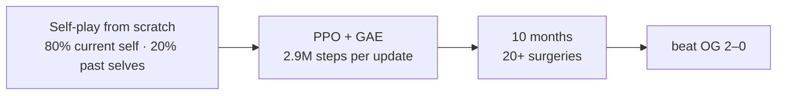
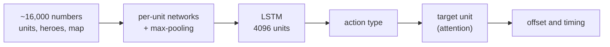

# OpenAI Five (Dota 2)

**The paper:** C. Berner et al. (OpenAI), "Dota 2 with Large Scale Deep Reinforcement Learning", arXiv [1912.06680](https://arxiv.org/abs/1912.06680) (2019), [PDF](https://arxiv.org/pdf/1912.06680). The appendices have the details: surgery (App. B), the rewards (App. G).

OpenAI, 2019. The first AI to defeat the world champions at an esports game: it beat Team OG 2–0 on 2019-04-13. In a public arena it won 99.4% of 7,257 games against 3,193 teams (§4.1). It learned by self-play from random weights. Human games set only one thing: the random changes to the scripted item builds.

## How OpenAI made it

* **Surgery** (§3.3, App. B): when the game or the model changed, they converted the trained network to the new version and kept the same behaviour. Training continued for 10 months without a restart.
* **A clean rerun** (§4.2) on the final setup took 2 months and ~20% of the compute. It beat OpenAI Five in more than 98% of games: the surgeried model had stopped at a weaker level.
* **Rewards** (App. G, Table 6): a win, plus kills, deaths, gold, experience and more. Each team's reward subtracts the other team's. All rewards but the win shrink over the game, ×0.6 per 10 minutes, so the late game does not dominate.
* **Team spirit** (App. G): each hero's reward is (1−τ)·its own + τ·the team's mean. τ rose from 0.3 to 1.0 over training (App. C).
* **A win/loss reward alone** also learned to beat the scripted bot, but much more slowly than with the shaping (App. G, Fig. 16).
* **The horizon** (§4.5, Fig. 6): a trained agent resumed with a longer horizon won more, up to the longest tried (6–12 minutes).
* **Fresh data** (§4.4): data ~8 versions old slowed learning a lot. Each sample used 2–3 times made it ~2× slower.
* **Compute at the peak** (App. C): up to 1,536 GPUs for the optimizer, 1,440 for rollouts and 172,800 CPU cores.

## The network

* **One copy of the network per hero.** The five copies share the same weights. Each copy acts for its own hero.
* **An action every 4 frames**, about 7.5 actions per second, about 20,000 steps per game.
* 159 million weights. The LSTM has 84% of them.
* Scripts, not the network, chose the order of item and skill purchases, controlled the courier, and chose which items a hero keeps in reserve.
* Restrictions: 17 of 117 heroes, and no items that control more than one unit.

## What we took, and where we differ

| | OpenAI Five | warcraftsim |
|---|---|---|
| start | random weights, self-play | a clone of the built-in AI |
| control | one network copy per hero | one network for all units of a player |
| actions | one per hero, every 4 frames | one per unit, every half second |
| rewards | shaped (kills, gold, experience) | win, and the change of the material lead as shaping, at half weight (half gave 62% → 72% of games) |
| horizon | 60 s at first, 840 s at the end (App. C) | ~28 minutes (γ 0.9997) |
| opponents | 80% itself, 20% past selves | itself, past snapshots, the built-in AI |
| surgery | 20+ in 10 months | a new memory core or new inputs start at zero |
| compute | up to 1,536 + 1,440 GPUs | one RTX 3090 |
