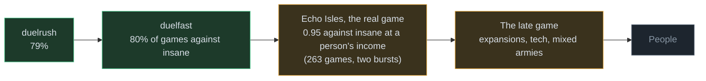

# The road to the real game

The goal: a policy that plays a real 1v1 on a ladder map with the game's own rules. It plays the built-in AI first, then people.

## Where it stands (2026-11-20)

The policy plays the real game on Echo Isles against the insane AI: the game's own rules, no handicap, and the same income as a person. Its best version, the weight average of `fgself-236`'s checkpoints at 43-53M steps, won **91 of 95** of those games (0.955, every race 0.90-1.00) in one evaluation burst (burst-237, ±0.042), and the runs since are confirming it. `fgself-236`'s end checkpoint read 0.845 over two bursts. The base now, `fgself-238`, goes on from that average. It can give every order a melee player can give, and it sees what a player sees ([order coverage](reference/order-coverage.md), [observation coverage](reference/observation-coverage.md)).

Until 2026-10-26 the agent slots had the insane AI's double income. The 95-97% of October were at that income and do not compare.

## How it wins and loses

[Audit 20](reference/audit-20.md) read 2,832 burst games against insane by the bases before `fgself-236` (2,275 won):

| game minutes | 0-12 | 12-15 | 15-18 | 18-24 | 24-30 | 30-41 |
|---|---|---|---|---|---|---|
| games won | 0.99 | 0.96 | 0.82 | 0.49 | 0.21 | 0.02 |
| not won | 7 | 24 | 70 | 196 | 129 | 131 |

The long games are decided by the AI's development. At the end of the games past 18 minutes:

| | learner, won | learner, lost | AI, learner won | AI, learner lost |
|---|---|---|---|---|
| tier 2 / tier 3 | 64% / 18% | 66% / 17% | 40% / 8% | 98% / 89% |
| research levels | 2.0 | 1.9 | 2.2 | 15.9 |
| air units | 0.0 | 0.1 | 0.1 | 4.5 |
| expanded | 0% | 0% | 3% | 60% |
| workers trained | 8.6 | 9.5 | 27.0 | 14.4 |

* The learner builds the same in the long games it wins and loses. It wins them when the AI's economy broke (the AI rebuilding its workers), and it never wins once the AI has 8 or more research levels (0 of 433) or 4 or more air units (0 of 301).
* It expanded in 3 of 2,832 games. Its one mine runs dry at about 24 minutes.
* The first hero decided orc and human games (orc: Far Seer 0.93, Tauren Chieftain 0.62, Blademaster 0.40; human: Archmage 0.95, the others ~0.77). The teacher had drawn it uniformly. Weighted toward the Far Seer and the Archmage (`fgself-236`), the policy opens with them 70-85% of the time, and orc rose from the weakest race to 0.75 over two bursts.
* The night elf AI is the hardest opponent (0.71). Short losses are rare and not rushes.

## What is missing

| area | gap | tried, and next |
|---|---|---|
| Late game | 49% of the games at 18-24 minutes won, 2% past 30 | every training game in the real game (`fgself-212`, kept). Not kept: upgrades in the shaping (`-213`), late starts in the real game (`-214`), late starts from lost positions (`-230`), capped army and upgrade lessons (`-226`, `-227`). Next: pressure on the AI's economy (its workers counted in the shaping), the capped lessons stacked |
| Economy | no expansion without a target; in long games ~460-530 gold a minute against the AI's 840-920 | expansion lessons in every game pulled too hard (`-202`); a late one capped expanded in 4% of games but cost 11 points (`-223`: its camp lesson cannot be capped) |
| Army | mostly one tier-1 unit type, no answer to air | the capped army lesson (`-226`) was level. Next: an air specialist in the league |
| Heroes | dead heroes lie dead long (a median 15 hero-minutes in filmed training losses) | next: the revival lesson under the cap |
| Spells | most spells had ~0 chance in the policy | the capped spell lesson (`-224`, kept): ~17 taught spells a game in training |
| Refused orders | ~46 a game in training before the masks (`fgself-229`) | the order masks (`-231`, kept): ~20% fewer |
| APM | every unit, every half second | an APM cap before games against people |
| Data | the demonstrations come from the built-in AI. People's 1.29 replays play back in our client ([human replays](reference/human-replays.md)) | people's late-game states are late starts already. People's clone as a KL anchor (`-215`, `-216`) was not kept |

## Next

The 0.95 is confirmed (250 of 263 over two bursts, 2026-11-20). Insane is beaten without a handicap; the next step the user set (2026-10-15) is people. The plan: [next experiments](proposals/next-experiments.md). [Ideas](reference/ideas.md) lists each idea, where it came from and what became of it.

## Compute

* ~5,000-5,700 agent steps a second in training: 72 games on the main machine (Ryzen 9 5950X, RTX 3090) and 64 on a games box. The main machine's CPU sets the speed, and the GPU is ~84% busy.
* A verdict is an evaluation burst between runs: ~1,000 games in 45 minutes on the main machine. Before it, an experiment and its control train ~1.5 hours each (~26M steps). A laptop plays head-to-head games during the runs.
